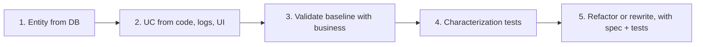

# Chapter 8. Brownfield: applying SDD to an existing system

## 1. Scenario

Trước RoomBook, văn phòng dùng một script PHP cũ tên `roomsheet` (6 năm tuổi, không tài liệu, người viết đã nghỉ) ghi vào bảng MySQL `tbl_rsv`. Công ty muốn thay bằng RoomBook nhưng **giữ nguyên các business rule người dùng đang quen**, kể cả những rule không ai nhớ có. Nếu bảo AI "viết lại cho sạch", nó sẽ viết một hệ thống đẹp với business rule sai.

Hai sai lầm điển hình với legacy cộng AI:

1. **Đưa code cũ cho AI và bảo "refactor".** AI giữ cả lỗi lẫn business rule ngầm hoặc đổi chúng mà không ai biết.
2. **Viết spec từ trí tưởng tượng về hệ thống cũ**, rồi tin spec đó. Spec lệch khỏi hành vi thật ngay từ đầu.

Giải pháp: lấy hành vi *thật* ra thành spec, kiểm chứng với business stakeholder, lock bằng characterization test, rồi mới đổi.

## 2. Five steps



### Step 1: Build the Entity Model from the database

Lấy schema thật, đặt tên khái niệm theo glossary của dự án đích. Ví dụ bảng cũ:

| Cột ở `tbl_rsv` | Khái niệm trong RoomBook | Ghi chú |
|---|---|---|
| `id` | `Booking.booking_id` | |
| `rm` | `Booking.room_id` | reference tới `Room` |
| `usr` | `Booking.member_id` | |
| `d1`, `d2` | `TimeSlot.start_at`, `TimeSlot.end_at` | tên cũ khó hiểu; phải ghi mapping |
| `n` | `Booking.attendee_count` | |
| `st` | `Booking.status` | giá trị cũ `1`, `9`: cần hỏi nghĩa |

Ghi **cả mapping cũ sang mới** và các cột không rõ nghĩa vào danh sách open question. Đừng đoán `st = 9`.

### Step 2: Build Use Cases from code, logs, and UI

Ba nguồn: đọc code (điều kiện `if`, query), log hoặc dữ liệu thật (hành vi thực tế), và màn hình. Để AI hỗ trợ, nhưng **bắt nó trích dẫn nguồn** (file và dòng) cho mỗi business rule, và gắn nhãn "suy đoán" nếu không có bằng chứng.

Hai công cụ tìm business rule ngầm:

```bash
# các điều kiện số trong code cũ (con số kỳ lạ thường là business rule)
grep -rnE "[<>]=? *[0-9]{2,}" legacy/roomsheet/ | head

# file nào bị sửa nhiều nhất trong 1 năm (hotspot): đừng quên --format=
git log --since="1 year ago" --format= --name-only | sort | uniq -c | sort -rn | head -20
```

Về dòng git: **bắt buộc có `--format=`**. Nếu thiếu, đầu ra lẫn cả dòng header của commit (`commit ...`, `Author:`, `Date:`) và dòng trống vào bảng đếm. Tôi đã chạy thử cả hai bản trong container Docker (`ruby:3.3`, git 2.47.3): bản thiếu `--format=` đếm ra `8` dòng trống, `3 Date:`, `3 Author:` chen vào trước các file thật; bản có `--format=` chỉ ra `3 a.py`, `1 b.py`. File sửa nhiều thường là nơi business rule ẩn nấp và là ứng viên cho characterization test sớm.

**AIUP `reverse-engineer`:** nếu dùng plugin `aiup-core`, gọi skill `/reverse-engineer` hoặc yêu cầu bằng ngôn ngữ tự nhiên (ví dụ "reverse-engineer entity model và use case từ thư mục `legacy/roomsheet`"). Skill **không có cờ `--target` hay `--source`**; tài liệu mô tả nó đọc entry point, domain model, schema, authentication, integration rồi đề xuất entity model, use case diagram và use case, kèm danh sách hành vi chưa phân loại được. Đầu ra là đề xuất để người duyệt, không phải source of truth.

### Step 3: Validate the baseline with the business

Mang bản nháp UC (chỉ bảng business rule, không mang code) cho chị Hà và vài người dùng. Ba loại phản hồi và cách xử lý:

| Phát hiện | Xử lý |
|---|---|
| Đúng, đúng ý | ghi "Verified" vào UC |
| Hành vi cũ, business không muốn nữa | ghi nhận là *thay đổi có chủ đích*, tạo UC hoặc AC mới ở bước 5 |
| Hành vi cũ là lỗi, không ai biết | ghi lỗi, quyết định giữ hay sửa rõ ràng |

Mục tiêu: baseline = "hệ thống đang làm gì" đã được xác nhận, tách khỏi "ta muốn nó làm gì".

### Step 4: Characterization tests for current behavior

Trước khi đổi gì, viết test mô tả hành vi *hiện tại*, dù xấu. Chạy chúng với hệ thống cũ (qua API, hoặc query dữ liệu mẫu), rồi dùng lại chúng cho hệ thống mới. Tên test vẫn theo AC (ví dụ `test_ac_001_7_...`) cho những hành vi đã có UC; hành vi chưa có UC đặt tên tạm `test_legacy_...` và ghi lại để business quyết.

### Step 5: Replace or refactor, protected by spec and tests

Làm theo slice: mỗi lần một UC (đầu tiên UC-001), chạy bộ characterization test, rồi chuyển traffic. Mỗi thay đổi hành vi so với baseline phải có dòng "Lịch sử" trong UC và được duyệt (chương 4: Requirements-Driven).

## 3. Tools

- **OpenSpec** hợp giai đoạn sau: baseline đã nằm trong `openspec/specs/`, mỗi thay đổi là một change với delta ADDED/MODIFIED/REMOVED. Tài liệu có trang "existing projects". `openspec init` không suy ra spec từ code cũ; bạn tạo baseline ở bước 1 đến 3.
- **Spec Kit:** tài liệu "existing projects" khuyên tạo baseline và branch, `specify init --here --force --integration <khóa>`, chạy `/speckit-constitution` với nguyên tắc có bằng chứng (README, ADR, CI), chọn một slice giới hạn rồi `/speckit-specify`. Nó **không suy ra spec cho hành vi hiện có**; `spec.md` mô tả thay đổi dự kiến.
- **AIUP `/reverse-engineer`:** để tạo bản nháp bước 1 và 2.
- **Tự làm:** `grep`, `git log`, subagent chỉ đọc để trích dẫn business rule có nguồn.

## 4. Pragmatic principles

- Đừng cố đặc tả toàn bộ legacy. Chọn slice có giá trị hoặc đang đau nhất.
- Mọi business rule rút ra từ code phải có nguồn (file, dòng, hoặc dữ liệu); không nguồn thì đánh dấu suy đoán.
- Giữ lại lỗi tương thích có chủ ý đến khi business quyết định bỏ.
- Dữ liệu thật quý hơn code: đếm trong database xem rule "tối đa 4 giờ" có thật sự bị vi phạm không.

## 5. When to stop

Dừng khi (a) slice này đã được thay thế và characterization test pass, (b) chi phí khai quật vượt giá trị (hệ thống sắp bị tắt), hoặc (c) business không còn ai xác nhận được. Ghi lại phần chưa đặc tả như technical debt có chủ đích.

## 6. Pitfalls

- Tin kết quả của AI khi nó "đọc" code mà không có trích dẫn.
- Đổi tên field khi chuyển (`d1` → `start_at`) mà không ghi mapping; sau đó không đối soát được dữ liệu.
- Bỏ qua dữ liệu bẩn đã tồn tại (booking cũ lệch business rule mới).
- Dùng lệnh git thiếu `--format=` rồi đọc nhầm bảng hotspot.
- Dùng tool mong nó "tự hiểu" legacy; tool chỉ đề xuất.

## 7. Summary

1. Hành vi thật được rút từ DB, code, log, UI, mỗi business rule có nguồn.
2. Validate baseline với business trước khi đổi bất cứ thứ gì.
3. Characterization test lock hành vi hiện tại; tên theo AC khi có thể.
4. Làm từng slice; thay đổi hành vi phải có quyết định rõ ràng.
5. Công cụ chỉ tạo bản nháp: Spec Kit không suy spec từ code; AIUP `reverse-engineer` kích hoạt bằng ngôn ngữ tự nhiên, không có cờ `--target`/`--source`.

## 8. Self-check

1. Vì sao lệnh hotspot cần `--format=`?
2. Ba nguồn để rút Use Case từ hệ thống cũ?
3. Test nào nên viết trước khi đụng code legacy?
4. `st = 9` trong `tbl_rsv` nên xử lý thế nào?

<details><summary>Answer</summary>

1. Không có nó, header commit và dòng trống bị đếm lẫn vào tên file.
2. Code, log/dữ liệu thật, UI.
3. Characterization test cho hành vi hiện tại.
4. Ghi vào open question và hỏi business; không đoán.
</details>
