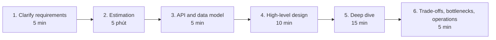

# Chương 1. Phỏng vấn System Design: bản chất và khung trả lời

> Cập nhật: 2026-11-07. Chương này không có con số kỹ thuật cần tra; các chương sau mới có.

## 1.1 Vòng phỏng vấn này kiểm tra điều gì?

**System Design Interview (SDI)** là buổi thảo luận 45–60 phút, trong đó bạn nhận một đề bài mơ hồ ("thiết kế dịch vụ rút gọn link", "thiết kế chat") và phải cùng người phỏng vấn dựng ra một hệ thống chạy được ở quy mô lớn. Không có đáp án duy nhất. Người phỏng vấn đánh giá **quá trình suy nghĩ**, không đánh giá bạn có nhớ kiến trúc của công ty nào đó hay không.

Họ thường chấm các nhóm năng lực sau:

| Năng lực | Biểu hiện tốt | Biểu hiện kém |
|---|---|---|
| Clarify requirements | Hỏi về người dùng, scale, read/write, yêu cầu consistency | Lao vào vẽ kiến trúc ngay |
| Estimation | Tính ra QPS, storage, bandwidth để chọn công nghệ | Nói "hệ thống lớn lắm" mà không có con số |
| High-level design | Sơ đồ rõ, luồng dữ liệu đầy đủ | Liệt kê tên công nghệ rời rạc |
| Deep dive | Chọn 1–2 điểm khó và đi sâu đến mức cơ chế | Chỉ nói chung chung |
| Đánh đổi (trade-off) | Nêu cả ưu lẫn nhược, nói khi nào đổi ý | "Cái này tốt nhất" |
| Communication | Nói to suy nghĩ, nhận góp ý, điều chỉnh | Im lặng vẽ, phản ứng phòng thủ |

## 1.2 Vì sao người mới hay vấp

1. **Không có bài giải chuẩn.** Người quen thi cử cố đoán "đáp án" thay vì trình bày lập luận.
2. **Thiếu kinh nghiệm vận hành quy mô lớn.** Cách bù: học con số (chương 2), học cơ chế (chương 4–9), luyện tính nhẩm.
3. **Quản lý thời gian.** Sa đà vào một thành phần (ví dụ chọn loại database) rồi hết giờ trước khi có sơ đồ tổng thể.
4. **Nhớ tên công nghệ thay vì hiểu vấn đề nó giải quyết.** Nói "dùng Kafka" mà không giải thích vì sao cần queue sẽ bị hỏi vặn ngay.
5. **Không nói ra giả định.** Mọi con số và lựa chọn đều dựa trên giả định; nếu giả định sai, người phỏng vấn cần biết để chỉnh bạn.

## 1.3 Khung 6 bước (dùng cho mọi đề)

**Bước 1. Làm rõ yêu cầu.** Tách:
- *Functional requirements*: hệ thống làm gì (tạo link, chuyển hướng, thống kê lượt click…).
- *Non-functional requirements*: latency mục tiêu, availability, durability (độ bền dữ liệu), mức consistency, scale, ràng buộc pháp lý (dữ liệu nằm ở vùng nào).
- *Out of scope*: nói rõ phần bạn không làm để khỏi bị hỏi lan man.

**Bước 2. Ước lượng (back-of-the-envelope).** Từ số người dùng suy ra QPS đọc/ghi, storage theo năm, bandwidth, kích thước cache. Mục đích là *chọn công nghệ và quyết định có cần shard hay không*, không phải tính cho đẹp. Cách làm xem chương 2.

**Bước 3. API và dữ liệu.** Viết 2–4 endpoint chính, các bảng/collection chính, primary key và partition key dự kiến.

**Bước 4. High-level design.** Vẽ client → (CDN) → load balancer → app server → cache → database, thêm queue/worker nếu có xử lý asynchronous. Đi theo luồng một request đọc và một request ghi.

**Bước 5. Deep dive.** Chọn phần khó nhất của đề: sinh ID, fan-out feed, quản lý kết nối WebSocket… Đây là nơi bạn chứng minh chiều sâu.

**Bước 6. Trade-off và vận hành.** Bottleneck, single point of failure (SPOF), cách monitoring, cách xử lý khi một thành phần chết, hướng mở rộng tiếp.

## 1.4 Ví dụ mở đầu một buổi phỏng vấn

Đề: "Thiết kế dịch vụ đặt vé xem phim."

Câu mở nên nghe như sau (tình huống thiết kế, tự soạn):

> "Trước khi vẽ, em xin làm rõ vài điểm: Mình phục vụ một thành phố hay toàn quốc? Có cần giữ ghế tạm thời trong lúc thanh toán không? Điều tệ nhất em phải tránh là hai người cùng mua một ghế, nên em sẽ coi correctness của việc giữ ghế quan trọng hơn latency vài chục mili-giây. Nếu anh/chị đồng ý, em giả định 5 triệu người dùng/tháng, đỉnh điểm là lúc mở bán phim bom tấn."

Chú ý ba điều: hỏi có chủ đích, tuyên bố ưu tiên (đúng đắn hơn tốc độ), nêu giả định số.

## 1.5 Đánh đổi (trade-off) trong chính cách phỏng vấn

- **Rộng hay sâu?** Quá rộng thì nông; quá sâu vào một ô thì bỏ sót cả hệ thống. Quy tắc: 40% thời gian đầu cho rộng, 40% sau cho sâu, 20% còn lại cho trade-off.
- **Công nghệ cụ thể hay khái niệm?** Nói khái niệm trước ("cần một key-value store có TTL"), rồi gợi ý sản phẩm cụ thể kèm lý do. Nếu bị hỏi, bạn nêu được sản phẩm đó *hiện nay* ra sao (giấy phép, phiên bản), thay vì nhắc lại kiến thức cũ.

## 1.6 Khi phỏng vấn nên nói gì

- "Em xin phép làm rõ yêu cầu trước khi đi vào thiết kế."
- "Em giả định X; nếu khác, em sẽ đổi Y."
- "Có hai hướng: A tốt ở …, B tốt ở …; với yêu cầu của mình em chọn A vì …"
- "Điểm yếu của phương án này là …, em giảm nhẹ bằng cách …"
- "Nếu còn thời gian em muốn đào sâu phần … vì đó là phần rủi ro nhất."

## 1.7 Cạm bẫy thường gặp

- Vẽ sơ đồ khổng lồ với Kafka, Redis, Elasticsearch, Kubernetes ngay từ đầu (over-engineering). Hãy bắt đầu từ thiết kế đơn giản nhất đáp ứng yêu cầu, rồi chỉ thêm thành phần khi con số ước lượng đòi hỏi.
- Dùng buzzword mà không giải thích vấn đề nó giải quyết.
- Bỏ qua dữ liệu: không nói primary key, cách query, cách partitioning.
- Không bao giờ nhắc đến lỗi: "nếu node này chết thì sao?"
- Tranh cãi với người phỏng vấn thay vì xem gợi ý của họ là dữ kiện mới.
- Nhớ nhầm sự thật (ví dụ coi "5 số 9" là vài giây downtime mỗi năm). Chương 2 sửa các nhầm lẫn kiểu này.

## 1.8 Tóm tắt

1. SDI chấm quá trình lập luận, không chấm một kiến trúc "đúng".
2. Luôn bắt đầu bằng làm rõ yêu cầu và giả định có con số.
3. Dùng khung 6 bước để quản lý thời gian.
4. Mỗi quyết định đi kèm trade-off và điều kiện đổi ý.
5. Đi từ đơn giản đến phức tạp; mỗi thành phần thêm vào phải có lý do định lượng.

## 1.9 Câu hỏi tự kiểm tra

1. Hai nhóm yêu cầu chính cần làm rõ ở bước 1 là gì? Cho 3 ví dụ cho mỗi nhóm.
2. Ước lượng ở bước 2 phục vụ quyết định nào?
3. Vì sao nên bắt đầu bằng thiết kế đơn giản?
4. Bạn sẽ làm gì khi người phỏng vấn đưa một ràng buộc mới giữa chừng?
5. Nêu một dấu hiệu của việc "đọc thuộc đáp án" mà người phỏng vấn dễ nhận ra.

Đáp án

1. Functional (tạo, đọc, xóa, tìm kiếm…) và non-functional (latency, availability, consistency, durability, scale, security, cost).
2. Chọn công nghệ và kiến trúc: một DB đủ hay cần shard, có cần cache, số server cần bao nhiêu, bandwidth và storage.
3. Dễ giải thích, dễ vận hành, ít lỗi; mỗi thành phần thêm chỉ khi số liệu đòi hỏi. Tránh phức tạp không cần thiết.
4. Xem là dữ kiện mới: nhắc lại ràng buộc, nói phần nào của thiết kế bị ảnh hưởng, sửa có chọn lọc và nói rõ cái giá phải trả.
5. Nói tên công nghệ liên tục mà không giải thích vì sao; không có con số; không nêu được nhược điểm hay phương án thay thế.

