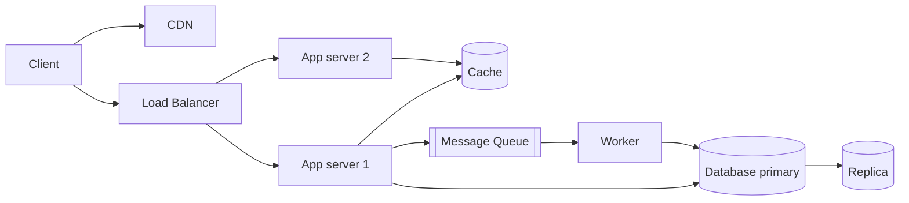

# Chapter 2. Foundational Concepts and Numbers to Know

> Cập nhật: 2026-11-07. Mọi phép tính được viết ra để bạn tự kiểm lại.

## 2.1 Latency and throughput

- **Latency** (độ trễ): thời gian từ lúc gửi request đến lúc nhận kết quả của *một* request (mili-giây).
- **Throughput** (thông lượng): số việc hoàn thành trong một đơn vị thời gian (request/giây, MB/giây).

Hai đại lượng liên quan nhưng không đồng nghĩa. Ví dụ ẩn dụ: đường cao tốc có 4 làn. Một xe đi hết đường mất 30 phút (latency), mỗi giờ có 8.000 xe qua trạm (throughput). Thêm làn tăng throughput, không làm xe nào đến sớm hơn. Để giảm latency phải rút ngắn đường hoặc tăng tốc độ.

**Little's Law**: số request đang xử lý đồng thời `L = λ × W`, với λ là tốc độ đến và W là thời gian xử lý trung bình. Nếu một service nhận 2.000 req/s và mỗi req mất 50 ms thì `L = 2000 × 0,05 = 100` request đang chạy cùng lúc; connection pool/thread nhỏ hơn 100 sẽ gây queue.

### Use percentiles, not averages

Trung bình che giấu tail latency. Người ta báo cáo **p50, p95, p99, p99.9**. *p99 = 200 ms* nghĩa là 99% request nhanh hơn 200 ms, 1% chậm hơn.

**Tail amplification**: một trang gọi song song 100 backend, mỗi backend chậm (vượt p99) với xác suất 1%. Xác suất ít nhất một backend chậm là `1 − 0,99^100 = 1 − 0,366 = 63,4%`. Vì vậy hệ thống có nhiều lần gọi phụ thuộc phải kiểm soát p99 chặt hơn nhiều so với p50.

## 2.2 Scalability

| | Vertical (scale up) | Horizontal (scale out) |
|---|---|---|
| Cách làm | Máy mạnh hơn | Thêm máy |
| Ưu | Đơn giản, không đổi code | Gần như không có trần, fault tolerance tốt hơn |
| Nhược | Có trần, giá tăng phi tuyến, vẫn là SPOF | Cần phân phối dữ liệu/state, phức tạp hơn |

Để scale out dễ, application layer nên **stateless** (không giữ session trong RAM của server; đưa session ra Redis hoặc dùng token). State được đẩy xuống data layer, nơi bài toán khó hơn (chương 4–5).

**Lưu ý**: scalability không chỉ là "thêm máy được"; cần *hiệu suất tăng gần tuyến tính*. Bottleneck dùng chung (một database, một lock, một hot key) sẽ cản trở.

## 2.3 Availability

**Availability** (tính khả dụng) là tỉ lệ thời gian hệ thống phục vụ được đúng yêu cầu:

`Availability = Uptime / (Uptime + Downtime) = MTBF / (MTBF + MTTR)`

- **MTBF** (Mean Time Between Failures): thời gian trung bình giữa hai lần hỏng.
- **MTTR** (Mean Time To Repair/Recover): thời gian trung bình để khôi phục.

Ví dụ: MTBF = 1.000 giờ, MTTR = 1 giờ → `1000/1001 = 99,90%`. Giảm MTTR xuống 6 phút (0,1 giờ): `1000/1000,1 = 99,99%`. Nghĩa là **rút ngắn recovery time (phát hiện nhanh, failover tự động, rollback nhanh) thường rẻ hơn và hiệu quả hơn việc cố làm hệ thống không bao giờ hỏng.**

### The "nines" table (exact figures)

Quy ước: 1 năm = 365 ngày = 525.600 phút; 1 tháng = 30 ngày = 43.200 phút; 1 tuần = 10.080 phút. Downtime cho phép = `(1 − A) × thời gian`.

| Availability | Downtime / năm | Downtime / tháng (30 ngày) | Downtime / tuần |
|---|---|---|---|
| 90% | 36,5 ngày (876 giờ) | 72 giờ | 16,8 giờ |
| 99% | 3,65 ngày (87,6 giờ) | 7,2 giờ | 100,8 phút (1,68 giờ) |
| 99,9% | 8,76 giờ | 43,2 phút | 10,08 phút |
| 99,95% | 4,38 giờ (262,8 phút) | 21,6 phút | 5,04 phút |
| 99,99% | 52,56 phút | 4,32 phút | 60,5 giây |
| 99,999% | **5,256 phút (315,4 giây)** | 25,9 giây | 6,05 giây |
| 99,9999% | 31,5 giây | 2,59 giây | 0,60 giây |

Ví dụ kiểm tra: 99,999% → `0,00001 × 525.600 = 5,256` phút. Đây **không phải "vài giây"** mỗi năm như một số tài liệu viết sai; vài giây mỗi năm tương ứng khoảng 7 số 9.

### Composing availability

- **Series** (request phải đi qua tất cả): `A = A1 × A2 × …`. Ba thành phần 99,99% nối tiếp: `0,9999³ ≈ 0,9997` = 99,97%.
- **Parallel redundancy** (chỉ cần một cái sống, lỗi độc lập): `A = 1 − (1−A1)(1−A2)`. Hai replica 99%: `1 − 0,01² = 99,99%`. Giả định "lỗi độc lập" thường sai (cùng bug, cùng AZ, cùng cấu hình), nên con số thực tế thấp hơn.

### SLA, SLO, SLI and "design availability"

- **SLI**: chỉ số đo được (tỉ lệ request thành công).
- **SLO**: mục tiêu nội bộ (99,9% request thành công trong 30 ngày).
- **SLA**: *cam kết hợp đồng* với khách hàng, thường kèm bồi thường (service credit). Nhà cung cấp cloud chỉ hứa hoàn tiền một phần khi vi phạm, không hứa "không bao giờ hỏng".
- **Design availability** (mức thiết kế): con số kỹ sư dùng khi thiết kế, *không phải* cam kết hợp đồng.

Ví dụ thực tế (tra trang chính thức ngày 2026-11-07):

| Dịch vụ AWS | Cam kết SLA (credit khi thấp hơn) | Ghi chú |
|---|---|---|
| S3 Standard | 99,9% (dưới 99,9% được credit 10%; dưới 99% 25%; dưới 95% 100%) | Design availability của S3 Standard là 99,99%. SLA và thiết kế khác nhau. |
| S3 Standard-IA, One Zone-IA, Intelligent-Tiering, Glacier Instant Retrieval | 99% | Design availability 99,9% (Standard-IA, Intelligent-Tiering, Glacier IR) và 99,5% (One Zone-IA) |
| EC2 (Region-level, ≥ 2 AZ) | 99,99% | Mỗi instance đơn lẻ: 99,5% |
| RDS Multi-AZ | 99,95% | Ngưỡng credit đầu tiên: dưới 99,95% |

Trang SLA S3 ghi cập nhật lần cuối 2023-11-28; các nhà cung cấp có thể đổi, hãy tra lại khi trích dẫn. **Durability** (ví dụ S3 thiết kế 99,999999999% — "11 số 9") là khái niệm khác availability: dữ liệu không mất khác với dữ liệu truy cập được ngay.

## 2.4 Reliability vs. availability

- **Reliability**: xác suất hệ thống *hoạt động đúng* trong một khoảng thời gian (không lỗi, không trả sai).
- **Availability**: hệ thống *sẵn sàng phục vụ* tại thời điểm cần.

Hai ví dụ cho thấy chúng tách rời:
1. Dịch vụ hỏng 1 giây mỗi 10 phút nhưng hồi phục ngay: availability rất cao (`600/601 ≈ 99,83%`) nhưng reliability thấp vì request đang xử lý bị mất.
2. Dịch vụ luôn phản hồi nhưng đôi khi trả số dư sai: available, không reliable.

Reliability gắn với MTBF và tỉ lệ lỗi; availability gắn với cả MTBF và MTTR.

## 2.5 Latency table (order of magnitude)

Bộ số kinh điển của Jeff Dean/Peter Norvig có từ khoảng 2012; phần cứng đã đổi. Dưới đây là *bậc độ lớn* để ước lượng, không phải số đo chính xác; phụ thuộc phần cứng và tải.

| Thao tác | Bậc độ lớn | Ghi chú |
|---|---|---|
| Truy cập cache L1 | ~1 ns | |
| Truy cập RAM | ~100 ns | |
| Đọc sequential 1 MB từ RAM | vài chục µs | |
| Đọc random 4 KB từ SSD | ~10–150 µs | NVMe nhanh hơn SATA; bảng cũ ghi ~150 µs |
| Round trip trong cùng datacenter | ~0,1–0,5 ms | |
| Seek ổ HDD | ~2–10 ms | |
| Round trip liên lục địa | ~100–150 ms | Giới hạn bởi tốc độ ánh sáng trong cáp quang |

**So sánh đúng bậc**: RAM nhanh hơn SSD khoảng **1.000 lần (3 bậc, 100 ns so với ~100 µs)** và nhanh hơn HDD khoảng **10⁴–10⁵ lần** (100 ns so với vài ms). Không phải "gấp vài chục lần". Hệ quả thiết kế: đưa dữ liệu nóng vào RAM (cache) tạo ra khác biệt định tính; một vòng mạng trong datacenter (~0,5 ms) đắt hơn một truy cập RAM khoảng 5.000 lần, nên tránh gọi mạng trong vòng lặp (N+1 query).

## 2.6 Quick estimation (back-of-the-envelope)

Hằng số hữu ích:
- 1 ngày = 86.400 giây ≈ **10⁵ giây** (làm tròn để nhẩm).
- 1 tháng ≈ 2,6 × 10⁶ giây (30 ngày: 2.592.000).
- 1 năm ≈ 3,15 × 10⁷ giây.
- 1 KB = 10³ B, 1 MB = 10⁶ B, 1 GB = 10⁹ B, 1 TB = 10¹² B (làm tròn thập phân cho nhanh).
- Đỉnh (peak) thường lấy 2–3 lần trung bình.

Quy trình: số người dùng → số hành động/ngày → QPS trung bình (chia 86.400) → QPS đỉnh → storage (QPS ghi × kích thước × thời gian lưu) → bandwidth → số máy.

Ví dụ nhỏ: 1 triệu người dùng hoạt động mỗi ngày (DAU), mỗi người ghi 10 record 1 KB/ngày. Ghi/ngày = 10⁷, QPS = 10⁷/86.400 ≈ 116. Đỉnh ×3 ≈ 350 QPS (một PostgreSQL vừa là gánh được). Storage/năm = 10⁷ × 1 KB × 365 = 3,65 TB. Kết luận: chưa cần shard, cần lên kế hoạch storage và backup.

## 2.7 High-level architecture

Cách đọc: đường đọc nhanh đi qua CDN/cache; đường ghi đi vào database; việc nặng/không cần phản hồi ngay đi qua queue. Từng thành phần được nói ở chương 3 và sâu hơn ở chương 4–9.

## 2.8 What to say in an interview

- "Em giả định 1 triệu DAU; ước lượng QPS đỉnh khoảng X, nên em chọn Y."
- "Em sẽ đo p99 chứ không chỉ trung bình vì tail latency quyết định trải nghiệm."
- "Mục tiêu 99,99% nghĩa là khoảng 52 phút downtime mỗi năm, tức là phải có failover tự động; phục hồi thủ công không đủ nhanh."
- "SLA của nhà cung cấp là cam kết hoàn tiền, không bảo đảm thiết kế của em đạt được con số đó."

## 2.9 Pitfalls

- Viết "99,999% = vài giây/năm". Đúng là ~5,26 phút.
- Nhầm SLA với design availability, hoặc nhầm availability với durability.
- Báo trung bình latency, bỏ qua p99.
- Nhân availability của các thành phần song song mà quên giả định lỗi độc lập.
- Dùng bảng latency kinh điển như số đo hiện tại (đặc biệt số SSD).
- Nhầm reliability và availability.

## 2.10 Summary

1. Latency và throughput là hai trục khác nhau; dùng percentile.
2. `A = MTBF/(MTBF+MTTR)`; giảm MTTR là đòn bẩy mạnh.
3. 99,9% ≈ 8,76 giờ/năm, 99,99% ≈ 52,6 phút/năm, 99,999% ≈ 5,26 phút/năm.
4. SLA (cam kết, kèm credit) khác design availability và khác durability.
5. RAM : SSD : HDD cách nhau khoảng 10³ và 10⁵ lần ở bậc độ lớn.

## 2.11 Self-check questions

1. Tính downtime cho phép mỗi tháng (30 ngày) ở 99,95%.
2. Hệ thống có MTBF 500 giờ và MTTR 30 phút. Availability là bao nhiêu?
3. Vì sao hệ thống gọi 50 service phụ thuộc lại nhạy với p99 hơn?
4. Phân biệt reliability và availability bằng một ví dụ.
5. Một dịch vụ mà SLA cloud ghi 99,9%, có phải nhà cung cấp hứa chỉ down tối đa 8,76 giờ/năm không?

Answer

1. `0,0005 × 43.200 = 21,6` phút.
2. `500 / (500 + 0,5) = 99,90%` (99,9001%).
3. Xác suất ít nhất một lần gọi rơi vào tail latency tăng theo `1 − (1−p)^n`; với p = 1%, n = 50 là `1 − 0,605 = 39,5%`.
4. Ví dụ: dịch vụ luôn trả lời nhưng trả sai dữ liệu (available nhưng không reliable); hoặc dịch vụ crash ngắn nhưng phục hồi nhanh (availability cao, reliability thấp).
5. Không. SLA là cam kết bồi thường credit khi uptime thực tế thấp hơn ngưỡng trong hợp đồng, được tính theo tháng và theo điều kiện; nó không bảo đảm số phút downtime, và các điều khoản loại trừ có thể áp dụng.

## Sources consulted

- AWS S3 SLA: https://aws.amazon.com/s3/sla/
- AWS S3 storage classes: https://aws.amazon.com/s3/storage-classes/
- AWS EC2 SLA: https://aws.amazon.com/compute/sla/
- AWS RDS SLA: https://aws.amazon.com/rds/sla/
- Bảng latency kinh điển (Jeff Dean/Norvig, ~2012) và các bản cập nhật của Colin Scott: nhiều bản sao trên mạng (ví dụ https://gist.github.com/rtomayko/2847627); chỉ dùng cho bậc độ lớn.
