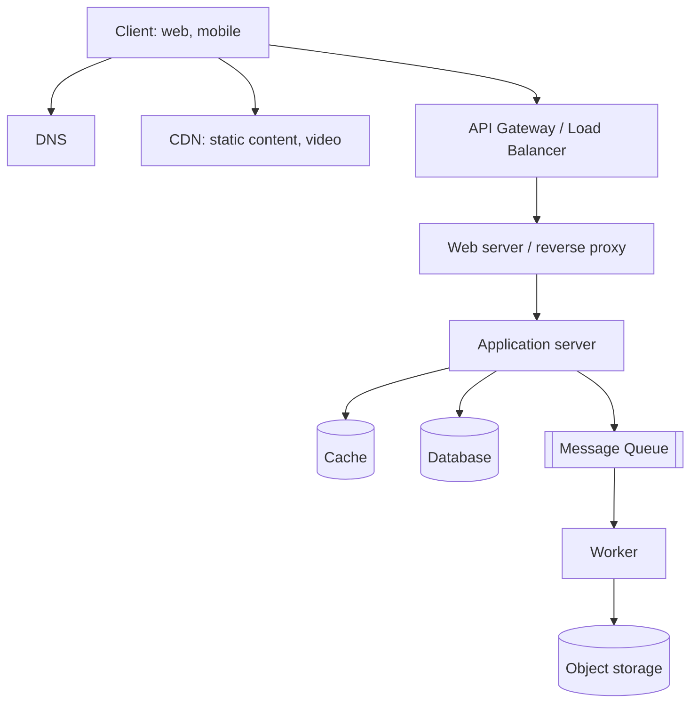

# Chương 3. Các thành phần phổ biến trong hệ thống

> Cập nhật: 2026-11-07. Chương này là bản đồ tổng quan; Load Balancer, Cache, Message Queue được đào sâu ở chương 6 và 7.

## 3.1 Bức tranh chung

Mỗi thành phần tồn tại để giải quyết một vấn đề cụ thể về latency, throughput, availability hoặc chi phí. Khi phỏng vấn, hãy nêu "vấn đề → thành phần", không nêu "thành phần" trước.

## 3.2 Web server và reverse proxy

**Web server** (Nginx, Apache HTTP Server, Caddy) nhận kết nối HTTP, phục vụ file tĩnh, terminate TLS, compression, và đóng vai **reverse proxy** chuyển request tới application server. Ưu điểm của đặt reverse proxy phía trước: ẩn topology nội bộ, gom TLS ở một nơi, buffer kết nối chậm (slow client) để app server không bị giữ thread.

## 3.3 Application server

Chạy logic nghiệp vụ (Spring Boot, ASP.NET Core, Node.js, Go, Django…). Nguyên tắc để scale: **stateless**. Mọi state bền vững nằm ở database hoặc object storage; state tạm (session) nằm ở cache hoặc nằm trong token đã ký. Khi stateless, load balancer có thể gửi request tới bất kỳ instance nào, và có thể thêm/bớt instance tự do (autoscaling).

## 3.4 Database

Hai nhóm chính được so sánh kỹ ở chương 5:
- **Relational (SQL)**: PostgreSQL, MySQL, SQL Server, Oracle. Mạnh ở constraint, transaction ACID, join.
- **NoSQL**: key-value (DynamoDB, Redis), document (MongoDB), wide-column (Cassandra), graph (Neo4j). Mạnh ở horizontal scaling và data model linh hoạt.

Cập nhật quan trọng: ranh giới đã mờ. Nhiều hệ NoSQL hiện có transaction (MongoDB từ 4.0 trên replica set và 4.2 trên sharded cluster; DynamoDB có `TransactWriteItems`/`TransactGetItems`), còn nhiều hệ SQL scale ngang (Vitess/MySQL, Citus/PostgreSQL, CockroachDB, Spanner). Vì thế chọn theo **access pattern và yêu cầu consistency**, không chọn theo nhãn "SQL" hay "NoSQL".

**Object storage** (Amazon S3, Google Cloud Storage, Azure Blob) lưu file lớn (ảnh, video, backup) với durability cao, rẻ, truy cập qua HTTP API. Database chỉ nên lưu *metadata* và URL/key tham chiếu. Từ tháng 12/2020, S3 cung cấp strong read-after-write consistency cho mọi request (GET, PUT, LIST).

## 3.5 Load Balancer (tóm tắt)

Phân phối request tới nhiều instance, loại instance hỏng nhờ health check, terminate TLS. Có L4 (theo IP/port) và L7 (theo HTTP). Chi tiết chương 6.

## 3.6 Cache (tóm tắt)

Giữ bản sao dữ liệu nóng ở layer nhanh hơn (RAM) để giảm latency và tải cho database. Có nhiều vị trí: browser, CDN, application cache (Redis/Valkey, Memcached), cache trong DB. Chi tiết chương 6.

Lưu ý về sản phẩm: Redis đã đổi giấy phép nhiều lần (2024 chuyển sang SSPL/RSAL; từ Redis 8 ra mắt 2025-05, thêm AGPLv3 làm một lựa chọn giấy phép). Cộng đồng/Linux Foundation duy trì nhánh **Valkey** (fork từ Redis 7.2.4, giấy phép BSD 3-clause, 2024-03). Khi chọn, hãy xem giấy phép và dịch vụ managed của nhà cloud bạn dùng.

## 3.7 CDN (Content Delivery Network)

Mạng các edge location (PoP) đặt gần người dùng, lưu bản sao nội dung (ảnh, JS, CSS, video segment) để giảm latency và giảm tải cho origin. Hai mô hình: *pull* (CDN lấy từ origin khi có cache miss, đặt TTL qua header `Cache-Control`) và *push* (bạn chủ động đẩy lên). Gỡ nội dung cũ bằng **invalidation/purge** hoặc, tốt hơn, dùng **tên file có hash** (`app.3f9a1c.js`) để không phải invalidate.

Về video: video on demand (VOD) bằng **HLS** hoặc **MPEG-DASH** chạy trên **HTTP** (chia video thành segment vài giây, client chọn chất lượng theo bandwidth), nên tận dụng được CDN HTTP bình thường. UDP dành cho các real-time stream (RTP, WebRTC) và cho QUIC/HTTP/3.

## 3.8 Message Queue (tóm tắt)

Đặt một durable buffer giữa bên gửi và bên xử lý để decoupling, load leveling, xử lý asynchronous và retry. Chi tiết, kể cả delivery semantics, ở chương 7.

## 3.9 Ví dụ thiết kế: tải ảnh đại diện

Tình huống: người dùng tải ảnh lên, cần thumbnail 3 kích cỡ.

1. Client xin *pre-signed URL* từ app server, tải ảnh thẳng lên object storage (app server không phải chuyển tiếp byte nặng).
2. Object storage phát event "ảnh mới" vào queue.
3. Worker lấy event, tạo thumbnail, ghi lại object storage, cập nhật metadata trong DB.
4. Ảnh được phục vụ qua CDN.

Điểm hay: luồng upload nặng không đi qua app server; xử lý ảnh asynchronous nên không làm chậm người dùng; lỗi worker chỉ khiến thumbnail trễ, queue giữ event để retry.

## 3.10 Đánh đổi

| Thêm thành phần | Được | Mất |
|---|---|---|
| Cache | Latency thấp, giảm tải DB | Dữ liệu cũ (stale), phức tạp invalidation |
| Queue | Decoupling, chịu peak load | Phức tạp hơn, kết quả không tức thì, cần xử lý duplicate |
| CDN | Latency thấp toàn cầu | Chi phí, khó cập nhật nội dung tức thời |
| Replica đọc | Tăng read throughput | Replication lag, đọc có thể cũ |

## 3.11 Khi phỏng vấn nên nói gì

- "Em bắt đầu với một app server stateless sau load balancer và một database. Em chỉ thêm cache khi ước lượng cho thấy DB không chịu nổi QPS đọc."
- "File lớn em đưa lên object storage, DB chỉ giữ metadata."
- "Phần nào không cần phản hồi ngay (gửi email, tạo thumbnail) em đẩy qua queue."

## 3.12 Cạm bẫy

- Lưu file binary lớn trong cột database.
- Giữ session trong RAM từng server rồi mới nhớ ra không scale được.
- Thêm cache mà không nói cách invalidation.
- Nói video VOD chạy bằng UDP. Thực tế HLS/DASH chạy trên HTTP.
- Đặt CDN cho dữ liệu cá nhân hóa mà không tính `Cache-Control: private`/`Vary`.

## 3.13 Tóm tắt

1. Mỗi thành phần giải một vấn đề riêng; nêu vấn đề trước.
2. App server stateless là điều kiện scale ngang dễ.
3. Chọn database theo access pattern và mức consistency, không theo nhãn SQL/NoSQL.
4. File lớn vào object storage, phục vụ qua CDN.
5. Queue cho việc async; cache cho đọc nóng; cả hai kéo theo trade-off riêng.

## 3.14 Câu hỏi tự kiểm tra

1. Vì sao nên để app server stateless?
2. Nêu hai cách giải quyết việc nội dung CDN bị cũ.
3. Vì sao không lưu ảnh lớn trong database?
4. HLS/DASH dùng giao thức transport layer nào, và vì sao điều đó thuận lợi cho CDN?
5. Redis hiện có những lựa chọn giấy phép nào và có fork nào?

Đáp án

1. Để load balancer gửi request đến instance bất kỳ, thêm/bớt instance tự do, và instance chết không làm mất state.
2. TTL ngắn kèm `Cache-Control`; purge/invalidate khi cập nhật; đặt tên file có hash để URL đổi khi nội dung đổi.
3. Làm phình DB, tốn bandwidth và cache của DB, backup chậm, đắt hơn object storage; DB tối ưu cho dữ liệu có cấu trúc, query nhỏ.
4. HTTP (trên TCP, hoặc QUIC với HTTP/3); vì là HTTP thông thường nên CDN cache từng segment như file tĩnh.
5. Redis 8 (2025) có thêm AGPLv3 bên cạnh các giấy phép source-available; Valkey là fork BSD do Linux Foundation duy trì. Cần tra lại khi quyết định vì tình hình thay đổi.

## Nguồn đã tra

- Redis chuyển AGPLv3 (2025-05): https://redis.io/blog/agplv3/
- Valkey (Linux Foundation, 2024): https://www.phoronix.com/news/Linux-Foundation-Valkey
- S3 strong consistency (2020-12): https://aws.amazon.com/about-aws/whats-new/2020/12/amazon-s3-now-delivers-strong-read-after-write-consistency-automatically-for-all-applications
- MongoDB transactions: https://www.mongodb.com/docs/manual/core/transactions/
- DynamoDB transactions: https://docs.aws.amazon.com/amazondynamodb/latest/developerguide/transaction-apis.html
