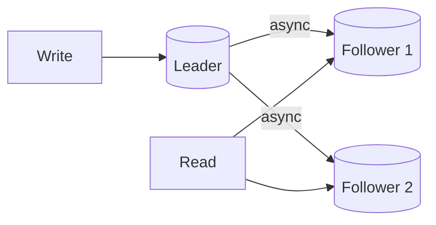

# Chapter 4. Consistency and Availability: Replication, Quorum, CAP, PACELC

> Cập nhật: 2026-11-07.

## 4.1 Why this is the hardest chapter

Ngay khi dữ liệu có nhiều replica (để fault tolerance và tăng tốc đọc), câu hỏi xuất hiện: *nếu hai replica khác nhau, người dùng thấy bản nào?* Mọi thiết kế phân tán đều trả lời câu hỏi này bằng cách chọn một **consistency model** và chấp nhận cái giá về latency hoặc availability.

## 4.2 Consistency models (strong to weak)

| Mô hình | Ý nghĩa dễ hiểu | Ví dụ |
|---|---|---|
| **Linearizability** (strong consistency) | Mọi operation trông như xảy ra tức thời tại một điểm trong thời gian; đọc luôn thấy record mới nhất đã hoàn tất | Đọc từ leader sau khi ghi đã commit trên Raft; DynamoDB strongly consistent read; S3 hiện tại |
| **Sequential consistency** | Mọi process thấy cùng một thứ tự operation, nhưng thứ tự không bắt buộc khớp thời gian thực | Một số hệ cache đồng bộ |
| **Causal consistency** | Operation có quan hệ causal được thấy theo đúng thứ tự (trả lời luôn sau câu hỏi) | MongoDB causal sessions |
| **Session guarantees** | *Read-your-writes* (đọc thấy điều mình vừa ghi), *monotonic reads* (không "quay ngược thời gian") | Thường đảm bảo bằng cách ghim session vào một replica |
| **Eventual consistency** | Nếu ngừng ghi, mọi replica sẽ converge; không hứa gì về thời điểm | Cassandra (mức thấp), DynamoDB eventually consistent read, DNS |

Lưu ý thuật ngữ: chữ "C" của **ACID** (dữ liệu thỏa ràng buộc) khác chữ "C" của **CAP** (linearizability). Đừng trộn.

**Ví dụ nên chọn mức nào?**
- Số dư tài khoản, tồn kho cuối: cần mạnh (hoặc dùng cơ chế compensation).
- Số lượt thích, số lượt xem: eventual là đủ.
- Hồ sơ cá nhân vừa sửa: cần *read-your-writes* cho chính người sửa, người khác thấy trễ vài giây cũng được.

## 4.3 Replication

**Leader–follower (primary–replica)**: mọi ghi đi qua leader, rồi được replicate sang follower.
- *Sync*: leader chờ follower xác nhận mới trả lời client. Không mất dữ liệu khi leader chết, nhưng chậm hơn và một follower treo có thể chặn ghi.
- *Async*: leader trả lời ngay. Nhanh, nhưng nếu leader chết trước khi replicate xong, các record chưa sang follower bị mất khi chuyển leader.
- *Semi-sync*: chờ ít nhất một (hoặc một số) follower rồi mới trả lời; thỏa hiệp phổ biến.

**Replication lag** là khoảng trễ giữa leader và follower; đọc từ follower có thể thấy dữ liệu cũ. Cách giảm hại: đọc dữ liệu quan trọng từ leader, ghim phiên người dùng vào một replica, theo dõi lag và loại replica quá trễ khỏi read pool.

**Multi-leader**: nhiều node nhận ghi (thường mỗi datacenter một leader). Cần giải quyết **conflict** (last-write-wins dễ mất dữ liệu; hoặc CRDT/merge ở application).

**Leaderless (kiểu Dynamo)**: client/coordinator ghi tới nhiều node, đọc từ nhiều node và dùng quorum (mục 4.5).

## 4.4 Failover

Khi leader chết cần: (1) **detect** (heartbeat, timeout), (2) **elect** leader mới, (3) **redirect** client.

Rủi ro chính:
- **Split-brain**: hai node cùng nghĩ mình là leader và cùng nhận ghi → dữ liệu diverge. Phòng bằng **majority vote** (consensus như Raft, Paxos) và **fencing token** (token tăng dần để storage từ chối ghi của leader cũ).
- **Mất write chưa replicate** khi dùng async replication.
- **False positive**: timeout quá ngắn khiến failover không cần thiết khi mạng chập chờn; quá dài thì downtime kéo dài. Nhớ công thức `A = MTBF/(MTBF+MTTR)`: failover nhanh là giảm MTTR.

Hot standby (luôn chạy, đồng bộ) phục hồi nhanh hơn cold standby (khởi động khi cần) nhưng tốn chi phí hơn.

## 4.5 Quorum

Với **N** replica, ghi chờ **W** xác nhận, đọc hỏi **R** replica. Nếu **W + R > N** thì tập node được đọc và tập node đã ghi **chắc chắn giao nhau**, nên mỗi lần đọc có ít nhất một node mang giá trị đã ghi (trong điều kiện không có lỗi khác).

Ví dụ N=3: (W=2, R=2) chịu được 1 node chết cho cả đọc và ghi; (W=3, R=1) đọc nhanh nhưng ghi dừng khi mất một node; (W=1, R=1) nhanh nhất nhưng không có bảo đảm giao nhau.

**Điều W + R > N KHÔNG bảo đảm**: chuyện này thường bị hiểu quá mức thành "strong consistency". Nó chỉ đảm bảo giao nhau, còn linearizability có thể bị phá vỡ bởi:
- **Sloppy quorum / hinted handoff**: khi một số node trong tập chuẩn không với tới được, hệ thống ghi tạm vào node khác; đọc quorum chuẩn có thể không thấy record đó.
- **Last-write-wins theo clock**: clock skew làm record cũ ghi đè bản mới.
- **Partial write failure**: ghi đến được vài node nhưng chưa đủ W; client nhận lỗi nhưng giá trị đó vẫn có thể bị đọc, rồi biến mất sau.
- **Concurrent read/write** và việc chưa có read repair: hai đọc liên tiếp có thể thấy giá trị mới rồi cũ.

Muốn linearizability thực sự, cần consensus protocol (Raft/Paxos) hoặc leader duy nhất; Dynamo-style cần thêm cơ chế riêng (ví dụ lightweight transactions của Cassandra, vốn đắt hơn).

## 4.6 CAP theorem

Phát biểu chính xác (Gilbert & Lynch, 2002, hình thức hóa phỏng đoán của Brewer):
- **C = linearizability**: đọc trả về giá trị của ghi mới nhất đã hoàn tất.
- **A = availability**: *mọi node còn sống* nhận request đều phải trả lời **không lỗi** (không có yêu cầu "nhanh" trong định nghĩa).
- **P = tolerance to partitions**: hệ thống tiếp tục hoạt động khi mạng giữa các node bị chia cắt, mất gói.

Kết luận đúng: **trong lúc có network partition, hệ thống không thể đồng thời vừa linearizable vừa available**. Không phải "chọn 2 trong 3 tùy ý": partition là sự kiện bạn không chọn được trong mạng thật, nên "bỏ P" không phải là một lựa chọn thực tế với hệ phân tán nhiều node. Quyết định thật là *khi partition xảy ra thì hy sinh C hay hy sinh A*.

- **CP khi partition**: minority side từ chối phục vụ (trả lỗi/timeout) để giữ correctness. Ví dụ: etcd, ZooKeeper, Spanner.
- **AP khi partition**: mọi phía cùng phục vụ, chấp nhận inconsistency rồi reconcile. Ví dụ: Cassandra/Dynamo cấu hình ưu tiên availability.

Nhãn CP/AP hay bị gán cứng cho sản phẩm; thực tế nhiều hệ có tham số (consistency level theo từng query), nên nhãn phụ thuộc cấu hình.

## 4.7 PACELC: what CAP leaves out

CAP chỉ nói về lúc có partition, mà phần lớn thời gian mạng ổn. **PACELC** (Daniel Abadi, 2012) mở rộng: *nếu có Partition (P) thì chọn Availability (A) hay Consistency (C); Else (E), khi không có partition, chọn Latency (L) hay Consistency (C).* Nguyên nhân: đồng bộ nhiều replica để giữ consistency luôn tốn thêm round trip, tức là thêm latency, kể cả khi mọi thứ khỏe.

Ví dụ phân loại (theo bài báo gốc 2012, có thể đổi theo cấu hình/phiên bản):
- **PA/EL**: Dynamo, Cassandra, Riak (ưu tiên availability, latency thấp).
- **PC/EC**: HBase/BigTable-kiểu, strong consistency cả hai tình huống.
- **PA/EC**: MongoDB theo phân loại của Abadi (khi partition chấp nhận mất C, bình thường thì ưu tiên C). Phân loại này phụ thuộc write/read concern, đừng coi là cố định.
- **PC/EL**: PNUTS của Yahoo.

Trong phỏng vấn, câu "nếu không có partition thì hệ thống này đánh đổi latency với consistency thế nào?" cho thấy bạn hiểu sâu hơn việc đọc thuộc CAP.

## 4.8 Design example: multi-region hotel booking

Yêu cầu: không bán hai lần một phòng. Dùng leader duy nhất cho mỗi khách sạn (partition theo `hotel_id`), ghi sync sang một replica cùng region, async sang region khác. Trade-off: người ở xa leader chịu latency cao hơn (EC trong PACELC); khi region của leader bị cô lập, đặt phòng khách sạn đó tạm dừng (chọn C hơn A cho thao tác ghi). Đọc danh sách phòng (tìm kiếm) lấy từ replica cục bộ với eventual consistency, và kiểm tra lại trên leader khi người dùng bấm đặt.

## 4.9 What to say in an interview

- "Với thao tác trừ tiền em cần linearizable, em chấp nhận ghi bị từ chối khi partition. Với bảng tin em dùng eventual consistency."
- "Em không dựa vào W + R > N để bảo đảm strong consistency; nó chỉ đảm bảo giao nhau. Em sẽ dùng leader/Raft."
- "Theo PACELC, ngay cả khi không có lỗi, replicate sync cross-region thêm vài chục đến vài trăm mili-giây; em đặt leader gần người dùng chính."
- "Failover tự động cần cơ chế chống split-brain: majority vote và fencing token."

## 4.10 Pitfalls

- Trình bày CAP như "chọn 2 trong 3" tuyệt đối, hoặc coi A là "nhanh".
- Dán nhãn CP/AP cố định cho sản phẩm.
- Tin rằng quorum là strong consistency.
- Quên replication lag khi đọc từ replica ngay sau khi ghi.
- Dùng last-write-wins với đồng hồ lệch cho dữ liệu không được phép mất.
- Nhầm "C" của ACID và CAP.

## 4.11 Summary

1. Chọn consistency model theo giá trị nghiệp vụ của dữ liệu.
2. Replication async nhanh nhưng có thể mất ghi khi failover; sync an toàn nhưng chậm hơn.
3. `W + R > N` chỉ đảm bảo giao nhau; không bằng linearizability.
4. CAP: khi có partition, chọn linearizable hoặc available; không phải "chọn 2 trong 3".
5. PACELC bổ sung trade-off latency vs consistency khi không có lỗi.

## 4.12 Self-check questions

1. Hệ thống N=5, W=3, R=3: chịu mất tối đa mấy node để vẫn đọc và ghi được? Nó có linearizable không?
2. Định nghĩa "A" trong CAP.
3. Nêu hai tình huống mà quorum vẫn đọc ra dữ liệu cũ.
4. PACELC nói thêm gì so với CAP?
5. Split-brain là gì và phòng thế nào?

Answer

1. Cần 3 node cho cả đọc và ghi nên chịu mất tối đa 2 node. Không tự động linearizable; vẫn bị ảnh hưởng bởi sloppy quorum, last-write-wins, partial write failure.
2. Mọi node còn sống nhận request đều phải trả lời không lỗi; không có yêu cầu về tốc độ.
3. Sloppy quorum/hinted handoff; partial write failure rồi bị đọc; clock skew với last-write-wins; đọc đồng thời với ghi chưa lan hết.
4. Khi không có partition vẫn tồn tại trade-off giữa latency và consistency (E: Else, L/C).
5. Hai node cùng tự nhận là leader. Phòng bằng majority vote (Raft/Paxos), lease, fencing token, và quy tắc node thiểu số ngừng nhận ghi.

## Sources consulted

- Abadi, "Consistency Tradeoffs in Modern Distributed Database System Design" (2012): https://cs.umd.edu/~abadi/papers/abadi-pacelc.pdf
- Gilbert & Lynch (2002), định nghĩa C/A/P: kiến thức chuẩn, chưa tra lại trực tiếp trong phiên này (xem phần "điểm chưa chắc" trong báo cáo).
- DynamoDB strongly consistent read trong tài liệu transaction: https://docs.aws.amazon.com/amazondynamodb/latest/developerguide/transaction-apis.html
- S3 strong consistency: https://aws.amazon.com/about-aws/whats-new/2020/12/amazon-s3-now-delivers-strong-read-after-write-consistency-automatically-for-all-applications
