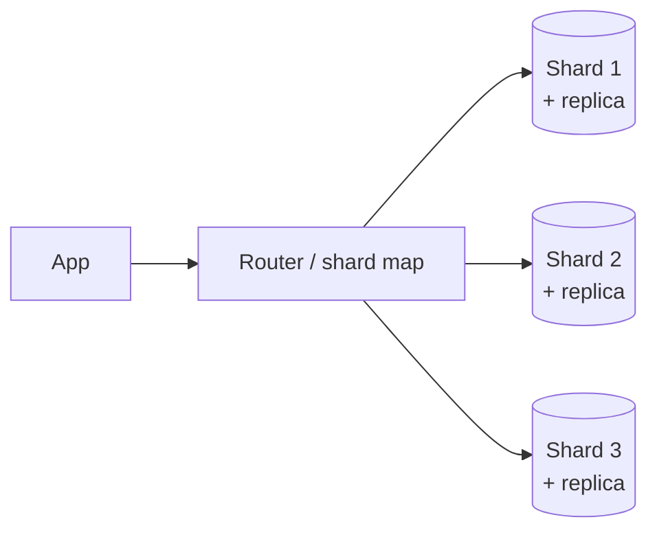

# Chương 5. Database: chọn loại, sharding, index, transaction, locking

> Cập nhật: 2026-11-07.

## 5.1 SQL hay NoSQL?

Câu hỏi đúng không phải "SQL nhanh hay NoSQL nhanh" mà là: *dữ liệu có dạng gì, truy cập thế nào, cần bảo đảm gì?*

| Tiêu chí | Relational (PostgreSQL, MySQL…) | Key-value / wide-column (DynamoDB, Cassandra) | Document (MongoDB) |
|---|---|---|---|
| Data model | Table, foreign key, join | Key → value/row, thiết kế theo query | JSON document lồng nhau |
| Query | Linh hoạt (SQL, join, aggregation) | Nhanh theo key; query ngoài key hạn chế | Linh hoạt vừa phải, index phụ |
| Scale ngang | Khó hơn (cần Vitess, Citus, sharding thủ công…) hoặc dùng NewSQL | Thiết kế sẵn để scale ngang | Có sharding sẵn |
| Transaction | ACID đầy đủ | Có (xem dưới), phạm vi hạn chế | Có |

**Cập nhật quan trọng (quan điểm cũ "NoSQL hy sinh ACID" không còn đúng):**
- **MongoDB**: multi-document transaction từ **4.0** (replica set) và **4.2** (sharded cluster).
- **DynamoDB**: `TransactWriteItems` / `TransactGetItems` nhóm tối đa **100** operation, tổng ≤ **4 MB**, trong cùng một Region/tài khoản, isolation level serializable với các operation đơn lẻ; mỗi item trong transaction tiêu tốn gấp đôi capacity đọc/ghi (một lần prepare, một lần commit). Đọc strongly consistent bằng `ConsistentRead=true`.
- Hạn chế vẫn còn: transaction NoSQL thường có giới hạn kích thước, đắt hơn, và không trải rộng nhiều Region (DynamoDB global tables có thể lộ transaction dang dở ở Region khác).

**Cách chọn thực dụng**: bắt đầu bằng relational database vì constraint và transaction giúp tránh lỗi dữ liệu; chuyển hoặc bổ sung NoSQL khi có lý do định lượng (ghi hàng chục nghìn QPS, dữ liệu theo key đơn giản, cần trải toàn cầu, schema biến động mạnh).

## 5.2 ACID và isolation level

**ACID**: Atomicity (hoặc tất cả, hoặc không), Consistency (thỏa constraint), Isolation (transaction đồng thời không giẫm nhau), Durability (đã commit thì không mất).

**Các anomaly**:
- **Dirty read**: đọc dữ liệu chưa commit của transaction khác.
- **Non-repeatable read**: đọc cùng row hai lần, thấy hai giá trị vì transaction khác commit giữa chừng.
- **Phantom read**: chạy lại query điều kiện, xuất hiện/biến mất row.
- **Lost update**: hai transaction cùng đọc rồi ghi đè lẫn nhau, mất một cập nhật.
- **Write skew**: hai transaction đọc cùng tập dữ liệu, mỗi bên ghi vào row khác nhau làm vỡ constraint chung (ví dụ cả hai bác sĩ cùng xin nghỉ trực, còn 0 người).

| Isolation level (chuẩn SQL) | Dirty read | Non-repeatable | Phantom |
|---|---|---|---|
| Read Uncommitted | có thể | có thể | có thể |
| Read Committed | không | có thể | có thể |
| Repeatable Read | không | không | có thể (theo chuẩn) |
| Serializable | không | không | không |

Thực tế khác bảng chuẩn tùy sản phẩm: PostgreSQL mặc định Read Committed, và Repeatable Read của nó là snapshot isolation (không có phantom nhưng vẫn có write skew); MySQL InnoDB mặc định Repeatable Read. **Lost update và write skew không phải dirty read**; chúng thuộc nhóm lỗi khác và cần cơ chế riêng (lock, `SERIALIZABLE`, hoặc optimistic locking). Hãy đọc tài liệu isolation của đúng sản phẩm bạn dùng.

**MVCC** (multi-version concurrency control): mỗi transaction đọc một *snapshot* consistent, nên **reader không chặn writer và writer không chặn reader**. Hệ quả: câu `SELECT` thông thường không bị chặn bởi các transaction ghi. `SELECT ... FOR UPDATE` trên DB dùng MVCC **chỉ lock các row được chọn để chặn writer hoặc các lệnh locking read khác**, không chặn các `SELECT` thường (đọc snapshot).

## 5.3 Locking trong hệ thống đồng thời

### Pessimistic locking

Giả định conflict rất dễ xảy ra, nên lock row ngay khi đọc:

```sql
BEGIN;
SELECT stock FROM product WHERE id = 7 FOR UPDATE;  -- giữ row lock
UPDATE product SET stock = stock - 1 WHERE id = 7;
COMMIT;
```

Phù hợp khi contention cao trên cùng row và transaction **ngắn** (ví dụ trừ kho, cập nhật số dư). Cái giá: giữ lock làm giảm throughput, có nguy cơ **deadlock**, và nếu giữ qua lúc người dùng suy nghĩ hoặc gọi dịch vụ ngoài thì chặn người khác lâu. **Vì vậy pessimistic lock không phải lựa chọn ưu tiên cho transaction dài.**

### Optimistic locking

Giả định conflict hiếm, không lock khi đọc; khi ghi thì kiểm tra row chưa bị ai sửa, thường bằng cột `version` (hoặc `updated_at`, ETag):

```sql
UPDATE product
SET stock = 9, version = version + 1
WHERE id = 7 AND version = 5;   -- nếu 0 row bị ảnh hưởng: có người đã sửa
```

Nếu `0 rows affected`, ứng dụng đọc lại và retry hoặc báo conflict cho người dùng. Điểm cần nhớ:
- Nó **chống lost update**. Nó **không liên quan đến dirty read** (đó là chuyện isolation level).
- Nó **không làm dữ liệu kém chính xác**; dữ liệu vẫn đúng, cái giá là **phải xử lý retry** khi contention.
- Rất hợp với transaction dài/qua nhiều request (người dùng mở form sửa rồi lưu sau 5 phút), và với HTTP qua ETag + `If-Match`.
- Khi contention cao, tỉ lệ retry tăng, lúc đó pessimistic lock hoặc atomic update (`stock = stock - 1 WHERE stock > 0`) tốt hơn.

**Lựa chọn nhanh**: atomic update một câu lệnh > optimistic (conflict hiếm, transaction dài) > pessimistic (conflict nhiều, transaction ngắn) > distributed lock (khi dữ liệu không nằm trong một DB; cẩn thận với lease hết hạn và cần fencing token).

## 5.4 Index

Index là cấu trúc phụ giúp tìm row nhanh, đổi lại tốn memory/disk và làm **chậm ghi** (mỗi insert/update phải cập nhật mọi index liên quan).

- **B-tree / B+tree** (mặc định ở hầu hết RDBMS): hỗ trợ `=`, `<`, `>`, `BETWEEN`, `ORDER BY`, tiền tố `LIKE 'abc%'`.
- **Hash index**: chỉ hữu ích cho so sánh bằng `=`. Không dùng cho `<`, `>`, sắp xếp, và **không giúp `!=`** (muốn tìm "mọi thứ khác" phải duyệt gần như toàn bộ).
- **LSM-tree** (Cassandra, RocksDB): ghi nhanh theo batch, đọc có thể phải merge nhiều level.
- **Composite index** `(a, b, c)`: dùng được cho query lọc `a`, `a,b`, `a,b,c` (quy tắc *leftmost prefix*); thứ tự cột quan trọng. Thường đặt cột lọc bằng `=` trước, cột phạm vi sau.
- **Covering index**: chứa đủ cột query cần nên không phải quay lại bảng.
- Cột có **selectivity thấp** (ví dụ giới tính) ít lợi ích nếu index riêng lẻ.
- Cạm bẫy làm index "tắt": bọc cột trong hàm (`WHERE LOWER(email) = ...` nếu không có index theo hàm), `LIKE '%abc'`, so sánh kiểu dữ liệu không khớp.

Dùng `EXPLAIN` để xem execution plan, đừng đoán.

### Foreign key và index

- **MySQL InnoDB** yêu cầu có index trên cột foreign key và **tự tạo** nếu bạn chưa có.
- **PostgreSQL, SQL Server, Oracle** **không tự tạo** index trên cột foreign key (phía tham chiếu). Tài liệu PostgreSQL giải thích: `DELETE` ở bảng cha hoặc `UPDATE` parent key buộc scan bảng con, nên thường nên tự index cột FK ở bảng con.
- Vì vậy lời khuyên "đừng tạo index cho FK" là sai ở hầu hết trường hợp có join theo FK hoặc xóa/sửa bảng cha. Ngoại lệ hiếm: bảng con rất nhỏ, hoặc không bao giờ join/xóa cha và ghi rất nặng; hãy đo trước.

Quan hệ với query: phía được tham chiếu (primary key/unique) luôn có index.

## 5.5 Sharding / Partitioning

Chia một tập dữ liệu thành nhiều phần ở nhiều máy để vượt giới hạn capacity và throughput của một máy. Phân biệt:
- **Partitioning**: chia bảng thành các phần (có thể trên một máy).
- **Sharding**: chia ra nhiều máy/DB cluster độc lập.
- **Replication**: sao chép *cùng* dữ liệu (chương 4); thường dùng kết hợp: mỗi shard có replica.

**Chiến lược chia**:
| Chiến lược | Cách làm | Ưu | Nhược |
|---|---|---|---|
| Range | Theo khoảng key (A–F, G–M…) | Range query hiệu quả | Dễ **hotspot** (ví dụ key theo thời gian: shard mới nhận hết ghi) |
| Hash | `hash(key) mod N` | Phân bố đều | Đổi N phải di chuyển gần hết dữ liệu; range query không tốt |
| **Consistent hashing** | Key và node nằm trên vòng; mỗi key thuộc node gặp trước theo chiều kim đồng hồ; dùng *virtual node* cho đều | Thêm/bớt node chỉ di chuyển khoảng 1/N dữ liệu | Triển khai phức tạp hơn |
| Directory | Bảng tra shard của key | Linh hoạt | Bảng tra là bottleneck/SPOF |

**Chọn shard key** là quyết định quan trọng nhất: cần *cardinality cao*, *phân bố đều*, và phù hợp query chính (để mỗi query chỉ đến 1 shard). Ví dụ thương mại điện tử: shard theo `user_id` thì đơn hàng của một người nằm một chỗ; còn query "mọi đơn hàng hôm nay" phải gom từ mọi shard.

**Cái giá của sharding**: join và transaction xuyên shard khó (cần saga/2PC), resharding phức tạp, hotspot (người nổi tiếng), vận hành nhiều hơn. Quy tắc kinh nghiệm: **trì hoãn sharding** cho tới khi đã tận dụng index, cache, read replica, nâng cấp phần cứng, và table partitioning.



## 5.6 Một số lựa chọn lưu trữ khác

- **Cache/in-memory store** cho dữ liệu nóng và session.
- **Search engine** (Elasticsearch/OpenSearch) cho full-text search; là bản sao có index của dữ liệu gốc, không phải source of truth.
- **Time-series DB** cho metric/log theo thời gian.
- **Object storage** cho file lớn.
- **Data warehouse/lake** cho phân tích (tách khỏi OLTP database).

Mô hình phổ biến: một **source of truth** (thường là DB quan hệ) và các **derived view** (cache, search index, warehouse) được cập nhật qua event (CDC/queue); derived view chấp nhận eventual consistency.

## 5.7 Ví dụ thiết kế: số dư ví điện tử

Yêu cầu: không âm tiền, không mất cập nhật. Cách làm: một transaction DB:
```sql
UPDATE wallet SET balance = balance - 100 WHERE id = ? AND balance >= 100;
```
Nếu 1 row bị ảnh hưởng thì đồng thời ghi một row vào bảng `ledger` (immutable ledger) trong cùng transaction. Atomic update tránh lost update mà không cần lock dài. Nếu chia shard theo `wallet_id`, chuyển tiền giữa hai ví khác shard cần saga (trừ → cộng → compensate khi lỗi) kèm idempotency key (chương 7–8).

## 5.8 Khi phỏng vấn nên nói gì

- "Em chọn PostgreSQL trước vì cần transaction và join; nếu ghi vượt khoảng X QPS em mới cân nhắc shard theo `user_id`."
- "Chống lost update bằng optimistic locking với cột version; nếu tỉ lệ retry cao em chuyển sang atomic update."
- "Index composite theo `(user_id, created_at)` để phục vụ query timeline và sắp xếp."
- "Em sẽ index cột foreign key ở bảng con vì PostgreSQL không tự tạo."
- "NoSQL ngày nay vẫn có transaction (MongoDB 4.0+, DynamoDB), nên em chọn theo access pattern chứ không theo ACID."

## 5.9 Cạm bẫy

- Nói NoSQL "không có ACID" hay "SQL không scale".
- Nhầm optimistic locking với isolation level, hoặc nói nó làm dữ liệu kém chính xác.
- Giữ pessimistic lock qua cuộc gọi mạng/hành động người dùng.
- Cho rằng `SELECT ... FOR UPDATE` chặn mọi reader trên DB MVCC.
- Hash index cho query `!=` hoặc phạm vi.
- Bỏ index FK ở PostgreSQL/SQL Server/Oracle; hoặc ngược lại index mọi cột khiến ghi chậm.
- Chọn shard key theo timestamp gây hotspot.
- Nhầm giữa `hash mod N` và consistent hashing.

## 5.10 Tóm tắt

1. Chọn DB theo access pattern và nhu cầu consistency; ranh giới SQL/NoSQL đã mờ.
2. Isolation level quyết định anomaly nào có thể xảy ra; lost update và write skew cần cơ chế riêng.
3. Optimistic locking: version + retry, chống lost update, hợp transaction dài; pessimistic: transaction ngắn, contention cao.
4. Index tăng tốc đọc, giảm tốc ghi; hash index chỉ cho `=`; index FK ở PostgreSQL/SQL Server/Oracle thường cần tự tạo.
5. Sharding là biện pháp cuối: chọn shard key kỹ, dùng consistent hashing, chấp nhận cái giá về query xuyên shard.

## 5.11 Câu hỏi tự kiểm tra

1. Hai transaction cùng đọc `stock=10` rồi đều ghi `stock=9`. Đây là anomaly nào, chặn bằng cách nào?
2. Vì sao hash index không giúp query `WHERE status != 'done'`?
3. PostgreSQL có tự tạo index cho cột foreign key không? MySQL InnoDB thì sao?
4. Khi nào chọn optimistic hơn pessimistic?
5. Vì sao shard theo `created_at` theo range thường gây vấn đề?

<details>
<summary>Đáp án</summary>

1. Lost update. Chặn bằng atomic update (`stock = stock - 1`), optimistic locking (`WHERE version = ?`), hoặc `SELECT ... FOR UPDATE` trong transaction ngắn, hoặc isolation đủ mạnh.
2. Hash index chỉ trả lời "key này nằm ở đâu" cho phép so sánh bằng; `!=` là tập "mọi thứ trừ một giá trị", không có cách tra trực tiếp, và phần lớn row đều khớp nên cũng thường full table scan.
3. PostgreSQL: không tự tạo (index cột FK ở bảng con tự làm). MySQL InnoDB: có, tự tạo nếu chưa có index phù hợp.
4. Xung đột hiếm, transaction kéo dài qua nhiều bước/request, không muốn giữ lock lâu; chấp nhận retry khi có conflict.
5. Record mới luôn rơi vào shard cuối cùng, tạo hotspot ghi, các shard cũ ít tải. Nên dùng hash của key hoặc composite key.

</details>

## Nguồn đã tra

- MongoDB transactions: https://www.mongodb.com/docs/manual/core/transactions/
- DynamoDB transactions (giới hạn 100 item, 4 MB, 2x capacity, serializable, ConsistentRead): https://docs.aws.amazon.com/amazondynamodb/latest/developerguide/transaction-apis.html
- PostgreSQL về index cho foreign key (qua tài liệu/danh sách thảo luận): https://postgrespro.com/list/thread-id/1452269
- MySQL Query Cache bị gỡ ở 8.0: xem chương 6.
