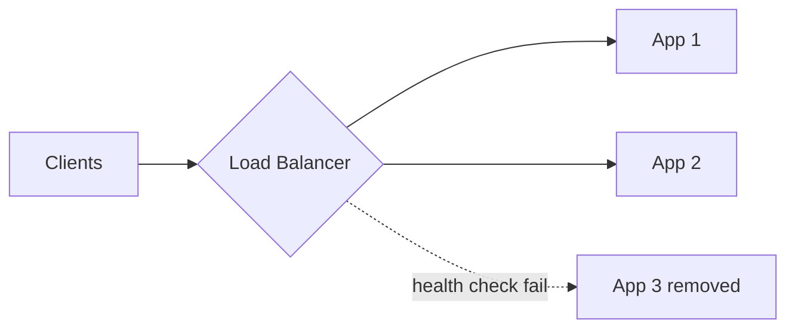
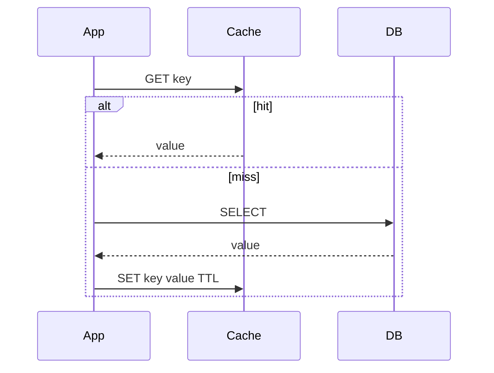

# Chapter 6. Scaling and Performance: Load Balancer and Caching

> Cập nhật: 2026-11-07.

# Part A. Load Balancer

## 6.1 Role

**Load Balancer (LB)** nhận traffic và chia cho nhiều backend để: (1) tăng throughput, (2) tăng availability (loại backend hỏng nhờ **health check**), (3) cho phép deploy/scale mà không gián đoạn (rolling, blue/green, canary), (4) thường kiêm terminate TLS.

LB cũng có thể là SPOF: triển khai nhiều LB (active-active hoặc active-passive với virtual IP/anycast), hoặc dùng dịch vụ managed của cloud vốn đã dự phòng nhiều AZ.

## 6.2 Load balancing algorithms

| Thuật toán | Ý tưởng | Dùng khi |
|---|---|---|
| Round robin | Lần lượt từng backend | Request đồng đều, backend giống nhau |
| Weighted round robin | Backend mạnh nhận nhiều hơn | Cấu hình máy khác nhau |
| Least connections | Chọn backend ít connection đang mở | Request dài ngắn không đều, connection kéo dài (WebSocket) |
| Least response time | Chọn backend đáp nhanh | Muốn tự thích nghi |
| IP hash / consistent hash | Cùng key → cùng backend | Cần *affinity* (cache cục bộ, sticky session) |
| Random of two choices | Chọn ngẫu nhiên 2 backend, lấy cái nhẹ hơn | Cân bằng tốt với chi phí thấp, tránh herd effect |

**Sticky session** ghim người dùng vào một backend. Tiện nhưng cản trở scale/failover (backend chết thì mất session). Nên để app stateless, session ngoài.

## 6.3 Layer 4 and Layer 7

| | L4 (transport) | L7 (application) |
|---|---|---|
| Quyết định dựa trên | IP, port, giao thức TCP/UDP | URL, header, cookie, method |
| Hiệu năng | Rất cao, latency thấp | Tốn CPU hơn |
| Khả năng | Forward connection | Route theo path/host, terminate TLS, compression, rewrite, rate limit, WAF |
| Ví dụ | AWS NLB, HAProxy mode tcp | AWS ALB, Nginx, Envoy, HAProxy mode http |

Chọn L4 khi cần hiệu năng thô hay giao thức không phải HTTP (gaming UDP, database proxy); L7 khi cần route thông minh (microservices: `/api/orders` → service đơn hàng). Thường kết hợp: L4 ở ngoài cùng, L7 phía sau.

LB trong nội bộ microservice có thể nằm ở client (client-side load balancing) hoặc **service mesh/sidecar** (Envoy).

## 6.4 When you need an LB, and global LB

Cần khi có từ hai instance trở lên hoặc cần zero-downtime deploy. Ở quy mô multi-region: **DNS-based / GSLB / anycast** chuyển người dùng tới region gần nhất hoặc region còn sống; hạn chế là DNS cache làm failover không tức thời (TTL).

---

# Part B. Caching

## 6.5 What a cache is and its benefits

Cache lưu bản sao dữ liệu ở nơi nhanh hơn để giảm latency và tải cho origin. Hiệu quả đo bằng **hit ratio**. Nếu hit 90%, cache 1 ms, DB 20 ms: thời gian trung bình = `0,9×1 + 0,1×(1+20)`, tức khoảng 3 ms, so với 20 ms (và DB nhận 10% tải thay vì 100%). Nguyên lý đằng sau: RAM nhanh hơn SSD cỡ 10³ lần và HDD cỡ 10⁴–10⁵ lần (chương 2).

## 6.6 Where to place a cache

1. **Browser**: HTTP caching qua `Cache-Control` (`max-age`, `no-store`, `private`, `public`), `ETag`/`If-None-Match` cho conditional request (304 Not Modified).
2. **CDN/edge**: nội dung tĩnh và có thể cache (chương 3).
3. **Reverse proxy/API gateway** cache.
4. **Application cache**: in-process (nhanh nhất, nhưng mỗi instance một bản, khó consistent) hoặc distributed cache (Redis/Valkey, Memcached).
5. **Cache trong database**: buffer pool của DB (luôn có). Lưu ý riêng: **MySQL Query Cache đã bị gỡ hoàn toàn từ MySQL 8.0** (deprecated từ 5.7.20 vì không scale trên máy nhiều core). Ai viết "bật query cache của MySQL để tăng tốc" là đang dùng kiến thức cũ. Thay thế: cache ở application layer (Redis…), ProxySQL, hoặc tối ưu index/query.

## 6.7 Cache update strategies

(Đây là *cache-aside*.)

| Chiến lược | Đọc | Ghi | Ưu | Nhược |
|---|---|---|---|---|
| **Cache-aside** (lazy loading) | App kiểm tra cache, miss thì đọc DB rồi nạp | App ghi DB, rồi xóa (invalidate) key | Đơn giản, chỉ cache cái được hỏi; cache chết thì vẫn chạy được | Miss đầu chậm; có stale window; race giữa đọc-nạp và ghi-xóa |
| **Read-through** | Cache tự đọc DB khi miss | – | Logic gom về một chỗ | Phụ thuộc thư viện/cache |
| **Write-through** | – | Ghi cache và DB sync | Cache luôn mới | Ghi chậm hơn, cache nhiều dữ liệu ít đọc |
| **Write-behind** (write-back) | – | Ghi cache, ghi DB sau, async | Ghi rất nhanh, batch được | Mất dữ liệu nếu cache chết trước khi flush; phức tạp |
| **Write-around** | – | Ghi thẳng DB, bỏ qua cache | Tránh làm bẩn cache bởi dữ liệu ít đọc | Đọc ngay sau ghi bị miss |

Khuyến nghị mặc định: **cache-aside + xóa key khi ghi + TTL**. Xóa key an toàn hơn cập nhật giá trị vì tránh cập nhật sai thứ tự giữa hai ghi đồng thời.

### Eviction

Khi đầy: **LRU** (ít dùng gần đây nhất), **LFU** (ít dùng tần suất nhất), FIFO, random, TTL. Chọn theo access pattern.

### The three classic failures

1. **Cache stampede (thundering herd)**: key nóng hết hạn, hàng nghìn request cùng đập vào DB. Giảm bằng *request coalescing/single-flight* (một request nạp, các request khác chờ), lock ngắn khi nạp, refresh-ahead, và **thêm jitter vào TTL**.
2. **Cache penetration**: query key không tồn tại, luôn miss và luôn đập DB (có thể là tấn công). Giảm bằng cache giá trị "không có" với TTL ngắn, Bloom filter, validate đầu vào.
3. **Cache avalanche**: nhiều key hết hạn cùng lúc hoặc cache chết. Giảm bằng TTL ngẫu nhiên, nhiều node, rate limit vào DB, load shedding.

Thêm: **hot key** (một key nhận traffic khổng lồ) → replicate key ra nhiều node hoặc local cache ngắn hạn; **consistency** giữa cache và DB luôn là eventual, nêu rõ cửa sổ stale chấp nhận được.

## 6.8 Design example: product detail page

Đọc: CDN cache HTML tĩnh/ảnh → app → Redis (key `product:{id}`, TTL 5 phút ± jitter 30 giây) → DB. Ghi giá: cập nhật DB, xóa `product:{id}`. Chống stampede cho sản phẩm hot bằng single-flight. Tồn kho (thay đổi nhanh, quan trọng) *không* cache chung với mô tả sản phẩm; đọc trực tiếp hoặc cache TTL rất ngắn, và kiểm tra lại khi thanh toán.

## 6.9 What to say in an interview

- "Em dùng cache-aside, xóa key khi ghi, TTL 5 phút có jitter. Dữ liệu có thể cũ tối đa 5 phút; chấp nhận được cho mô tả sản phẩm, không chấp nhận cho tồn kho."
- "Để tránh stampede em dùng single-flight và TTL ngẫu nhiên."
- "Em không dựa vào query cache của MySQL vì đã bị gỡ ở 8.0."
- "Ở LB em chọn L7 vì cần route theo path và terminate TLS; phía trước có thể thêm L4 cho hiệu năng."

## 6.10 Pitfalls

- Cache không có cách invalidation, hoặc không nói cửa sổ stale.
- Cập nhật giá trị cache khi ghi (dễ ghi sai thứ tự) thay vì xóa.
- Dùng sticky session thay vì stateless.
- Cache dữ liệu cá nhân ở CDN công khai.
- Coi LB là không bao giờ hỏng (SPOF).
- Nhắc tới MySQL Query Cache như tính năng hiện hành.
- Quên rằng cache làm tăng độ phức tạp vận hành: cần monitoring hit ratio, eviction, memory.

## 6.11 Summary

1. LB chia tải, health check, hỗ trợ deploy không downtime; bản thân LB cần redundancy.
2. L4 nhanh và thô; L7 thông minh theo nội dung.
3. Cache-aside + invalidate + TTL jitter là mặc định hợp lý.
4. Phòng ba failure: stampede, penetration, avalanche.
5. MySQL Query Cache không còn từ 8.0; cache ở application layer.

## 6.12 Self-check questions

1. Vì sao least connections hợp với WebSocket hơn round robin?
2. Nêu hai khác biệt giữa L4 và L7.
3. Phân biệt cache stampede và cache penetration.
4. Vì sao thường xóa key thay vì cập nhật giá trị khi ghi dữ liệu?
5. Query Cache của MySQL còn dùng được ở phiên bản nào?

Answer

1. Connection WebSocket sống lâu và không đều; round robin chia theo số lần connection mới chứ không theo tải hiện tại, còn least connections nhìn số connection đang mở.
2. L4 quyết định theo IP/port, nhanh, không hiểu HTTP; L7 hiểu URL/header/cookie, route theo nội dung, kết thúc TLS, nhưng tốn CPU hơn.
3. Stampede: nhiều request cùng tải lại một key tồn tại vừa hết hạn. Penetration: query key không tồn tại nên luôn miss.
4. Hai ghi đồng thời có thể làm cache lưu giá trị cũ nếu cập nhật sai thứ tự; xóa buộc lần đọc sau nạp lại từ DB (source of truth).
5. Đã bị gỡ hoàn toàn từ MySQL 8.0 (deprecated từ 5.7.20); chỉ còn ở 5.7 trở về trước (và MariaDB có bản riêng).

## Sources consulted

- MySQL Query Cache gỡ ở 8.0 (worklog WL#10824 và tài liệu Percona về mục bị gỡ): https://dev.mysql.com/worklog/task/?id=10824 ; https://docs.percona.com/percona-server/latest/upgrade-changes-removed.html
- Redis/Valkey: xem chương 3.
