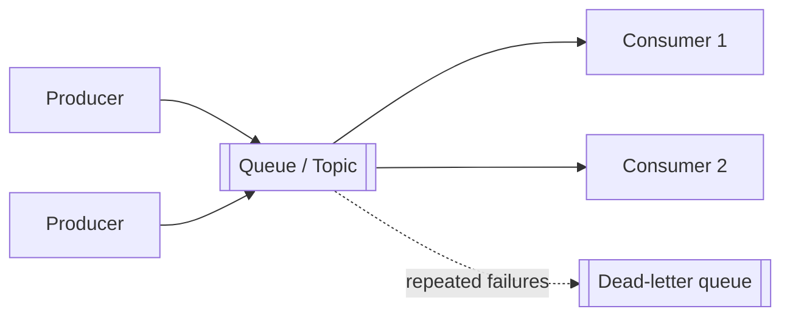
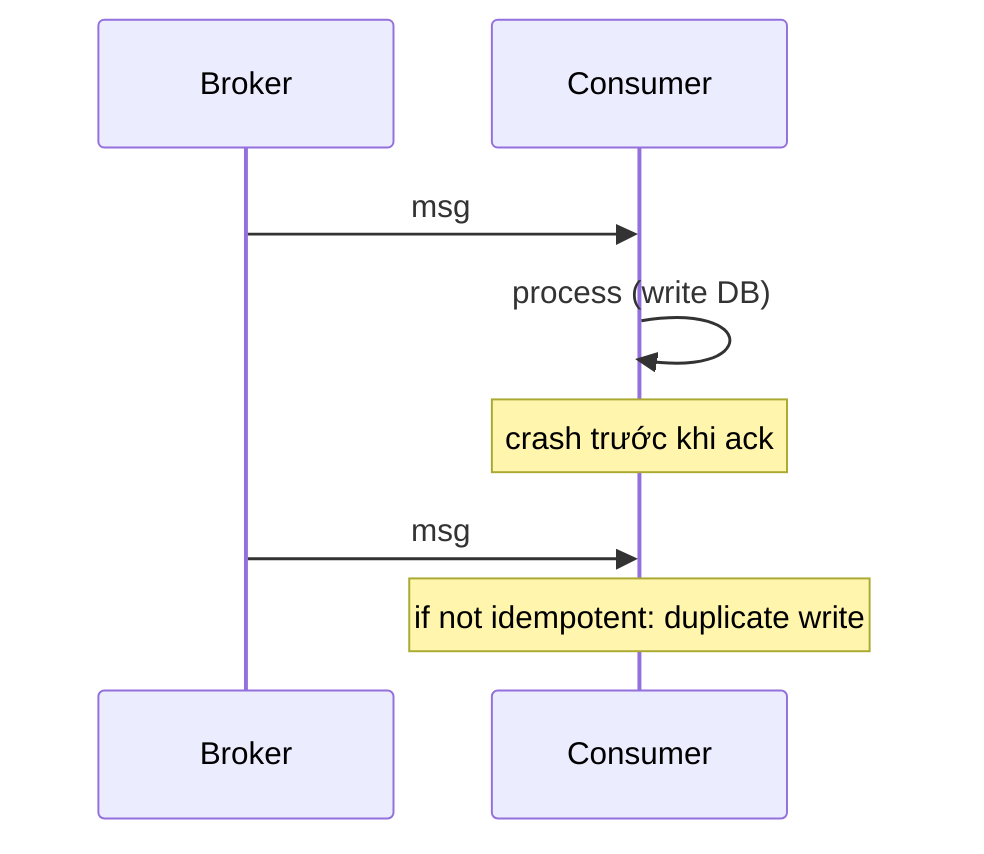
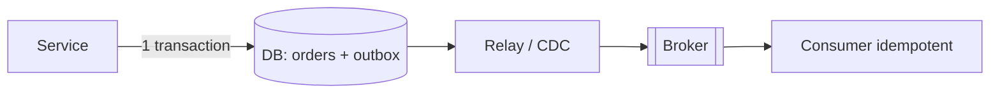

# Chapter 7. Message Queues, Delivery Semantics and Idempotency

> Cập nhật: 2026-11-07.

## 7.1 What problem does a message queue solve?

**Message queue / message broker** là thành phần trung gian lưu message một cách durable giữa **producer** (bên gửi) và **consumer** (bên xử lý). Lợi ích:

1. **Decoupling** về thời gian và về tên: producer không cần biết consumer có sống hay không.
2. **Load leveling**: lượng đến tăng đột biến được đệm lại, consumer xử lý theo năng lực.
3. **Asynchronous processing**: việc chậm (gửi email, tạo báo cáo, xử lý ảnh) không giữ người dùng chờ.
4. **Retry và durability**: message chưa xử lý xong vẫn còn đó.
5. **Fan-out**: một event, nhiều bên quan tâm (pub/sub).

Khi **không** nên dùng: thao tác cần kết quả ngay và synchronous (đọc số dư để hiển thị), luồng quá đơn giản, hoặc đội chưa đủ năng lực vận hành broker (thêm độ phức tạp: duplicate, ordering, monitoring latency của queue).



## 7.2 Two models

- **Queue (point-to-point)**: mỗi message tới *một* consumer trong group (competing consumers). Dùng để chia việc.
- **Pub/sub (topic)**: mỗi message tới *mọi* subscriber/group. Dùng để phát event.
- **Partitioned log (Kafka, Pulsar, Redis Streams...)**: message được ghi nối đuôi vào log, consumer tự giữ **offset**; có thể đọc lại, mỗi consumer group đọc độc lập. Thứ tự đảm bảo *trong một partition*, không toàn cục.

## 7.3 Current products (checked 2026-11)

| Sản phẩm | Đặc điểm cần nhớ |
|---|---|
| **Apache Kafka** | Partitioned log, throughput rất cao, retention có thời hạn, replay được. Từ **Kafka 4.0** (2025-03) ZooKeeper bị gỡ, KRaft là cơ chế metadata duy nhất. Tài liệu chính thức hiện liệt kê bản 4.4 là mới nhất tại lúc tra. Có chuyển động về "queue" kiểu share group (KIP-932); hãy xem release notes để biết trạng thái ổn định trước khi dùng. |
| **RabbitMQ** | Broker AMQP, routing linh hoạt (exchange). Từ **RabbitMQ 4.0** (2024) *mirrored classic queues đã bị gỡ*; queue cần replication dùng **quorum queues** hoặc **streams**. |
| **Amazon SQS** | Managed. *Standard*: at-least-once, ordering best-effort. *FIFO*: ordering theo message group, deduplication trong window 5 phút bằng deduplication ID. |
| **Pulsar, NATS JetStream, Google Pub/Sub, Azure Service Bus** | Các lựa chọn khác; mỗi cái có semantics riêng, cần đọc tài liệu. |

Quy tắc chọn thô: cần *replay*, throughput lớn, stream processing → Kafka-kiểu; cần routing phức tạp, latency thấp, mỗi message ack riêng → RabbitMQ-kiểu; không muốn vận hành → dịch vụ managed (SQS...).

## 7.4 Delivery semantics

Mạng có thể mất gói, consumer có thể chết giữa chừng, ack có thể thất lạc. Vì thế có ba mức:

| Mức | Nghĩa | Cách xảy ra | Dùng khi |
|---|---|---|---|
| **At-most-once** | Tối đa một lần; có thể mất | Ack/commit offset *trước* khi xử lý; không retry | Log metric, telemetry chịu mất được |
| **At-least-once** | Ít nhất một lần; có thể **duplicate** | Xử lý xong *rồi* mới ack; retry khi không có ack | Mặc định phổ biến; cần xử lý duplicate |
| **Exactly-once** | Side effect đúng một lần | Rất khó; xem dưới | Thanh toán, kế toán |



### The truth about "exactly-once"

Không thể có delivery đúng một lần *qua mạng không tin cậy* nếu không có sự hợp tác của phía nhận. Cách thực tế: **at-least-once + xử lý idempotent = side effect chỉ xảy ra một lần (effectively-once)**.

- **Kafka**: *idempotent producer* (broker gán producer ID và sequence number để loại duplicate write do retry), cùng **transaction** (atomic write nhiều partition và commit offset consumer trong cùng transaction). Consumer đặt `isolation.level=read_committed` để không thấy record của transaction bị hủy. Mặc định là `read_uncommitted` nên có thể thấy record của transaction hủy. Bảo đảm này áp dụng cho luồng *đọc từ Kafka → ghi vào Kafka* (Kafka Streams). Ghi ra hệ ngoài (DB, email) cần hệ đó cùng hợp tác (idempotent).
- **SQS FIFO**: loại duplicate send trong 5 phút; tài liệu cũng nói hiệu quả chỉ đúng nếu consumer xử lý và xóa trước khi hết visibility timeout. Vẫn nên idempotent.

### Idempotent consumer

Mỗi message mang một **message ID / idempotency key** ổn định. Consumer ghi nhận đã xử lý trong *cùng transaction* với side effect:

```sql
BEGIN;
INSERT INTO processed_message(id) VALUES (:message_id);  -- PRIMARY KEY, duplicate sẽ lỗi
UPDATE account SET balance = balance + :amt WHERE id = :acc;
COMMIT;
```

Nếu `INSERT` vi phạm primary key nghĩa là đã xử lý: bỏ qua. Cách khác: thao tác tự nhiên idempotent (`SET status='shipped'`, upsert theo key), hoặc version để bỏ message cũ. Đây thường gọi là mẫu **inbox**.

## 7.5 The DB write plus event publish problem: Transactional Outbox

Bài toán *dual write*: đơn hàng được lưu vào DB, rồi gửi event `OrderCreated` lên broker. Nếu lưu xong mà crash trước khi gửi → mất event; gửi trước rồi lưu thất bại → phantom event. Không có transaction chung giữa DB và broker.

**Outbox**: trong *cùng một transaction DB* ghi đơn hàng và ghi một row vào bảng `outbox`. Một process riêng (poller hoặc **CDC**, ví dụ Debezium đọc log DB) đọc `outbox` và phát lên broker, đánh dấu đã gửi.



Relay có thể gửi duplicate (crash sau khi gửi, trước khi đánh dấu) nên đây là at-least-once, buộc consumer idempotent. Kết quả: không mất event, không phantom event.

**Saga** (chuỗi local transaction với compensating action) là cách xử lý nghiệp vụ nhiều dịch vụ thay cho distributed transaction (2PC). 2PC chặn khi coordinator chết và hiếm dùng giữa các dịch vụ độc lập.

## 7.6 Ordering, backpressure, dead letter

- **Ordering**: chỉ đảm bảo trong một partition/message group. Muốn mọi event của một đơn hàng theo đúng thứ tự, dùng `order_id` làm partition key. Đổi lại, scale consumer bị giới hạn bởi số partition, và hot key gây load skew.
- **Backpressure**: khi producer nhanh hơn consumer, queue dài ra, latency tăng. Đối phó: autoscale consumer, giới hạn kích thước/độ dài queue, **prefetch** nhỏ cho consumer, producer chậm lại hoặc từ chối (load shedding), theo dõi *consumer lag* hoặc tuổi message cũ nhất.
- **Poison message**: message luôn gây lỗi. Retry có giới hạn (exponential backoff + jitter, chương 9) rồi chuyển sang **dead-letter queue (DLQ)** để điều tra, tránh chặn cả queue.
- **Visibility timeout / ack timeout**: thời gian một message "invisible" khi consumer đang xử lý. Đặt quá ngắn → bị giao lại khi vẫn đang xử lý (duplicate); quá dài → recovery chậm.

## 7.7 Design example: sending order confirmation emails

1. API ghi đơn hàng + row outbox trong một transaction, trả 201.
2. Relay phát `OrderCreated` lên topic.
3. Dịch vụ email consume; trước khi gửi, `INSERT` vào `processed_message(order_id)`; duplicate thì bỏ qua.
4. Lỗi tạm (SMTP quá tải) → retry backoff + jitter; lỗi vĩnh viễn → DLQ, alert.
Đánh đổi: email có thể đến trễ vài giây; đổi lại API nhanh và không mất email. Có thể duplicate email trong ca cực hiếm (gửi xong, crash trước khi lưu "đã xử lý"); chấp nhận, hoặc dùng idempotency key phía nhà cung cấp email nếu có.

## 7.8 What to say in an interview

- "Em dùng at-least-once và làm consumer idempotent bằng message ID; em không hứa exactly-once qua mạng."
- "Để không mất event khi ghi DB, em dùng transactional outbox với CDC."
- "Ordering chỉ cần trong một đơn hàng nên em partition theo `order_id`."
- "Có DLQ cho poison message, và theo dõi consumer lag để scale."

## 7.9 Pitfalls

- Nói "Kafka đảm bảo exactly-once" mà không giới hạn phạm vi.
- Gửi event ngay trong code ứng dụng sau `commit` (dual write).
- Ack trước khi xử lý xong.
- Cho rằng global ordering tồn tại giữa nhiều partition.
- Retry vô hạn không backoff; không có DLQ.
- Dùng queue cho việc cần phản hồi synchronous.
- Còn nghĩ RabbitMQ có classic mirrored queue (đã gỡ ở 4.0) hoặc Kafka cần ZooKeeper (đã gỡ ở 4.0).

## 7.10 Summary

1. Queue cho tách rời, load leveling, async, retry.
2. At-most-once mất; at-least-once duplicate; exactly-once thực chất là at-least-once + idempotent.
3. Idempotent consumer: key ổn định, ghi nhận trong cùng transaction với side effect.
4. Outbox giải quyết dual write; saga thay cho transaction phân tán.
5. Quản lý ordering theo partition key, backpressure, DLQ.

## 7.11 Self-check questions

1. Consumer xử lý xong, crash trước khi ack. Điều gì xảy ra và làm sao an toàn?
2. Vì sao dual write nguy hiểm? Outbox sửa thế nào?
3. Khác biệt `read_committed` và `read_uncommitted` ở consumer Kafka là gì?
4. Làm sao đảm bảo các event của cùng một đơn hàng được xử lý theo thứ tự?
5. Poison message là gì và cách xử lý?

<details>
<summary>Answer</summary>

1. Broker giao lại (at-least-once). An toàn nếu xử lý idempotent (dedup theo message ID trong cùng transaction với side effect).
2. Hai hệ thống không có transaction chung nên có thể lưu mà không gửi hoặc gửi mà không lưu. Outbox ghi event cùng transaction DB, rồi relay/CDC phát lên broker (at-least-once, nên consumer idempotent).
3. `read_committed` chỉ trả record của transaction đã commit (ẩn transaction hủy); `read_uncommitted` (mặc định) có thể trả cả record thuộc transaction bị hủy.
4. Dùng `order_id` làm partition key (hoặc message group ID ở SQS FIFO) để chúng cùng partition; thứ tự được bảo đảm trong partition.
5. Message luôn gây lỗi khi xử lý. Retry có giới hạn với backoff + jitter, rồi đưa vào DLQ để điều tra thủ công/khắc phục.

</details>

## Sources consulted

- Kafka, Message Delivery Semantics: https://kafka.apache.org/44/design/design/
- Kafka 4.0 gỡ ZooKeeper (nhiều nguồn, ví dụ): https://softwaremill.com/apache-kafka-4-0-0-released-kraft-queues-better-rebalance-performance/
- RabbitMQ 4.0 (gỡ classic queue mirroring): https://github.com/rabbitmq/rabbitmq-server/discussions/12321 ; https://www.cloudamqp.com/blog/rabbitmq-403.html
- SQS FIFO exactly-once processing: https://docs.aws.amazon.com/AWSSimpleQueueService/latest/SQSDeveloperGuide/FIFO-queues-exactly-once-processing.html
