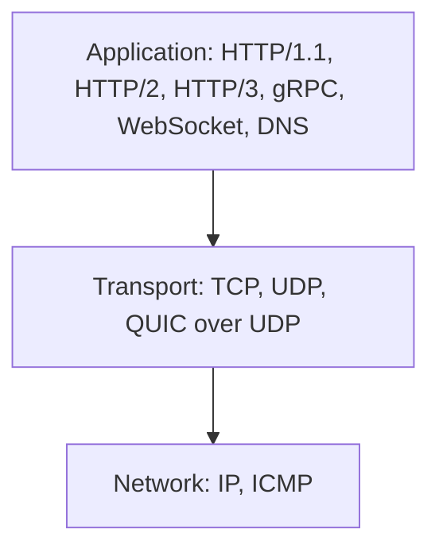

# Chương 8. Giao tiếp và thiết kế API: HTTP, TCP, UDP, QUIC, RPC, REST

> Cập nhật: 2026-11-07.

## 8.1 Bản đồ các layer



Điểm hay nhầm:
- **HTTP/1.1** (RFC 9112) và **HTTP/2** (RFC 9113) chạy trên **TCP**.
- **HTTP/3** (RFC 9114) chạy trên **QUIC** (RFC 9000), và QUIC chạy trên **UDP**.
- **ping dùng ICMP** (Echo Request/Reply) ở network layer, *không* dùng UDP hay TCP.
- **Video VOD (HLS, MPEG-DASH)** chủ yếu truyền bằng HTTP. UDP dùng cho real-time stream (RTP, WebRTC, gọi video), DNS truyền thống, và QUIC.

## 8.2 TCP: reliable connection

TCP (cập nhật bởi **RFC 9293**, thay RFC 793) cung cấp byte stream có thứ tự, tin cậy:
- **3-way handshake** (SYN, SYN-ACK, ACK) trước khi truyền dữ liệu, tốn 1 RTT.
- **Sequence number và cumulative ACK**: ACK mang số X nghĩa là *mọi byte trước X đã nhận đủ*. Packet bị mất làm sender dừng ở chỗ đó cho đến khi receiver có đủ; có thêm SACK để báo nhận các đoạn rời rạc.
- **Retransmission** khi timeout hoặc nhận duplicate ACK.
- **Flow control**: bảo vệ *receiver*. Receiver advertise **receive window** (còn bao nhiêu byte nhận được), sender không gửi quá mức đó.
- **Congestion control**: bảo vệ *mạng*. Sender tự duy trì **congestion window**, tăng dần (slow start rồi tăng linear) và giảm mạnh khi phát hiện packet loss (các thuật toán như CUBIC, BBR; RFC 5681 mô tả cơ bản). Lượng gửi thực tế bị giới hạn bởi *giá trị nhỏ hơn* của hai window.

Hai cơ chế này khác nhau về mục đích và cách thực hiện; đừng gọi chung là "flow control".

**Hệ quả thiết kế**: mỗi connection mới tốn RTT (cộng thêm TLS), nên dùng **connection pooling/keep-alive**. **Head-of-line blocking** ở TCP: mất một packet làm chậm mọi stream ghép trong cùng connection (ảnh hưởng HTTP/2).

## 8.3 UDP và QUIC

**UDP**: gửi datagram connectionless, không bảo đảm đến nơi, không in-order, không có congestion control. Ưu: latency thấp, không handshake, hợp *dữ liệu hết hạn nhanh* (khung hình video đang gọi, vị trí game, voice) khi thà bỏ còn hơn chờ retransmit. DNS dùng UDP cho query nhỏ.

**QUIC** xây reliability, congestion control, **TLS 1.3 encryption tích hợp** trên UDP: handshake nhanh hơn (gộp transport và TLS handshake), nhiều stream độc lập (packet loss ở stream này không chặn stream kia), connection sống sót khi đổi mạng (Wi-Fi → 4G) nhờ connection ID. HTTP/3 = HTTP trên QUIC. Hạn chế: một số mạng chặn/hạn chế UDP nên client có cơ chế fallback về HTTP/2 qua TCP.

| | HTTP/1.1 | HTTP/2 | HTTP/3 |
|---|---|---|---|
| Transport | TCP | TCP | QUIC (UDP) |
| Multiplexing | Không (nhiều connection) | Có | Có, độc lập từng stream |
| Head-of-line | Có (ở mức request) | Có (ở mức TCP) | Không giữa các stream |

## 8.4 RPC và gRPC

**RPC (Remote Procedure Call)**: gọi hàm ở máy khác như hàm cục bộ. **gRPC** dùng HTTP/2 + Protocol Buffers (binary, có schema, sinh code client/server), hỗ trợ bidirectional streaming. Ưu: hiệu quả, strongly typed contract, phù hợp gọi *giữa các service nội bộ*. Nhược: khó gọi trực tiếp từ browser (cần gRPC-Web), khó đọc/debug thủ công, thay đổi schema cần kỷ luật backward compatibility.

**Cảnh báo**: RPC che giấu mạng, nhưng mạng vẫn có lỗi; mỗi call cần **timeout**, retry có kiểm soát, và xử lý partial failure (chương 9).

## 8.5 REST

REST là phong cách thiết kế API quanh **resource** và các HTTP method.

- URL là danh từ: `GET /orders/42`, `POST /orders`, `DELETE /orders/42`.
- Method semantics tuân theo RFC 9110.
- **Stateless**: mỗi request mang đủ thông tin (authentication token), server không giữ session giữa các request.
- Representation thường là JSON; dùng status code đúng nghĩa.
- Có thể cache (GET + `Cache-Control`/`ETag`).

**Pagination**: *offset* (`?page=3&size=20`) đơn giản nhưng chậm khi offset lớn và dễ lệch khi dữ liệu thay đổi; *cursor/keyset* (`?after=<cursor>`) ổn định và nhanh, dùng cho timeline lớn.

**Versioning**: `/v1/...` hoặc header; thay đổi *backward compatibility* (thêm field tùy chọn) không cần tăng version.

**GraphQL** cho client tự chọn field, giảm over/under-fetching, đổi lại khó cache/limit query cost hơn REST.

**Real-time**: *WebSocket* (bidirectional, connection dài), *Server-Sent Events* (server → client, one-way, trên HTTP), *long polling* (fallback).

## 8.6 Method: safe và idempotent (theo RFC 9110)

- **Safe**: không nhằm thay đổi state server: **GET, HEAD, OPTIONS, TRACE**.
- **Idempotent**: gửi N lần cho effect *trên server* giống gửi 1 lần: **GET, HEAD, OPTIONS, TRACE, PUT, DELETE**. Mọi method safe đều idempotent; ngược lại không đúng (PUT, DELETE idempotent nhưng không safe).
- **POST** và **PATCH** không idempotent theo mặc định.

Chú ý:
- *Idempotency* (lũy đẳng, không phải "bất biến") nói về *state effect*, không phải phản hồi: `DELETE /orders/42` lần đầu trả 204, lần hai có thể trả 404, state cuối vẫn giống nhau.
- Idempotent là thuộc tính *ngữ nghĩa mà server phải thực hiện đúng*; một handler PUT cài đặt sai (ví dụ cộng dồn) mất tính chất này.
- Tính idempotent quyết định **method nào được retry tự động** (client, proxy, SDK).

**Làm POST an toàn để retry**: dùng **Idempotency-Key**. Client sinh UUID cho mỗi *logical operation* và gửi trong header `Idempotency-Key`; server lưu (key → kết quả) trong một khoảng thời gian; request trùng key trả lại kết quả cũ thay vì thực hiện lại; cùng key nhưng nội dung khác thì từ chối. Đã có nhiều API lớn dùng cách này (ví dụ payment gateway, DynamoDB `ClientRequestToken` hết hạn sau 10 phút). Đề xuất chuẩn hóa là một Internet-Draft của IETF httpapi (bản mới nhất tôi tra là draft-07, 10/2025, chưa phải RFC), nên nói "thực hành phổ biến", đừng nói "chuẩn RFC".

```sql
-- server: lưu key trong cùng transaction với side effect
INSERT INTO idempotency(key, request_hash, response) VALUES (:k, :h, NULL);
-- duplicate key => trả response đã lưu (hoặc 409/422 nếu request_hash khác)
```

## 8.7 Bảng HTTP status code thường gặp

| Mã | Tên | Dùng khi |
|---|---|---|
| 200 | OK | Thành công, có response body |
| 201 | Created | Tạo resource; kèm `Location` |
| 202 | Accepted | Đã nhận, xử lý async (trả về job id) |
| 204 | No Content | Thành công, không có body (thường cho DELETE/PUT) |
| 301 / 308 | Moved Permanently / Permanent Redirect | Chuyển vĩnh viễn (308 giữ nguyên method) |
| 302 / 307 | Found / Temporary Redirect | Chuyển tạm thời (307 giữ method) |
| 304 | Not Modified | Cache còn hợp lệ (điều kiện `If-None-Match`) |
| 400 | Bad Request | Request sai cú pháp/không hợp lệ |
| 401 | Unauthorized | Chưa authenticate / token sai (thật ra là "unauthenticated") |
| 403 | Forbidden | Đã authenticate nhưng không đủ permission |
| 404 | Not Found | Không có resource |
| 405 | Method Not Allowed | Method không được hỗ trợ trên URL |
| 409 | Conflict | State conflict (ví dụ version không khớp, duplicate key) |
| 412 | Precondition Failed | `If-Match` không khớp (optimistic locking qua ETag) |
| 422 | Unprocessable Content | Cú pháp đúng nhưng ngữ nghĩa/validate sai |
| 429 | Too Many Requests | Bị rate limit; kèm `Retry-After` |
| 500 | Internal Server Error | Lỗi không lường trước ở server |
| 502 | Bad Gateway | Proxy/gateway nhận phản hồi sai từ upstream |
| 503 | Service Unavailable | Quá tải/bảo trì; có thể kèm `Retry-After` |
| 504 | Gateway Timeout | Gateway chờ upstream quá lâu |

Quy tắc retry: 4xx (trừ 408, 429) là lỗi của client, **không** retry; 5xx (đặc biệt 502, 503, 504) và 429 có thể retry *nếu method idempotent hoặc có idempotency key*, kèm backoff + jitter (chương 9). Với lỗi, nên dùng định dạng chuẩn (Problem Details, RFC 9457).

## 8.8 Ví dụ thiết kế: API tạo thanh toán

`POST /payments` + `Idempotency-Key: 7c1f...`. Server (1) tra key; (2) nếu chưa có, ghi key status `in_progress` và gọi nhà cung cấp; (3) lưu kết quả; (4) trả 201. Client timeout nên gửi lại *cùng key*, sẽ nhận kết quả cũ hoặc 409 nếu đang xử lý. Không có key → người dùng có thể bị trừ tiền hai lần. Trade-off: phải lưu key (TTL 24 giờ chẳng hạn) và xử lý race khi hai request cùng key đến đồng thời (dùng constraint unique).

## 8.9 Khi phỏng vấn nên nói gì

- "Giữa service nội bộ em dùng gRPC cho hiệu năng; API công khai em dùng REST/JSON vì dễ tích hợp và cache."
- "Em retry GET/PUT/DELETE tự động; POST chỉ retry khi có idempotency key."
- "Thông báo realtime em dùng WebSocket; nếu chỉ server → client thì SSE đơn giản hơn."
- "Em pagination bằng cursor để ổn định và nhanh khi dữ liệu lớn."
- "HTTP/3 chạy trên QUIC/UDP, giảm head-of-line blocking và setup time, nhất là trên mạng di động."

## 8.10 Cạm bẫy

- Nói HTTP/2 chạy trên UDP; hoặc ping dùng UDP; hoặc VOD streaming dùng UDP.
- Gộp flow control và congestion control làm một; hoặc coi ACK là từng packet riêng (nó là cumulative).
- Dịch idempotent là "bất biến".
- Cho rằng POST luôn không retry được, hoặc PUT luôn an toàn dù handler cộng dồn.
- Trả 200 kèm lỗi trong body; dùng 500 cho lỗi của client.
- Dùng 401 và 403 lẫn lộn.
- Dùng offset pagination cho feed hàng triệu record.

## 8.11 Tóm tắt

1. HTTP/1.1, HTTP/2 → TCP; HTTP/3 → QUIC trên UDP; ping → ICMP.
2. TCP có cumulative ACK; flow control (receiver) khác congestion control (mạng).
3. gRPC cho nội bộ; REST cho công khai; chọn theo người dùng API.
4. Safe: GET, HEAD, OPTIONS, TRACE. Idempotent: thêm PUT, DELETE. POST dùng Idempotency-Key.
5. Dùng đúng status code; chỉ retry khi an toàn.

## 8.12 Câu hỏi tự kiểm tra

1. Giao thức nào phía dưới HTTP/1.1, HTTP/2, HTTP/3?
2. Phân biệt flow control và congestion control.
3. Vì sao DELETE được coi là idempotent dù lần hai trả 404?
4. Làm sao cho phép client retry `POST /payments` an toàn?
5. 401 và 403 khác nhau thế nào? Khi nào dùng 409, 412, 429?

<details>
<summary>Đáp án</summary>

1. HTTP/1.1 và HTTP/2: TCP. HTTP/3: QUIC, chạy trên UDP.
2. Flow control: receiver giới hạn sender bằng receive window để không tràn buffer. Congestion control: sender tự giới hạn bằng congestion window để không làm tắc mạng; gửi tối đa theo giá trị nhỏ hơn của hai window.
3. Idempotency xét effect lên state server: sau 1 hay N lần DELETE, resource đều đã bị xóa. Mã phản hồi có thể khác nhau.
4. Client gửi `Idempotency-Key` duy nhất cho mỗi operation; server lưu key và kết quả (constraint unique); request trùng key trả kết quả cũ; khác nội dung thì từ chối.
5. 401: chưa authenticate/credential sai; 403: biết bạn là ai nhưng không đủ quyền. 409: state conflict (duplicate, version lệch); 412: precondition (`If-Match`) sai; 429: vượt rate limit.

</details>

## Nguồn đã tra

- RFC 9293 (TCP): https://www.rfc-editor.org/rfc/rfc9293.html
- RFC 9110 (HTTP Semantics, safe và idempotent): https://www.rfc-editor.org/rfc/rfc9110.html (đối chiếu qua nguồn thứ cấp trong phiên này; xem điểm chưa chắc)
- IETF draft Idempotency-Key: https://datatracker.ietf.org/doc/draft-ietf-httpapi-idempotency-key-header/
- DynamoDB ClientRequestToken: https://docs.aws.amazon.com/amazondynamodb/latest/developerguide/transaction-apis.html
- Số hiệu RFC của HTTP/1.1 (9112), HTTP/2 (9113), HTTP/3 (9114), QUIC (9000), 429 (6585), Problem Details (9457): kiến thức chuẩn, chưa tra lại từng trang trong phiên này.
