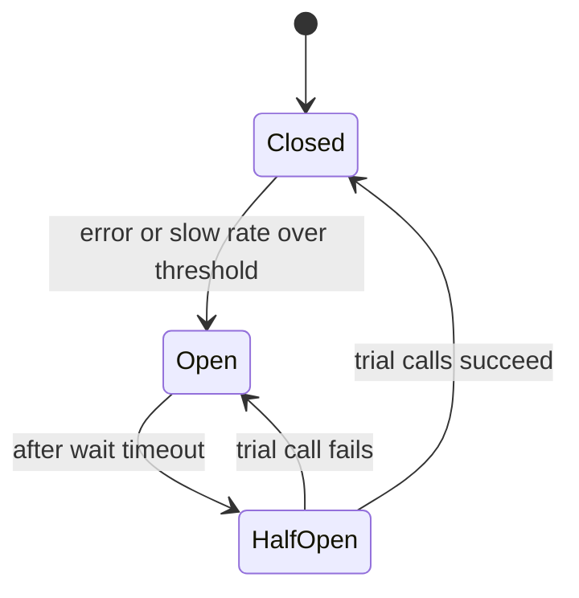

# Chương 9. Fault tolerance và recovery: retry, circuit breaker, rate limiting, HA

> Cập nhật: 2026-11-07.

## 9.1 Lỗi là chuyện bình thường

Ở quy mô lớn, *luôn có thứ gì đó đang hỏng*. Các loại failure hay gặp:

- **Hỏng node/disk/rack/AZ**; mất điện, lỗi cấu hình deployment.
- **Network partition**, mất gói, latency tăng vọt; DNS lỗi.
- **Partial failure**: dịch vụ chậm chứ không chết, khó phát hiện hơn chết hẳn.
- **Quá tải** (lượng truy cập tăng, retry storm), **cạn resource** (thread, connection, memory).
- **Lỗi con người và lỗi phần mềm**: deploy xấu, dữ liệu hỏng lan rộng. Redundancy không chống được bug đồng nhất ở mọi replica.
- **Cascading failure**: một dịch vụ chậm làm các dịch vụ gọi nó cạn thread, rồi lan ngược lên.

Mục tiêu thiết kế: **phát hiện nhanh, giới hạn blast radius, graceful degradation, recovery nhanh (MTTR thấp)**.

## 9.2 Timeout: nền móng

Mọi call qua mạng phải có **timeout** (connect và read). Không timeout = thread bị treo vô hạn = cascading failure. Đặt timeout dựa trên latency percentile cao của dịch vụ đích (ví dụ cao hơn p99 một chút), không đặt "30 giây cho chắc". Truyền **deadline** xuyên suốt call chain để layer dưới biết còn bao nhiêu thời gian, tránh làm việc cho một request mà người gọi đã bỏ.

## 9.3 Retry với exponential backoff và jitter

Retry giúp vượt lỗi tạm thời, nhưng retry bừa bãi biến failure nhỏ thành outage.

**Exponential backoff**: thời gian chờ tăng theo cấp số nhân: `wait = min(cap, base × 2^attempt)`. Ví dụ base = 100 ms, cap = 20 s: các lần chờ tối đa 100, 200, 400, 800, 1.600 ms…

**Jitter**: nếu mọi client đều chờ cùng thời gian, họ sẽ đập lại *cùng lúc* (synchronized). Thêm ngẫu nhiên để rải đều. Công thức **full jitter** phổ biến:

`sleep = random(0, min(cap, base × 2^attempt))`

(Biến thể *equal jitter* giữ một nửa cố định cộng một nửa ngẫu nhiên; *decorrelated jitter* dùng giá trị chờ trước đó.)

```text
for attempt in 0..maxAttempts-1:
    result = call()
    if ok(result): return result
    if not retryable(result) or deadlineExceeded(): fail
    sleep(random(0, min(cap, base * 2**attempt)))
fail
```

**Quy tắc vàng** (theo AWS Builders' Library):
1. **Chỉ retry operation idempotent** hoặc có idempotency key (chương 8).
2. **Chỉ retry lỗi retryable**: timeout, 502/503/504, 429 (tôn trọng `Retry-After`). Không retry 400/401/403/404.
3. **Giới hạn số lần** và tổng thời gian (deadline).
4. **Retry ở một layer duy nhất**. Nếu 3 layer, mỗi layer thử tối đa 3 lần, thì layer dưới cùng có thể nhận `3 × 3 × 3 = 27` lần load (**retry amplification**).
5. **Retry budget** bằng token bucket (ví dụ chỉ cho phép retry bằng 10% traffic bình thường) để khi dịch vụ đích sập, client không nhân load lên nhiều lần.
6. Dừng retry khi dependency đang unhealthy (kết hợp circuit breaker).

## 9.4 Circuit breaker

Khi dịch vụ đích liên tục lỗi, tiếp tục gọi chỉ lãng phí resource và làm nó khó hồi phục. **Circuit breaker** bọc call và có 3 state:



- **Closed**: cho gọi bình thường, đếm lỗi trong một window.
- **Open**: *từ chối ngay* (fail fast) hoặc trả fallback value mà không gọi đích.
- **Half-open**: sau một khoảng, cho vài trial call; thành công thì close lại, thất bại thì open tiếp.

Tham số: threshold lỗi (ví dụ 50% trong 20 call gần nhất), window size, thời gian giữ open, số trial call. Thư viện phổ biến: Resilience4j (Java), Polly (.NET), hoặc ở infrastructure layer (service mesh/Envoy outlier detection).

**Fallback**: trả dữ liệu cache cũ, giá trị mặc định, hoặc ẩn một tính năng ("gợi ý" trống) thay vì lỗi cả trang.

**Bulkhead**: tách thread/connection pool riêng cho từng dependency, để một dependency chậm không cạn resource của toàn dịch vụ.

## 9.5 Rate limiting

Bảo vệ hệ thống khỏi quá tải, lạm dụng, noisy neighbor và fair sharing. Thường đặt ở API gateway, theo user, API key hoặc IP; vượt giới hạn trả **429 Too Many Requests** kèm `Retry-After`.

| Thuật toán | Ý tưởng | Ưu | Nhược |
|---|---|---|---|
| **Token bucket** | Bucket chứa tối đa `b` token, nạp `r` token/giây; mỗi request lấy 1 | Cho phép burst tới `b`, tốc độ trung bình `r`; rất phổ biến | Cần tinh chỉnh `b`, `r` |
| **Leaky bucket** | Request vào queue, xử lý ra với tốc độ cố định | Smooth output | Burst bị trễ/đổ; queue có thể đầy |
| **Fixed window** | Đếm theo window cố định (mỗi phút) | Đơn giản, ít bộ nhớ | **Burst ở window boundary**: 100 request ở giây 59 và 100 ở giây 0 kế tiếp = 200 trong 2 giây |
| **Sliding window log** | Lưu timestamp từng request trong window trượt | Chính xác | Tốn bộ nhớ |
| **Sliding window counter** | Nội suy giữa window hiện tại và trước | Xấp xỉ tốt, nhẹ | Không tuyệt đối chính xác |

**Distributed rate limiting**: nhiều node gateway phải dùng chung counter, thường lưu ở Redis/Valkey, thực hiện *atomic* bằng script Lua hoặc lệnh `INCR` + `EXPIRE`. Đánh đổi: mỗi request thêm một vòng mạng tới Redis; có thể dùng local counter + sync định kỳ (xấp xỉ, nhanh hơn) nếu chấp nhận sai số nhỏ. Quyết định khi Redis chết: *fail-open* (cho qua, ưu tiên availability) hay *fail-closed* (chặn, ưu tiên bảo vệ).

Ví dụ: API công khai cho phép 100 request/phút/key, burst 20. Token bucket `b=20`, `r=100/60≈1,67/giây`.

**Load shedding**: khi quá tải, chủ động *bỏ* request ít quan trọng (hoặc từ chối sớm bằng 503) để giữ chất lượng cho phần còn lại, thay vì để tất cả chậm dần rồi chết.

## 9.6 High Availability và Fault Tolerance

| | High Availability (HA) | Fault Tolerance (FT) |
|---|---|---|
| Mục tiêu | Giảm downtime, recovery nhanh | Tiếp tục hoạt động *không gián đoạn* khi có lỗi |
| Cách | Redundancy + failover tự động (có thể có vài giây gián đoạn) | Active redundancy chạy song song, không có điểm chuyển |
| Chi phí | Vừa | Cao (nhân đôi resource, phức tạp) |
| Ví dụ | Primary–replica có failover; multi-AZ | Máy chủ phần cứng lockstep; hệ multi-writer với quorum |

HA nhắm vào *tỉ lệ uptime* (số 9); FT nhắm vào *không có gián đoạn nhìn thấy*. Hầu hết hệ phần mềm chọn HA có chi phí hợp lý, cộng thêm cơ chế FT cho phần đặc biệt quan trọng.

**Các mức redundancy**: nhiều instance → nhiều **AZ** (Availability Zone) → nhiều **Region**. Mỗi bước tăng availability và chi phí/phức tạp (sync dữ liệu cross-region: xem PACELC ở chương 4). Mẫu: *active-passive* (standby), *active-active* (cùng phục vụ; phải giải quyết write conflict).

**Health check**: deep health check (kiểm tra cả dependency) có nguy cơ làm toàn bộ fleet bị rút khỏi LB khi một dependency chung lỗi; nên phân biệt *liveness* và *readiness*.

## 9.7 Backup và disaster recovery

- **RPO** (Recovery Point Objective): chấp nhận mất tối đa bao nhiêu dữ liệu (tính bằng thời gian). Sync replication cho RPO ≈ 0; backup hằng đêm cho RPO ≈ 24 giờ.
- **RTO** (Recovery Time Objective): chấp nhận gián đoạn tối đa bao lâu.
- Chiến lược DR: *backup & restore* (rẻ, RTO dài), *pilot light*, *warm standby*, *multi-site active-active* (đắt, RTO ≈ 0).
- **Replication không thay backup**: xóa nhầm hoặc hỏng logic lan sang mọi replica. Cần backup có versioning/point-in-time và **restore test định kỳ** (backup chưa từng restore thử là chưa có backup).
- **Chaos engineering / game day**: chủ động gây lỗi (tắt instance, thêm latency) để kiểm chứng giả định fault tolerance.

## 9.8 Đánh giá: uptime, SLA, MTTR, MTBF

- Availability `= MTBF/(MTBF+MTTR)` (chương 2). Mục tiêu 99,99% ≈ 52,56 phút/năm; một incident mất 1 giờ đã vượt error budget cả năm.
- **Error budget** `= 1 − SLO`: SLO 99,9% trong 30 ngày cho phép 43,2 phút lỗi; dùng để cân đối tốc độ ra tính năng và stability.
- Phân biệt **SLA** (hợp đồng, có bồi thường), **SLO** (mục tiêu nội bộ), **SLI** (số đo). Đặt SLO của mình *chặt hơn* SLA đưa cho khách hàng.
- Số 9 của hệ thống bị giới hạn bởi *dependency yếu nhất nối tiếp*: nếu dịch vụ của bạn gọi nhà cung cấp 99,9% một cách bắt buộc, bạn không thể cam kết 99,99% trừ khi có cơ chế redundancy/degrade.

## 9.9 Ví dụ thiết kế: trang kết quả tìm kiếm phụ thuộc 3 dịch vụ

Trang cần: kết quả chính (bắt buộc), gợi ý (phụ), giá khuyến mãi (phụ). Thiết kế: timeout 300 ms cho dịch vụ phụ, parallel; circuit breaker + fallback "không hiển thị gợi ý" khi dịch vụ gợi ý lỗi; bulkhead tách pool; retry tối đa 1 lần với jitter cho dịch vụ chính nếu `GET` (idempotent); rate limit theo người dùng; hạ layer nhiều AZ. Kết quả: lỗi ở dịch vụ phụ chỉ làm trang kém phong phú chứ không sập.

## 9.10 Khi phỏng vấn nên nói gì

- "Mọi call có timeout; retry tối đa 3 lần, exponential backoff với full jitter, chỉ cho operation idempotent, ở một layer."
- "Em đặt circuit breaker và fallback cho dependency không thiết yếu để tránh cascading failure."
- "Rate limit bằng token bucket ở gateway, lưu counter trong Redis; khi Redis lỗi em chọn fail-open vì ưu tiên availability cho API đọc."
- "Mục tiêu RPO ≈ 0, RTO vài phút: sync replication trong region, async sang region khác, có runbook failover và diễn tập định kỳ."

## 9.11 Cạm bẫy

- Retry không giới hạn, không backoff, không jitter.
- Retry ở mọi layer gây retry amplification.
- Retry operation không idempotent (trừ tiền hai lần).
- Không timeout hoặc timeout quá dài.
- Circuit breaker không có fallback hoặc ngưỡng sai gây flapping.
- Coi replication là backup.
- Health check sâu làm sập cả fleet.
- Nhầm HA với FT.

## 9.12 Tóm tắt

1. Timeout bắt buộc; retry = backoff + jitter + giới hạn + idempotent + một layer.
2. Circuit breaker (closed/open/half-open), fallback và bulkhead chống cascading failure.
3. Rate limiting: token bucket phổ biến; phân tán cần counter dùng chung (Redis) và chính sách fail-open/closed.
4. HA giảm thời gian ngưng, FT không gián đoạn; chọn theo chi phí và yêu cầu.
5. Định nghĩa RPO/RTO/SLO/error budget và restore test thực tế.

## 9.13 Câu hỏi tự kiểm tra

1. Tại sao phải thêm jitter vào exponential backoff?
2. Ba layer gọi nhau, mỗi layer thử tối đa 3 lần. Tải tối đa lên layer thấp nhất?
3. Mô tả ba state của circuit breaker.
4. Fixed window có nhược điểm gì mà token bucket tránh được?
5. Phân biệt RPO và RTO.

<details>
<summary>Đáp án</summary>

1. Để các client không synchronize và đập lại cùng lúc (thundering herd); jitter rải đều thời điểm retry.
2. `3 × 3 × 3 = 27` lần.
3. Closed (cho qua, đếm lỗi), Open (từ chối ngay/fallback trong một thời gian), Half-open (cho vài call thử rồi đóng hoặc mở lại).
4. Burst ở biên window có thể gấp đôi giới hạn; token bucket quản lý burst bằng capacity của bucket và tốc độ nạp liên tục.
5. RPO: mức mất dữ liệu tối đa chấp nhận được (theo thời gian). RTO: thời gian gián đoạn tối đa chấp nhận được.

</details>

## Nguồn đã tra

- AWS Builders' Library, "Timeouts, retries and backoff with jitter": https://builder.aws.com/content/3EumjoZascWd1oZiEgL8ORlv3qE/timeouts-retries-and-backoff-with-jitter
- SLA/design availability: xem chương 2.
- Các thuật toán rate limiting, circuit breaker, RPO/RTO: khái niệm tiêu chuẩn, trình bày bằng lời của người viết, không gắn với số liệu sản phẩm.
