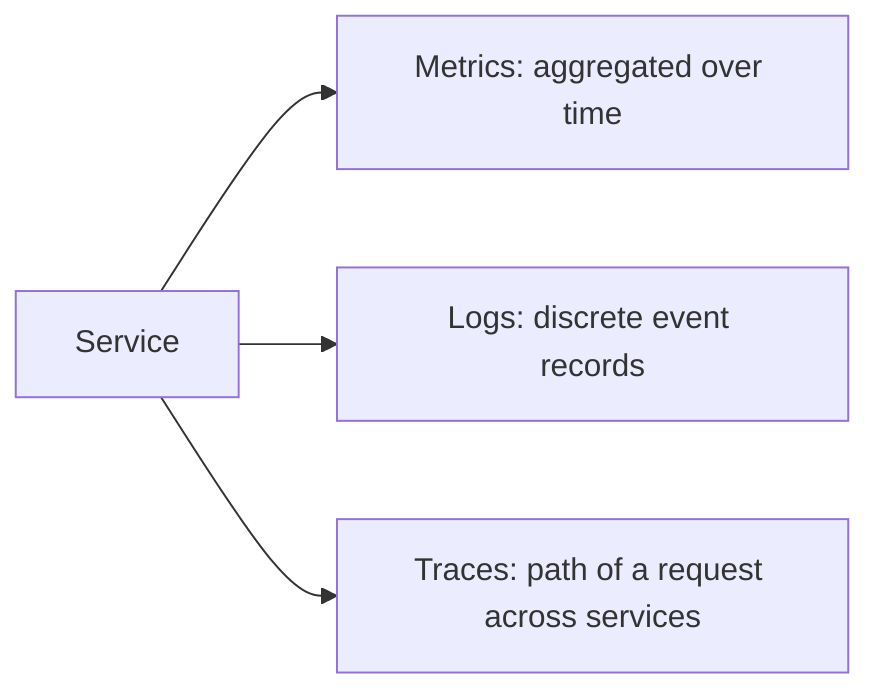
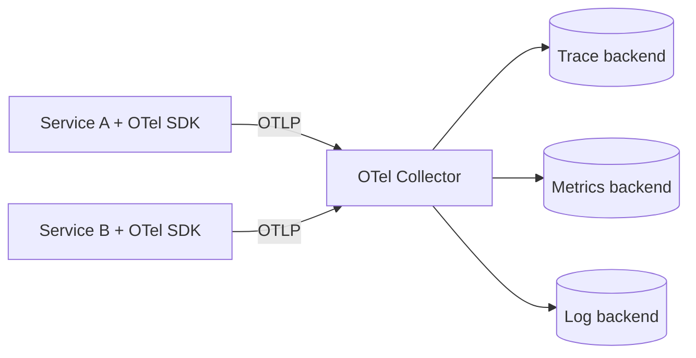

# Chương 11. Monitoring và Observability (kèm OpenTelemetry)

> Cập nhật: 2026-11-07.

## 11.1 Monitoring và observability khác nhau thế nào?

- **Monitoring**: theo dõi các metric và threshold *đã biết trước* để biết "có gì hỏng không" (CPU > 90%, tỉ lệ lỗi > 1%). Trả lời câu hỏi bạn đã nghĩ ra từ trước.
- **Observability**: khả năng suy ra internal state của hệ thống từ dữ liệu telemetry nó phát ra, để trả lời cả những câu hỏi *chưa nghĩ tới* ("vì sao riêng khách hàng ở region X dùng Android 14 bị chậm?"). Cần dữ liệu giàu ngữ cảnh (high-dimensional, high cardinality), có thể trace xuyên service.

Monitoring là một phần của observability; hệ phân tán nhiều service cần cả hai.

## 11.2 Ba loại signal

| Signal | Là gì | Mạnh ở | Yếu ở |
|---|---|---|---|
| **Metrics** | Con số theo thời gian (counter, gauge, histogram) | Rẻ, alerting, trend, dashboard | Mất chi tiết từng request |
| **Logs** | Record văn bản/JSON của từng event | Chi tiết ngữ cảnh khi debug | Tốn storage; khó aggregate nếu không có cấu trúc |
| **Traces** | Chuỗi **span** (mỗi span = một đoạn công việc, có thời gian, attribute) nối bằng *trace ID* | Thấy request chậm ở service nào | Cần context propagation; thường sampling |

Quy tắc thực hành:
- **Structured log (JSON)**, kèm `trace_id`, `request_id`, level, `service`, để nối log với trace.
- Không ghi dữ liệu nhạy cảm (mật khẩu, token, số thẻ) vào log.
- Với metric, tránh label có *cardinality* cực cao (user ID làm label) vì phình chi phí; dữ liệu theo từng user thuộc về log/trace.

## 11.3 Metric nên đo

- **Bốn Golden Signals (sách SRE của Google)**: *latency*, *traffic*, *errors*, *saturation*.
- **RED** (cho service): Rate, Errors, Duration.
- **USE** (cho resource như CPU, disk, network): Utilization, Saturation, Errors.
- Dùng **percentile** từ histogram (p50, p95, p99), không dùng trung bình (chương 2).
- Business metric: số đơn/phút, tỉ lệ thanh toán thành công; thường báo trước lỗi kỹ thuật.
- Với queue: depth, tuổi message cũ nhất, consumer lag (chương 7).

## 11.4 SLI, SLO, alerting

- **SLI**: ví dụ "tỉ lệ request trả status < 500 trong 300 ms". **SLO**: "99,9% trong 30 ngày" → **error budget** 0,1% = 43,2 phút/tháng.
- **Alert theo symptom, không theo cause**: báo khi người dùng bị ảnh hưởng (error rate, latency), không báo mọi lúc CPU cao.
- **Burn-rate alert**: alert khi đang tiêu error budget quá nhanh (ví dụ tốc độ tiêu gấp 14 lần sustainable rate trong 1 giờ), giảm false alarm so với static threshold.
- Mỗi alert phải *có hành động và runbook*; tránh alert fatigue. Phân biệt page (on-call) và ticket (xử lý giờ hành chính).
- Đo từ góc nhìn người dùng: **synthetic monitoring** và RUM (real user monitoring) bổ sung cho metric phía server. *Dashboard* cho từng dịch vụ: golden signals ở trên cùng.

## 11.5 Distributed tracing và context propagation

Một request đi qua gateway → service A → service B → DB. Mỗi bước tạo một **span**; chúng chia sẻ **trace ID**; thông tin này đi kèm các request (ví dụ qua header W3C `traceparent`). Nhờ vậy dựng lại được call tree và biết 300 ms mất ở đâu.

**Sampling**: không thể lưu 100% trace ở quy mô lớn. *Head-based* (quyết định ở đầu, rẻ, có thể bỏ mất trace lỗi hiếm) và *tail-based* (quyết định sau khi trace hoàn tất, giữ lại trace lỗi/chậm, cần buffer ở Collector).

## 11.6 OpenTelemetry (OTel): chuẩn hiện nay

**OpenTelemetry** là dự án open source của CNCF, cung cấp API/SDK, data format và protocol chung (**OTLP**) cho traces, metrics, logs, **vendor-neutral**. Ý tưởng: gắn instrumentation *một lần* bằng OTel, rồi gửi tới backend nào cũng được (Jaeger, Tempo, Prometheus-tương thích, Datadog, Grafana Cloud…) mà không phải đổi code.

Trạng thái theo trang chính thức (tra 2026-11-07):

| Signal | API | SDK | OTLP |
|---|---|---|---|
| Traces | Stable | Stable | Stable |
| Metrics | Stable | Mixed (tùy ngôn ngữ) | Stable |
| Logs | Stable (Bridge API) | Stable | Stable |
| Baggage | Stable | Stable | — |
| Profiles | — | — | **Development** (chưa ổn định) |

Thành phần: *instrumentation* (tự động hoặc thủ công), *SDK*, và **OpenTelemetry Collector** (process nhận, xử lý, sampling, export dữ liệu tới backend; tách logic đưa dữ liệu ra khỏi ứng dụng).

Hệ sinh thái: **Jaeger v2** (phát hành 2024-11) được xây trên nền OpenTelemetry Collector; sách và tài liệu cũ nhắc Jaeger v1 và các client riêng của Jaeger đã lỗi thời (nguồn thứ cấp nói v1 end of life cuối 2025; hãy kiểm tra trang Jaeger). **Grafana Tempo** (backend trace), **Prometheus** (metrics), **Loki** (logs) là các lựa chọn open source thường kết hợp với OTel.

### Về Lightstep và các công cụ cũ

Tài liệu cũ hay nhắc **Lightstep**. Tình trạng hiện tại: Lightstep được ServiceNow mua năm 2021, đổi tên **ServiceNow Cloud Observability** (2023), và **đã công bố end of life**: thông báo ngày 2025-08-25, hỗ trợ kết thúc **2026-03-01** hoặc hết hợp đồng, tùy mốc nào muộn hơn; ServiceNow nói sẽ không có sản phẩm thay thế tương đương và không có đường chuyển đổi trực tiếp. Bài học: **đừng bị lock-in vào API riêng của một nhà cung cấp**; dùng instrumentation chuẩn OTel để dễ đổi backend. Tương tự, OpenTracing và OpenCensus đã được hợp nhất vào OpenTelemetry.

## 11.7 Quy trình debug mẫu

Alert "tỉ lệ lỗi checkout 5%" → xem dashboard golden signals → lọc theo version/region → mở một trace lỗi mẫu để thấy span thanh toán timeout → nhảy tới log cùng `trace_id` ở dịch vụ thanh toán → thấy cạn connection pool → rollback/khắc phục → viết blameless postmortem và thêm alert/SLO.

## 11.8 Đánh đổi

| Quyết định | Được | Mất |
|---|---|---|
| Sampling trace 1% | Chi phí thấp | Có thể bỏ lỡ trace hiếm; dùng tail sampling cho lỗi |
| Log nhiều | Chi tiết khi debug | Tốn tiền, rủi ro lộ dữ liệu |
| Label metric nhiều chiều | Slicing linh hoạt | Cardinality bùng nổ làm đắt/chậm backend |
| Self-host backend | Kiểm soát, rẻ ở quy mô lớn | Công sức vận hành |
| Dùng SaaS | Nhanh, ít vận hành | Chi phí theo lượng dữ liệu, rủi ro nhà cung cấp (xem Lightstep) |

## 11.9 Khi phỏng vấn nên nói gì

- "Em đo bốn golden signals cho mỗi service, alert theo SLO bằng burn-rate, không theo CPU."
- "Em instrument bằng OpenTelemetry và gửi OTLP tới Collector; nhờ vậy backend (trace/metric/log) thay đổi được mà không sửa code."
- "Log JSON có trace_id để nối với trace; trace lấy mẫu, giữ lại 100% trace lỗi bằng tail sampling."
- "Em đặt SLO 99,9% cho checkout, error budget 43 phút mỗi tháng quyết định có tiếp tục ra tính năng không."

## 11.10 Cạm bẫy

- Chỉ monitoring CPU/RAM mà không monitoring trải nghiệm người dùng.
- Báo trung bình latency thay vì percentile.
- Quá nhiều alert, không runbook (alert fatigue).
- Label metric theo user ID.
- Không có trace/request ID xuyên suốt.
- Bị vendor lock-in; nhắc tới Lightstep như sản phẩm đang bán.
- Ghi dữ liệu nhạy cảm vào log.
- Coi OTel profiles là ổn định (hiện còn development).

## 11.11 Tóm tắt

1. Monitoring trả lời câu hỏi đã biết; observability cho phép hỏi câu mới.
2. Ba signal: metrics, logs, traces; nối bằng trace ID.
3. Đo golden signals/RED/USE, dùng percentile, alert theo SLO.
4. OpenTelemetry (OTLP, Collector) là chuẩn trung lập; traces/metrics/logs đã stable, profiles còn development.
5. Lightstep/ServiceNow Cloud Observability đã ngừng; tránh vendor lock-in.

## 11.12 Câu hỏi tự kiểm tra

1. Khác biệt monitoring và observability?
2. Nêu bốn golden signals.
3. Trace ID giúp gì khi debug microservice?
4. Vì sao nên alert bằng burn rate của SLO thay vì ngưỡng CPU?
5. Lợi ích của OpenTelemetry Collector là gì?

Đáp án

1. Monitoring theo dõi metric và threshold định sẵn; observability cho phép khám phá nguyên nhân những vấn đề chưa lường trước từ telemetry giàu ngữ cảnh.
2. Latency, traffic, errors, saturation.
3. Nối các span và log của cùng một request qua nhiều service, thấy bước nào chậm hoặc lỗi.
4. Burn rate gắn với tác động tới người dùng và error budget, giảm false alarm; CPU cao không đồng nghĩa người dùng bị ảnh hưởng.
5. Tách việc nhận/xử lý/sampling/export dữ liệu khỏi ứng dụng, hỗ trợ nhiều backend, thay đổi mà không sửa code.

## Nguồn đã tra

- OpenTelemetry signal status: https://opentelemetry.io/docs/specs/status/
- Lightstep/Cloud Observability end of life: https://docs.lightstep.com/changelog/eol-notice (qua kết quả tìm kiếm; đối chiếu thêm các bài bên thứ ba)
- Jaeger v2 trên OTel: https://www.cncf.io/blog/2024/11/12/jaeger-v2-released-opentelemetry-in-the-core/
