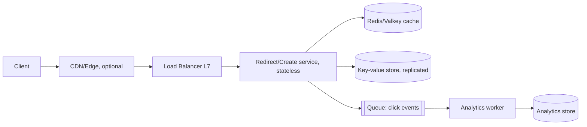
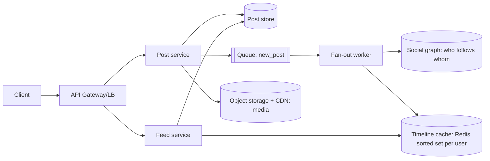
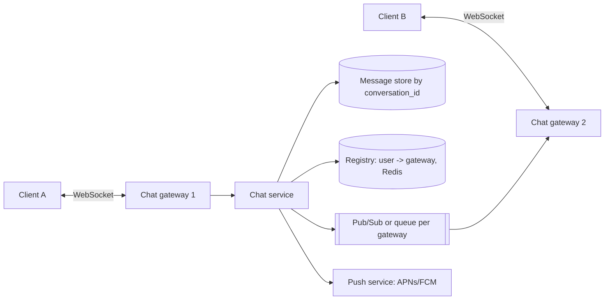

# Chương 12. Ba bài thiết kế mẫu từ đầu đến cuối

> Cập nhật: 2026-11-07. Khung chung: requirements → estimation → high-level design → deep dive → trade-off. Mọi con số là **giả định của bài**; trong phỏng vấn hãy nói rõ giả định và chấp nhận chỉnh. Hằng số: 1 ngày = 86.400 s; 1 tháng (30 ngày) = 2.592.000 s; đỉnh = 3 × trung bình.

---

# Bài 1. URL Shortener

## 1.1 Requirements

**Functional**: (a) tạo link ngắn từ link dài (tùy chọn alias riêng, hạn dùng); (b) truy cập link ngắn thì redirect tới link dài; (c) thống kê lượt click (mức cơ bản).
**Non-functional**: redirect latency thấp (p99 < 100 ms phía server); availability cao cho đường đọc (mục tiêu 99,99% ≈ 52,56 phút/năm); link không bị đoán/collision; tạo link có thể kém ngặt hơn đọc.
**Out of scope**: tài khoản người dùng phức tạp, A/B test.

## 1.2 Estimation

Giả định: 100 triệu link mới/tháng; tỉ lệ đọc:ghi = 100:1; lưu 5 năm; mỗi record ≈ 500 B.

- **Ghi**: `100.000.000 / 2.592.000 ≈ 38,6` ≈ **40 QPS**, đỉnh ≈ 120.
- **Đọc**: 100 × 38,6 ≈ **3.860 ≈ 4.000 QPS**, đỉnh ≈ 12.000.
- **Số link 5 năm**: `100 triệu × 12 × 5 = 6 × 10⁹`.
- **Storage**: `6 × 10⁹ × 500 B = 3 × 10¹² B = 3 TB` (chưa replication; ×3 ≈ 9 TB).
- **Độ dài key**: base62 (a–z, A–Z, 0–9). `62⁶ ≈ 5,68 × 10¹⁰`, `62⁷ ≈ 3,52 × 10¹²`. Cần ≥ 6 × 10⁹ key; 6 ký tự đủ nhưng dư ít (~9 lần), **7 ký tự** cho dư ~590 lần.
- **Cache**: đọc/ngày `3.860 × 86.400 ≈ 3,3 × 10⁸`. Giả định 20% link nóng chiếm hầu hết lượt đọc: `0,2 × 3,3 × 10⁸ ≈ 6,7 × 10⁷` link × 500 B ≈ **33 GB**, vừa một cache cluster nhỏ.
- **Bandwidth**: 4.000 × ~500 B ≈ 2 MB/s: không đáng kể.

Kết luận: tải thấp; thách thức chính là *sinh key không collision* và *read path nhanh, available*; chưa cần shard theo QPS, nhưng 3 TB và nhu cầu HA khiến dùng key-value store có replication là hợp lý.

## 1.3 API và data model

```
POST /v1/links        {long_url, alias?, expires_at?} -> 201 {short_url}
GET  /{key}           -> 302 Location: long_url   (404 nếu không có/hết hạn)
```
Bảng/collection `link`: `key` (primary key), `long_url`, `created_at`, `expires_at`, `owner`. Query chính là *tra theo key* nên rất hợp key-value.

## 1.4 High-level design



Read flow: cache hit → trả 302; miss → đọc DB → nạp cache (cache-aside, chương 6). Write flow: sinh key, ghi DB, trả short URL. Click event đẩy qua queue, async để không làm chậm redirect.

## 1.5 Deep dive: sinh key

Hai cách:
1. **Random key 7 ký tự base62 + unique constraint**. Fill ratio sau 5 năm là `6 × 10⁹ / 3,52 × 10¹² ≈ 0,17%`, nên xác suất collision mỗi lần insert ≤ 0,17%; `INSERT` vi phạm unique constraint thì sinh lại. Đơn giản, không cần coordination, khó đoán. Nhược: một vòng retry hiếm khi xảy ra.
2. **Block-allocated counter**: coordinator (một sequence trong DB) phát block 1.000 số cho mỗi app server; server tự tăng trong block rồi encode base62. Không collision, nhưng số tuần tự đoán được (kẻ xấu liệt kê link) — khắc phục bằng bijective shuffle hoặc XOR với secret; mất số khi server chết (chấp nhận được vì không gian rất lớn).

Chọn cách 1 cho đơn giản. Alias riêng: check duplicate bằng cùng unique constraint, trả 409 nếu duplicate.

**301 hay 302?** `301` (vĩnh viễn) được browser cache, giảm tải nhưng không đếm được click và khó đổi đích; `302/307` luôn đi qua hệ thống, cho analytics và revoke link. Chọn **302** vì cần analytics.

## 1.6 Trade-off, rủi ro, vận hành

- **Cache vs thống kê**: cache nhanh nhưng làm lệch số click nếu đếm ở DB; đếm ở event queue nên chính xác dù cache hit.
- **Abuse**: rate limit theo IP/key khi tạo link (chương 9); quét URL độc hại; chặn redirect loop.
- **Hết hạn**: TTL của key-value store hoặc cleanup job; cache cũng cần TTL ≤ thời hạn link.
- **Consistency**: tạo xong là đọc được ngay (đọc từ leader hoặc strong consistency ngay sau ghi), còn replica trễ vài trăm ms là chấp nhận được.
- **Scaling**: nếu 10×, shard theo hash của key (phân bố đều, mọi query là một key nên không cần query xuyên shard).
- **Monitoring**: p99 redirect, hit ratio, tỉ lệ 404, queue depth click.

---

# Bài 2. News Feed

## 2.1 Requirements

**Functional**: đăng bài (chữ + ảnh/video); theo dõi người khác; xem bảng tin gồm bài của những người mình theo dõi, mới nhất trước (có thể ranking sau).
**Non-functional**: xem feed nhanh (p99 < 300 ms); chấp nhận feed trễ vài giây (eventual); đăng bài không được mất; hệ thống availability cao.
**Out of scope**: ranking ML, quảng cáo, bình luận (chỉ nêu hướng).

## 2.2 Estimation

Giả định: 10 triệu DAU; mỗi người mở feed 5 lần/ngày; đăng trung bình 0,5 bài/ngày; trung bình 200 người theo dõi.

- **Đọc feed**: `10⁷ × 5 = 5 × 10⁷`/ngày → `5×10⁷ / 86.400 ≈ 579` ≈ **580 QPS**, đỉnh ≈ 1.700.
- **Bài đăng**: `10⁷ × 0,5 = 5 × 10⁶`/ngày → **58 QPS**.
- **Fan-out on write** (nếu đẩy vào timeline từng người theo dõi): `5 × 10⁶ × 200 = 10⁹` lần insert/ngày → `10⁹ / 86.400 ≈ 11.600` insert/giây (trung bình), đỉnh ≈ 35.000.
- **Timeline memory**: mỗi người giữ 500 ID bài × 8 B = 4 KB; `10⁷ × 4 KB = 40 GB` dữ liệu thô (nhân ~3 cho overhead cấu trúc Redis sorted set ≈ 120 GB; chia ra vài node).
- **Bài đăng**: mỗi bài ~1 KB metadata → `5 × 10⁶ × 1 KB = 5 GB/ngày` ≈ 1,8 TB/năm; ảnh/video nằm ở object storage + CDN.
- **Skew case**: người nổi tiếng 20 triệu người theo dõi: một bài = 20 triệu insert.

## 2.3 High-level design



Luồng đăng: ghi bài vào Post store (source of truth) → phát event `new_post` vào queue (qua outbox, chương 7) → worker đọc follower list, insert ID bài vào timeline của từng người.
Luồng xem: Feed service đọc danh sách ID từ timeline cache → lấy chi tiết bài (batch từ cache/DB) → trả về, pagination theo **cursor** (chương 8).

## 2.4 Deep dive: fan-out on write, on read hay hybrid

| | Fan-out on write (push) | Fan-out on read (pull) |
|---|---|---|
| Cách | Khi đăng, đẩy vào timeline người theo dõi | Khi xem, gom bài từ những người mình theo dõi rồi gộp/sắp xếp |
| Đọc | Rất nhanh (một lần đọc timeline) | Chậm, nhiều query/merge |
| Ghi | Tốn: N insert cho mỗi bài | Rẻ |
| Vấn đề | Người nổi tiếng gây write storm (20 triệu insert/bài), lãng phí cho người không online | Đọc nặng, đúng chỗ người dùng nhạy latency |

**Hybrid (thực tế)**: người dùng thường → push. Tài khoản có số người theo dõi vượt threshold (giả định 100.000) → *không* fan-out; khi người xem mở feed, hệ thống lấy timeline đã đẩy sẵn **cộng** bài mới của "người nổi tiếng mình theo dõi" (pull), merge theo thời gian. Với 20 triệu người theo dõi, push cần 20 triệu insert; ở tốc độ 50.000 insert/giây sẽ mất `20.000.000/50.000 = 400` giây và tạo hotspot, trong khi pull chỉ thêm vài query cho mỗi lượt xem.

Chi tiết quan trọng:
- **Chỉ fan-out cho người dùng hoạt động gần đây** (giảm ghi lãng phí); người không online sẽ rebuild timeline khi quay lại.
- **Read-your-writes**: bài của chính mình phải hiện ngay → gộp bài gần nhất của chính mình ở bước đọc, không phụ thuộc fan-out.
- **Xóa bài/hủy theo dõi**: lọc ở bước đọc (bài đã xóa trả tombstone) thay vì sửa mọi timeline.
- **Giới hạn kích thước timeline** (500 ID, truncate); trang xa hơn dựng bằng pull.
- **Social graph** lưu hai chiều (followers, following) vì hai query khác nhau; shard theo `user_id`.
- **Ranking**: thêm bước ranking sau khi lấy candidate; tách thành service riêng.

## 2.5 Trade-off

- Read latency thấp đổi lấy chi phí ghi/bộ nhớ lớn và độ phức tạp hybrid.
- Timeline là *derived view*, mất thì dựng lại từ Post store và social graph: cache không cần durability như DB.
- Eventual consistency: người theo dõi thấy bài trễ vài giây là chấp nhận được; đổi lại hệ thống chịu tải đỉnh nhờ queue.
- Ca xấu nhất: worker fan-out chậm → latency xuất hiện bài tăng; monitoring latency queue và autoscale worker.
- Idempotency: worker có thể insert duplicate khi retry; sorted set theo `post_id` tự dedup.

---

# Bài 3. Chat system (1–1 và group)

## 3.1 Requirements

**Functional**: nhắn 1–1 và group (tối đa 500 người, giả định); message status (sent/delivered/read); lịch sử tin nhắn; nhận tin khi offline (push notification); multi-device.
**Non-functional**: giao tin near real-time (p99 < 500 ms khi cả hai online); **không mất tin**; ordering đúng trong mỗi cuộc trò chuyện; availability cao.
**Out of scope**: gọi thoại/video, end-to-end encryption (chỉ nhắc ảnh hưởng).

## 3.2 Estimation

Giả định: 10 triệu DAU; mỗi người gửi 40 tin/ngày; tin ≈ 200 B (nội dung + metadata); 30% DAU connection cùng lúc ở đỉnh.

- **Message**: `10⁷ × 40 = 4 × 10⁸`/ngày → `4×10⁸/86.400 ≈ 4.630` ≈ **4,6k tin/s**, đỉnh ≈ 14.000.
- **Storage**: `4 × 10⁸ × 200 B = 8 × 10¹⁰ B = 80 GB/ngày` → `80 × 365 = 29.200 GB ≈ 29 TB/năm` (×3 replication ≈ 88 TB).
- **Concurrent connection**: `0,3 × 10⁷ = 3 × 10⁶` connection WebSocket. Giả định mỗi gateway giữ được ~100.000 connection (**cần load test**, phụ thuộc RAM/tinh chỉnh) → `3×10⁶ / 10⁵ = 30` server tối thiểu, ×2 redundancy ≈ **60**.
- **Bandwidth**: 14.000 × 200 B ≈ 2,8 MB/s cho 1–1 (group nhân theo số thành viên); không phải bottleneck: **connection và memory** mới là bottleneck.

## 3.3 High-level design



Luồng 1–1 khi B online: A gửi qua WebSocket tới G1 → Chat service gán ID/sequence, **ghi vào Message store** → tra Registry thấy B ở G2 → đẩy qua pub/sub tới G2 → G2 gửi cho B → B ack. Nếu B offline: tin vẫn được lưu; Push service gửi notification; khi B login, client xin "mọi tin sau sequence N của từng cuộc trò chuyện".

## 3.4 Deep dive

**Protocol**: WebSocket (bidirectional, long-lived connection) cho tin nhắn; HTTP cho tải ảnh/file (lên object storage, gửi tham chiếu); SSE hay long-polling chỉ là fallback.

**Ordering và ID**: ordering quan trọng *trong một cuộc trò chuyện*, không toàn cục. Mỗi `conversation_id` có một dãy `seq` tăng dần do *một* nơi cấp (partition theo `conversation_id`, tức một leader cho mỗi cuộc trò chuyện, chương 4). Message ID có thể là dạng thời gian + seq (Snowflake-style). Không dựa vào client clock.

**Delivery và idempotency**: client gửi kèm `client_msg_id`; server dedup theo (`conversation_id`, `client_msg_id`) nên retry khi mất ack không tạo tin duplicate. Delivery là **at-least-once** cho các thiết bị; client dedup theo message ID (chương 7). Trạng thái "đã gửi" khi server ghi xong; "đã nhận/đã đọc" là event riêng gửi ngược.

**Storage**: query chủ yếu "lấy N tin gần nhất của cuộc trò chuyện" → wide-column/key-value với key `(conversation_id, message_id)` sắp theo thời gian (Cassandra, DynamoDB…), hoặc shard SQL theo `conversation_id`. Lưu theo cuộc trò chuyện thay vì theo người nhận: group 500 người chỉ ghi **một** copy.

**Group**: ghi một lần vào store; fan-out *pointer* tới gateway của từng thành viên online (group lớn: gom theo gateway để mỗi gateway nhận một message thay vì một message mỗi người); thành viên offline nhận push/sync khi quay lại.

**Presence (online/offline)**: heartbeat định kỳ, TTL trong Redis; chỉ phát thay đổi presence cho bạn bè đang xem, tránh event storm (chấp nhận trễ vài giây).

**Multi-device**: mỗi thiết bị tự giữ `last_seq` cho từng cuộc trò chuyện và sync phần thiếu khi reconnect.

**Gateway failure**: client tự reconnect (với backoff + jitter, chương 9) tới gateway khác; Registry cập nhật; tin chưa ack được redeliver từ store theo `seq`. Khi deploy bản mới, drain connection từ từ để tránh 3 triệu client cùng reconnect (thundering herd).

## 3.5 Trade-off

- **Long-lived connection** làm gateway stateful (khó scale hơn REST): đổi lại latency thấp. Dùng LB *least connections* và drain khi deploy.
- **Ghi store trước, đẩy sau** đảm bảo không mất tin, nhưng thêm write latency vào đường đi; đổi lại durability (chọn durability hơn tốc độ).
- **Ordering theo cuộc trò chuyện** giới hạn parallelism trong một cuộc trò chuyện (một leader), nhưng đủ cho hầu hết quy mô.
- **End-to-end encryption** làm server không đọc/tìm kiếm được nội dung, phức tạp hóa multi-device và group.
- **Retention**: 29 TB/năm; có thể chuyển tin cũ sang storage tier rẻ.
- **CAP/PACELC**: chọn consistency về ordering trong cuộc trò chuyện (một leader) nên khi region của leader bị cô lập, cuộc trò chuyện đó tạm không gửi được (ưu tiên ordering hơn availability); các tính năng phụ (presence, đã đọc) chấp nhận eventual.

---

## Khi phỏng vấn nên nói gì (chung)

- "Em xin chốt requirement và giả định số; sau đó estimation để biết chỗ nào là bottleneck."
- "Bottleneck của bài này không phải bandwidth mà là X (key generation / fan-out / số connection)."
- "Phương án đơn giản nhất là …; em chỉ thêm … khi ước lượng cho thấy cần."
- "Em đánh đổi A lấy B vì yêu cầu ưu tiên …; nếu yêu cầu đổi, em chuyển sang …"

## Cạm bẫy chung

- Bỏ bước estimation hoặc tính sai bậc độ lớn (ví dụ nhầm giữa trung bình và đỉnh).
- Đi vào Kafka/microservice ngay cả khi tải 40 QPS.
- Không nói cách xử lý ca lệch (người nổi tiếng, key nóng).
- Quên cơ chế xử lý lỗi/retry/idempotency.
- Không nêu giả định nên người phỏng vấn không biết bạn đang tính theo gì.

## Tóm tắt

1. Mỗi bài có một "điểm khó": key generation, fan-out, quản lý connection + ordering.
2. Estimation chỉ ra bottleneck thật; URL shortener đọc nặng nhưng tải nhỏ, feed write amplification, chat nặng connection.
3. Hybrid (push + pull) giải ca lệch của feed.
4. Chat cần ordering theo cuộc trò chuyện, idempotency bằng client_msg_id, at-least-once + dedup.
5. Luôn kết thúc bằng trade-off, vận hành, monitoring.

## Câu hỏi tự kiểm tra

1. Với 100 triệu link/tháng và 100:1 đọc/ghi, QPS đọc trung bình xấp xỉ bao nhiêu?
2. Vì sao URL shortener nên dùng 302 thay vì 301 khi cần thống kê?
3. Vì sao feed dùng hybrid thay vì push thuần?
4. Chat đảm bảo ordering và không duplicate tin bằng cách nào?
5. Tính nhanh số gateway cần nếu 3 triệu connection và mỗi gateway giữ 100.000 (chưa redundancy).

<details>
<summary>Đáp án</summary>

1. Ghi ≈ 38,6 QPS; đọc ≈ 100 × 38,6 ≈ 3.860 QPS (~4k), đỉnh ~12k.
2. 301 được trình duyệt cache nên lượt click sau không đi qua hệ thống, không đếm được và khó đổi/revoke link; 302/307 luôn qua hệ thống.
3. Push thuần với người có hàng triệu người theo dõi tạo hàng triệu lần ghi mỗi bài và hotspot; hybrid pull bài của người nổi tiếng khi đọc.
4. Một leader cấp `seq` tăng dần cho mỗi `conversation_id`; client gửi `client_msg_id` để server dedup; client dedup theo message ID khi giao at-least-once.
5. `3.000.000 / 100.000 = 30` server (nhân redundancy ×2 ≈ 60); giả định cần load test.

</details>

## Nguồn

Chương này là thiết kế tự soạn; các con số đầu vào là giả định của bài, phép tính được ghi rõ. Các nguyên tắc nền tảng (cache-aside, outbox, retry/jitter, quorum, PACELC) dẫn nguồn ở các chương 4, 6, 7, 9.
