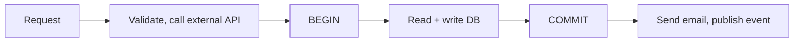

# Chương 1. Transaction và ACID

## 1. Tình huống

Bạn viết chức năng chuyển 100.000đ từ ví A sang ví B. Code gồm hai câu lệnh: trừ tiền A, cộng tiền B. Nếu process chết (OOM, deploy, mất mạng) ngay giữa hai câu thì tiền "bốc hơi". Nếu hai request chuyển tiền chạy cùng lúc, số dư có thể sai theo những cách rất khó tái hiện. **Transaction** (giao dịch) là cơ chế để database gom nhiều thao tác thành một đơn vị: hoặc tất cả có hiệu lực, hoặc không cái nào có.

Cả cuốn dùng một ví dụ xuyên suốt: hệ thống ví và đặt chỗ nhỏ với các bảng

| Bảng | Cột chính | Dùng ở chương |
|---|---|---|
| `acct` | `id`, `bal` (số dư), `ver` (version) | 2, 3, 6, 7 |
| `doctors` | `id`, `name`, `on_call` | 2, 3, 8 |
| `booking` | `id`, `room`, `s`, `e` (giờ bắt đầu, kết thúc) | 8 |
| `jobs` | `id`, `state`, `worker` | 9 |

Mọi kết quả "đã chạy" trong sách lấy từ lab trong thư mục `lab/` (xem README): PostgreSQL 18.6 và MySQL 9.7.4 (tag `mysql:lts` tại thời điểm viết).

## 2. ACID

| Chữ | Nghĩa thực tế | Ai chịu trách nhiệm |
|---|---|---|
| **A**tomicity (nguyên tử) | Tất cả hoặc không gì cả. `ROLLBACK` hoặc crash giữa chừng thì mọi thay đổi bị bỏ. | Engine (undo log / MVCC) |
| **C**onsistency (nhất quán) | Transaction đưa database từ trạng thái hợp lệ này sang trạng thái hợp lệ khác, **theo các constraint bạn khai báo**. | Chủ yếu là **ứng dụng** và constraint |
| **I**solation (cô lập) | Các transaction chạy đồng thời không "thấy" nhau ở mức mà level cho phép (chương 3). | Engine, theo isolation level |
| **D**urability (bền) | Đã `COMMIT` thành công thì mất điện cũng không mất. | WAL/redo log + `fsync` |

### Chữ C của ACID khác chữ C của CAP

- **C trong ACID** là *invariant* của dữ liệu: tổng tiền không đổi, foreign key trỏ đúng, `bal >= 0`. Database chỉ giữ được các invariant mà nó biết (PRIMARY KEY, UNIQUE, FOREIGN KEY, CHECK, exclusion constraint). Invariant kiểu "luôn có ít nhất một bác sĩ trực" (chương 8) database không tự biết, và các level thấp sẽ để nó vỡ. Nhiều tác giả nhận xét chữ C được thêm vào để từ viết tắt đọc được, nó khác bản chất với ba chữ còn lại.
- **C trong CAP** là *linearizability*: distributed system có nhiều replica, mọi client thấy dữ liệu như thể chỉ có một bản. Nó nói về replication, không liên quan đến constraint.

Hai khái niệm trùng chữ cái, khác hoàn toàn. Khi nghe "consistency", hãy hỏi lại: invariant của ứng dụng, hay các replica có đồng bộ.

### Durability không phải tuyệt đối

- PostgreSQL: `synchronous_commit = on` (mặc định) nghĩa là `COMMIT` chỉ trả về sau khi WAL được flush xuống đĩa. Đặt `off` thì có thể mất vài trăm ms transaction cuối khi crash (nhưng không hỏng dữ liệu).
- InnoDB: `innodb_flush_log_at_trx_commit = 1` (mặc định) flush redo log mỗi commit. Giá trị `0`/`2` đổi durability lấy tốc độ.

## 3. Cú pháp, autocommit và transaction boundary

Cả PostgreSQL và MySQL đều chạy ở chế độ **autocommit**: mỗi câu lệnh đơn lẻ tự là một transaction nhỏ. Bạn phải mở transaction tường minh để gom nhiều câu:

```sql
-- PostgreSQL
BEGIN;            -- hoặc START TRANSACTION
UPDATE acct SET bal = bal - 100000 WHERE id = 1;
UPDATE acct SET bal = bal + 100000 WHERE id = 2;
COMMIT;           -- hoặc ROLLBACK
```

```sql
-- MySQL: cùng ý nghĩa
START TRANSACTION;   -- hoặc BEGIN
UPDATE acct SET bal = bal - 100000 WHERE id = 1;
UPDATE acct SET bal = bal + 100000 WHERE id = 2;
COMMIT;
```

Kiểm tra trên lab: `SELECT @@autocommit;` trả về `1` trong MySQL. `SET autocommit=0` khiến câu đầu tiên tự mở transaction, một nguồn gây transaction "treo" khi quên commit.

### Savepoint

`SAVEPOINT` đặt một điểm rollback *bên trong* transaction. `ROLLBACK TO SAVEPOINT sp` hủy phần sau điểm đó nhưng giữ phần trước. Trong Go, `pgx.Tx.Begin` bên trong một transaction đang mở cũng tạo savepoint (chương 10).

Kết quả đã chạy (`lab/scripts/ch01_pg.sql`, `ch01_my.sql`): chèn dòng id=1, tạo savepoint, chèn trùng id=1 gây lỗi, rollback về savepoint, chèn id=2, commit.

| | PostgreSQL 18.6 | MySQL 9.7.4 |
|---|---|---|
| Sau lỗi `duplicate key` | Transaction vào trạng thái **aborted**. Mọi lệnh sau báo `current transaction is aborted, commands ignored until end of transaction block` | Chỉ câu lỗi bị hủy, transaction **vẫn mở**, lệnh sau chạy bình thường |
| Cách cứu | `ROLLBACK TO SAVEPOINT` (rồi dùng tiếp) hoặc `ROLLBACK` | Không bắt buộc |
| Kết quả cuối | bảng có id 1 và 2 | bảng có id 1 và 2 |

Hệ quả cho code: trong PostgreSQL, "bắt exception rồi tiếp tục" trong cùng transaction chỉ hoạt động nếu bạn bọc đoạn có thể lỗi trong savepoint. Đây là lý do mẫu `INSERT ... ON CONFLICT DO NOTHING` được ưa chuộng hơn "thử rồi bắt lỗi" ở PG.

### DDL và transaction

Đã chạy: `BEGIN; CREATE TABLE t2(x int); ROLLBACK;` trên PostgreSQL rồi `to_regclass('t2')` trả NULL, tức **DDL có transaction**, rollback được cả `CREATE TABLE`. Trên MySQL, `CREATE TABLE` giữa transaction gây **implicit commit**: dòng id=3 chèn trước đó vẫn còn (`COUNT(*) = 1`) dù đã gọi `ROLLBACK`. Hệ quả: migration lỗi giữa chừng trên MySQL để lại schema nửa vời, trên PG thì hoàn tác sạch.

### Transaction boundary nên đặt ở đâu



Đặt boundary **hẹp**: chỉ gói những thao tác DB phải atomic. Việc chậm hoặc không rollback được (HTTP ra ngoài, gửi mail) để ngoài. Lý do kỹ thuật ở chương 4 (transaction dài giữ snapshot, gây bloat) và chương 10.

## 4. Trade-off

- Transaction bọc càng rộng thì càng an toàn về logic nhưng giữ lock lâu, tăng deadlock và queueing.
- Không dùng transaction cho thao tác đọc thuần ở mức mặc định, trừ khi cần nhìn thấy một snapshot nhất quán cho nhiều câu SELECT (chương 2: read skew).
- Một câu `UPDATE` đơn lẻ đã atomic. Đừng bọc `BEGIN/COMMIT` quanh một câu vô ích, nhưng cũng đừng nghĩ "một câu SQL" luôn đủ: `SELECT` rồi `UPDATE` là hai câu.

## 5. Cạm bẫy

1. Tin rằng "ACID nghĩa là không bao giờ có race condition". Isolation mặc định của cả hai DB cho phép nhiều anomaly (chương 3).
2. Quên rằng MySQL có implicit commit với DDL (và một số lệnh khác).
3. Trong PG, tiếp tục dùng transaction sau lỗi mà không có savepoint.
4. Mở transaction rồi chờ input người dùng hoặc gọi API ngoài.
5. Nhầm C của ACID với C của CAP.

## 6. Tóm tắt

- Transaction gom nhiều thao tác thành một khối atomic, bền sau commit.
- C của ACID là invariant do bạn và constraint giữ; C của CAP là linearizability. Hai thứ khác nhau.
- Autocommit mặc định bật: mỗi câu lệnh là một transaction; muốn gom thì `BEGIN`.
- PG: lỗi làm transaction aborted, DDL rollback được. MySQL: lỗi chỉ hủy câu đó, DDL gây implicit commit.
- Giữ transaction ngắn và hẹp.

## 7. Tự kiểm tra

1. Hai chữ C (ACID, CAP) khác nhau thế nào?
2. Vì sao `SELECT` bị từ chối sau một lỗi `duplicate key` trong PostgreSQL nhưng chạy được trong MySQL?
3. Bạn chạy migration có `CREATE TABLE` rồi `ALTER TABLE` và lệnh thứ hai lỗi. Trên PG và MySQL kết quả khác nhau thế nào?
4. Savepoint dùng để làm gì và pgx dùng nó khi nào?

<details><summary>Đáp án</summary>

1. ACID-C: dữ liệu thỏa các constraint/invariant sau mỗi transaction. CAP-C: linearizability giữa các replica trong distributed system.
2. PostgreSQL đánh dấu transaction là aborted khi có lỗi, chỉ chấp nhận `ROLLBACK` hoặc `ROLLBACK TO SAVEPOINT`. InnoDB chỉ hủy câu lệnh lỗi và giữ transaction mở.
3. PG: nếu bọc trong một transaction thì cả hai bị rollback, schema về nguyên trạng. MySQL: mỗi DDL tự commit, `CREATE TABLE` đã có hiệu lực dù `ALTER` lỗi.
4. Hoàn tác một phần transaction mà không bỏ toàn bộ. `pgx.Tx.Begin` gọi trên một transaction đang mở tạo savepoint (`sp_1`, `sp_2`...).
</details>
