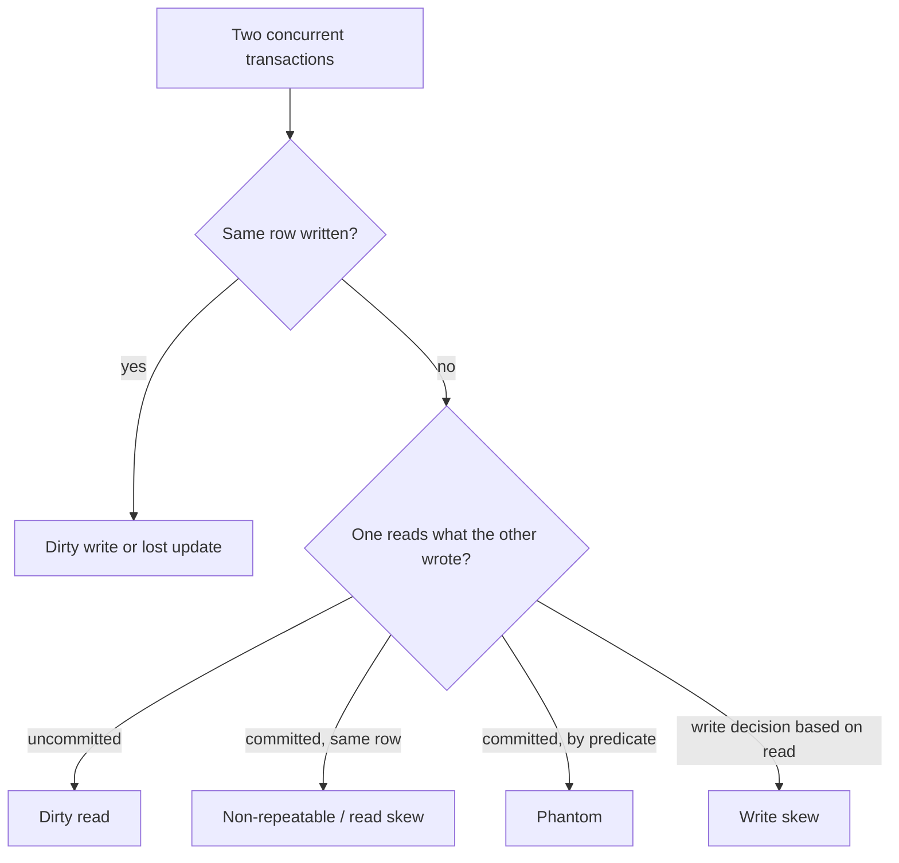

# Chương 2. Các anomaly khi chạy đồng thời

## 1. Tình huống

Mỗi transaction chạy một mình đều đúng. Hai transaction đồng thời thì sai, nhưng chỉ thỉnh thoảng, chỉ trên production, và log không có lỗi. Chương này liệt kê các kiểu sai có tên gọi (**anomaly**, hiện tượng bất thường), mỗi kiểu có một kịch bản hai session tái hiện được trong `lab/`. Biết tên và hình dạng của chúng là điều kiện để chương 3 (isolation level) có nghĩa.

Quy ước: hai session **A** và **B** chạy song song. Thứ tự các bước được ép bằng `pg_sleep()` / `SLEEP()` bên trong SQL (xem `lab/run.sh`). Kịch bản nằm ở `lab/scenarios/pg/<tên>.sql` và `lab/scenarios/my/<tên>.sql`. Chạy một kịch bản:

```bash
cd lab
./run.sh pg non_repeatable "READ COMMITTED"      # PostgreSQL
./run.sh my non_repeatable "READ COMMITTED"      # MySQL
VERBOSE=1 ./run.sh pg lost_update "REPEATABLE READ"   # xem toàn bộ output
```

Cột "kết quả" bên dưới là kết quả đã chạy. Bảng tổng hợp theo level ở chương 3.

## 2. Bảy anomaly

### 2.1 Dirty write

Transaction B ghi đè một dòng mà A đã sửa nhưng chưa commit. Hậu quả điển hình: hai bảng cùng cập nhật bởi hai transaction thì kết quả trộn lẫn.

Kịch bản `dirty_write`: bảng `listing` có hai dòng (một bản ghi cho người mua và một cho hóa đơn). A gán `buyer='A'` cho dòng 1, chờ, rồi gán dòng 2. B gán `buyer='B'` cho cả hai dòng, bắt đầu giữa lúc A đang chờ.

| Thời điểm | A | B |
|---|---|---|
| t0 | UPDATE dòng 1 = A | |
| t2 | | UPDATE dòng 1 = B (phải **chờ** A) |
| t4 | UPDATE dòng 2 = A; COMMIT | |
| sau t4 | | được chạy tiếp: UPDATE dòng 2 = B; COMMIT |

Kết quả đã chạy: không DB nào để dirty write xảy ra, ở bất kỳ level nào kể cả `READ UNCOMMITTED`. Khác biệt chỉ ở *cách chặn*: ở level thấp B chờ rồi ghi tiếp; ở `REPEATABLE READ` của PostgreSQL, B chờ xong thì bị `40001 could not serialize access due to concurrent update` vì dòng đã bị sửa sau snapshot của B.

### 2.2 Dirty read

A sửa `bal=0` rồi **rollback**. B đọc giữa chừng và thấy 0, một giá trị chưa từng tồn tại.

Kết quả đã chạy (`dirty_read`): chỉ xảy ra với MySQL `READ UNCOMMITTED`. PostgreSQL không có dirty read: `READ UNCOMMITTED` được chấp nhận về cú pháp nhưng hành xử như `READ COMMITTED`.

### 2.3 Non-repeatable read (fuzzy read)

Trong một transaction, đọc cùng một dòng hai lần, nhận hai giá trị khác nhau vì transaction khác commit ở giữa.

```sql
-- A                                   -- B
BEGIN;
SELECT bal FROM acct WHERE id=1;  -- 100
                                       UPDATE acct SET bal=999 WHERE id=1;  -- autocommit
SELECT bal FROM acct WHERE id=1;  -- 999 (READ COMMITTED) hoặc 100 (REPEATABLE READ)
COMMIT;
```

Kịch bản `non_repeatable`. Xảy ra ở `READ COMMITTED` (cả hai DB) và `READ UNCOMMITTED`, không xảy ra từ `REPEATABLE READ` trở lên.

### 2.4 Phantom

Giống non-repeatable, nhưng điều kiện **tìm kiếm** cho ra tập dòng khác: B `INSERT` một dòng thỏa `WHERE` mà A đang đếm.

```sql
SELECT count(*) FROM items WHERE cat='x';   -- 2
-- B: INSERT INTO items(cat) VALUES ('x'); COMMIT;
SELECT count(*) FROM items WHERE cat='x';   -- 3 (phantom)
```

Kịch bản `phantom`.

**Biến thể quan trọng, `phantom_update`.** A đếm (2), B chèn dòng thỏa điều kiện và commit, rồi A chạy `UPDATE items SET flag=1 WHERE cat='x'` và đếm lại. Kết quả đã chạy ở `REPEATABLE READ`:

| | số dòng `cat='x'` trước | sau UPDATE |
|---|---|---|
| PostgreSQL | 2 | 2 (UPDATE không thấy phantom row) |
| MySQL 9.7.4 | 2 | **3** (UPDATE đọc bản mới nhất; phantom row bị sửa và từ đó "thuộc" transaction A) |

Đây là chỗ `REPEATABLE READ` của InnoDB không "repeatable" như tên: snapshot chỉ áp dụng cho `SELECT` thường (consistent read). Câu có ghi (`UPDATE`, `DELETE`) và locking read (`FOR UPDATE`) luôn thao tác trên dữ liệu **mới nhất đã commit**.

### 2.5 Lost update

Hai transaction cùng *read-modify-write* một giá trị: cả hai đọc 100, A ghi 110, B ghi 120. Kết quả cuối là 110 (A ghi sau cùng), phần +20 của B biến mất; đúng ra phải là 130.

| Thời điểm | A | B |
|---|---|---|
| t0 | đọc bal = 100 | |
| t1.5 | | đọc bal = 100 |
| t2.5 | | UPDATE bal = 100 + 20; COMMIT |
| t5 | UPDATE bal = 100 + 10; COMMIT | |

Kết quả đã chạy (`lost_update`, số dư cuối kỳ vọng 130):

| Level | PostgreSQL | MySQL 9.7.4 |
|---|---|---|
| READ COMMITTED | **mất** (kết quả 110) | **mất** |
| REPEATABLE READ | A bị `40001`, không mất, app phải retry | xem bảng chương 3 |

Chương 7 trình bày năm cách chống.

### 2.6 Read skew

A đọc hai dòng liên quan ở hai thời điểm, giữa chừng B chuyển tiền giữa chúng. A thấy trạng thái không tồn tại ở bất kỳ thời điểm nào: tổng tiền sai.

Kịch bản `read_skew`: hai ví 50 + 50 = 100. A đọc ví 1 (50). B chuyển 50 từ ví 1 sang ví 2 rồi commit. A đọc ví 2 (100). Tổng A thấy: 150. Xảy ra ở `READ COMMITTED`; `REPEATABLE READ` (snapshot) chặn được. Đây chính là lý do **backup logic** (`pg_dump`) chạy trong transaction `REPEATABLE READ`: nó cần một snapshot nhất quán cho nhiều bảng.

### 2.7 Write skew

Hai transaction **đọc cùng một tập dữ liệu**, mỗi bên quyết định dựa trên nó, rồi **ghi vào các dòng khác nhau**. Không có dòng nào bị ghi bởi cả hai, nên không có write-write conflict để bị phát hiện, nhưng invariant vỡ.

Ví dụ kinh điển, lịch trực: luật là "luôn có ít nhất 1 bác sĩ trực". Alice và Bob đang trực. Cả hai cùng xin nghỉ.

```sql
-- mỗi bên:
BEGIN;
SELECT count(*) FROM doctors WHERE on_call;        -- thấy 2
-- (nghĩ một lúc)
UPDATE doctors SET on_call = false WHERE id = <mình>;   -- vì "còn người khác"
COMMIT;
```

Kết quả đã chạy (`write_skew`):

| Level | PostgreSQL 18.6 | MySQL 9.7.4 |
|---|---|---|
| READ COMMITTED | **0 bác sĩ trực** | **0** |
| REPEATABLE READ | **0** (snapshot isolation vẫn dính) | xem chương 3 |
| SERIALIZABLE | một bên bị `40001 ... read/write dependencies` | xem chương 3 |

Write skew là anomaly mà **snapshot isolation không chặn**. Phantom là một dạng gốc của nó khi điều kiện kiểm tra là "không có dòng nào" (đặt phòng, chương 8). Lost update thực ra là trường hợp riêng: hai bên ghi *cùng* một dòng.

## 3. Bản đồ nhanh



## 4. Trade-off

Càng chặn nhiều anomaly càng tốn chờ đợi hoặc retry. Không có level "miễn phí" bảo vệ mọi thứ; chương 3 cho biết mỗi DB cho bạn gì ở mỗi level, chương 7 và 8 cho biết cách chặn chọn lọc đúng chỗ cần.

## 5. Cạm bẫy

1. Chỉ test single-threaded rồi kết luận code đúng.
2. Nghĩ "SELECT rồi UPDATE trong một transaction" là an toàn. Chương này có bốn anomaly xảy ra chính trong tình huống đó.
3. Kiểm tra invariant bằng `SELECT` rồi `INSERT`/`UPDATE` ở level mặc định (check-then-act).
4. Nhầm phantom với non-repeatable read: một bên là dòng *thay đổi*, một bên là dòng *xuất hiện hoặc biến mất*.
5. Tin rằng `REPEATABLE READ` của InnoDB đảm bảo mọi câu lệnh thấy cùng một snapshot (xem `phantom_update`).

## 6. Tóm tắt

- Có bảy anomaly cơ bản: dirty write, dirty read, non-repeatable read, phantom, lost update, read skew, write skew.
- Dirty write bị chặn ở mọi level của cả hai DB; dirty read chỉ có ở MySQL `READ UNCOMMITTED`.
- Snapshot isolation chặn non-repeatable, phantom (đọc) và read skew, nhưng không chặn write skew.
- Câu có ghi trong InnoDB `REPEATABLE READ` thấy dữ liệu mới nhất, khác snapshot của `SELECT` thường.
- Mọi kịch bản có thể chạy lại bằng `lab/run.sh`.

## 7. Tự kiểm tra

1. Phân biệt lost update và write skew bằng số dòng bị ghi.
2. Vì sao `pg_dump` cần `REPEATABLE READ`?
3. Trong `phantom_update`, vì sao MySQL đếm ra 3 còn PostgreSQL đếm ra 2?
4. Dirty write xảy ra ở level nào của PG và MySQL?

<details><summary>Đáp án</summary>

1. Lost update: hai bên ghi cùng một dòng. Write skew: ghi các dòng khác nhau, vi phạm invariant liên dòng.
2. Để mọi bảng được đọc từ cùng một snapshot, tránh read skew giữa các bảng.
3. Câu `UPDATE` của InnoDB đọc bản mới nhất nên thấy dòng B vừa chèn và sửa nó, sau đó consistent read thấy được vì chính A đã sửa dòng đó. PG dùng snapshot của transaction cho cả `UPDATE` nên không thấy phantom row.
4. Không level nào, kể cả `READ UNCOMMITTED`; ở PG `REPEATABLE READ` kết quả là lỗi 40001 thay vì chờ-rồi-ghi.
</details>
