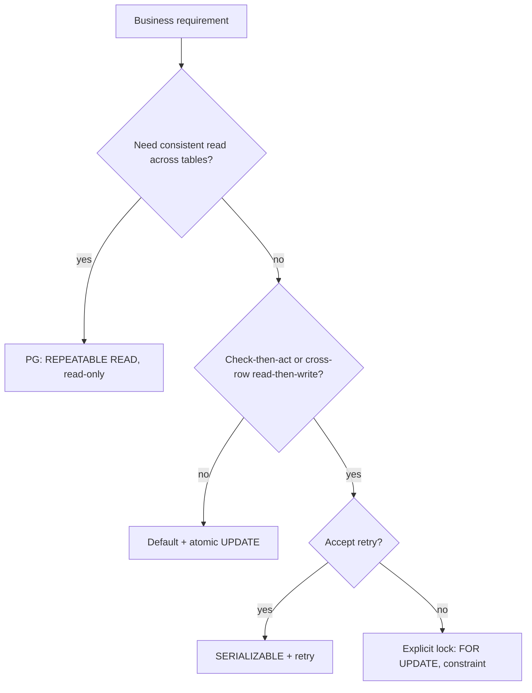

# Chapter 3. Isolation Levels: the SQL Standard and Reality

## 1. Scenario

Bạn đọc docs: "`REPEATABLE READ` chặn non-repeatable read, cho phép phantom". Rồi bạn chạy thử trên MySQL, thấy phantom bị chặn với `SELECT` nhưng `UPDATE` vẫn dính. Chạy trên PostgreSQL, thấy `REPEATABLE READ` chặn cả phantom nhưng lại ném lỗi `40001`. Chuẩn SQL nói một đằng, mỗi DB làm một nẻo. Chương này cho bạn bảng sự thật, lấy từ kết quả chạy thật, và cách đọc nó.

## 2. What the SQL standard says

SQL-92 định nghĩa bốn level bằng ba "phenomenon" (hiện tượng) mà mỗi level được phép hay không:

| Level (chuẩn SQL) | Dirty read | Non-repeatable read | Phantom |
|---|---|---|---|
| READ UNCOMMITTED | được phép | được phép | được phép |
| READ COMMITTED | không | được phép | được phép |
| REPEATABLE READ | không | không | được phép |
| SERIALIZABLE | không | không | không |

### The critique by Berenson et al. (1995)

Bài "A Critique of ANSI SQL Isolation Levels" (Berenson, Bernstein, Gray, Melton, O'Neil, O'Neil, SIGMOD 1995) chỉ ra các vấn đề chính:

1. Định nghĩa của chuẩn **mơ hồ**: nếu đọc theo nghĩa hẹp (chỉ tính khi sự kiện xảy ra rồi mới rollback, ký hiệu A1/A2/A3) thì cho phép những lịch chạy sai; cần đọc theo nghĩa rộng (P1/P2/P3, chỉ cần khả năng xảy ra).
2. Chuẩn **bỏ sót dirty write** (P0), điều kiện tối thiểu mà mọi level phải chặn.
3. Chuẩn **không nhắc** các anomaly có thật: lost update (P4), read skew (A5A), write skew (A5B).
4. Nhóm tác giả định nghĩa **Snapshot Isolation**, một level không nằm trong bảng ANSI: không có phenomenon nào trong ba cái trên, nhưng vẫn có write skew, nên **không tương đương** `SERIALIZABLE`.
5. Hệ quả thực tế: tên level giữa các sản phẩm không so sánh được. Một số DB gọi snapshot isolation là "serializable" (bài phê bình nói tới Oracle), tạo cảm giác an toàn giả.

Bài học: đừng đoán hành vi từ tên level. Hãy xem DB cụ thể làm gì, và tốt nhất là tự chạy thử.

## 3. Two databases, two approaches

| | PostgreSQL 18.6 | MySQL 9.7.4 (InnoDB) |
|---|---|---|
| Mặc định | `READ COMMITTED` | `REPEATABLE READ` (đã kiểm: `SELECT @@transaction_isolation`) |
| READ UNCOMMITTED | chấp nhận cú pháp, hành xử như READ COMMITTED | có dirty read thật |
| READ COMMITTED | mỗi **câu lệnh** thấy snapshot mới | mỗi câu thấy snapshot mới (consistent read mới mỗi câu) |
| REPEATABLE READ | **Snapshot isolation**: snapshot lấy ở câu đầu tiên, dùng cho mọi câu kể cả `UPDATE`; write conflict dẫn đến lỗi `40001` ("first updater wins") | Consistent read dùng read view lập ở lần đọc đầu; nhưng câu ghi và locking read thấy dữ liệu **mới nhất**, dùng next-key lock |
| SERIALIZABLE | **SSI** (Serializable Snapshot Isolation): chạy như snapshot nhưng theo dõi read/write dependency bằng predicate lock `SIReadLock` không chặn, rồi hủy transaction gây cycle, lỗi `40001` | Locking: `SELECT` thường tự hóa thành locking read (shared lock) khi autocommit tắt; xung đột thành chờ hoặc deadlock `1213` |
| Cách thất bại | Lỗi `40001` (app phải retry) | Chờ lock, hoặc deadlock `1213` / timeout `1205` |

Đặt level:

```sql
-- PostgreSQL: câu đầu tiên sau BEGIN (hoặc kèm BEGIN)
BEGIN ISOLATION LEVEL REPEATABLE READ;
-- hoặc SET TRANSACTION ISOLATION LEVEL SERIALIZABLE; ngay sau BEGIN
```

```sql
-- MySQL: TRƯỚC khi START TRANSACTION, áp dụng cho transaction kế tiếp
SET TRANSACTION ISOLATION LEVEL SERIALIZABLE;
START TRANSACTION;
-- SET SESSION TRANSACTION ISOLATION LEVEL ... để đổi mặc định cho cả session
```

## 4. Anomaly × level table: results actually run

Mỗi ô là một lần chạy thật của `lab/matrix.sh` (hai session đồng thời, xem README). Ký hiệu: **CÓ** = anomaly xảy ra; **không** = không xảy ra (chặn bằng snapshot hoặc bằng chờ lock); **40001/1213** = DB chặn bằng cách hủy một transaction, app phải retry.

### PostgreSQL 18.6

| Anomaly (kịch bản) | READ COMMITTED | REPEATABLE READ | SERIALIZABLE |
|---|---|---|---|
| Dirty write (`dirty_write`) | không (B chờ) | 40001 | 40001 |
| Dirty read (`dirty_read`) | không | không | không |
| Non-repeatable read (`non_repeatable`) | **CÓ** | không | không |
| Phantom, đọc (`phantom`) | **CÓ** | không | không |
| Phantom, đọc rồi UPDATE (`phantom_update`) | **CÓ** | không | không |
| Read skew (`read_skew`) | **CÓ** | không | không |
| Lost update (`lost_update`) | **CÓ** | 40001 | 40001 |
| Write skew, lịch trực (`write_skew`) | **CÓ** | **CÓ** | 40001 (SSI) |
| Write skew do phantom, đặt phòng (`booking`) | **CÓ** | **CÓ** | 40001 (SSI) |

`READ UNCOMMITTED` của PG chính là `READ COMMITTED` nên không chạy riêng.

### MySQL 9.7.4 (InnoDB)

| Anomaly (kịch bản) | READ UNCOMMITTED | READ COMMITTED | REPEATABLE READ | SERIALIZABLE |
|---|---|---|---|---|
| Dirty write | không | không | không | không |
| Dirty read | **CÓ** | không | không | không |
| Non-repeatable read | **CÓ** | **CÓ** | không | không |
| Phantom, đọc | **CÓ** | **CÓ** | không | không |
| Phantom, đọc rồi UPDATE | **CÓ** | **CÓ** | **CÓ** | không |
| Read skew | **CÓ** | **CÓ** | không | không |
| Lost update (read-modify-write ở app) | **CÓ** | **CÓ** | **CÓ** | 1213 |
| Write skew, lịch trực | **CÓ** | **CÓ** | **CÓ** | 1213 |
| Write skew do phantom, đặt phòng | **CÓ** | **CÓ** | **CÓ** | 1213 |

### Reading the table

- **Mặc định của MySQL (`REPEATABLE READ`) vẫn mất dữ liệu** với lost update dạng read-modify-write ở app, và dính phantom khi có câu ghi. Mặc định của PG (`READ COMMITTED`) cũng dính. Cả hai đều đòi bạn chủ động thiết kế (chương 7 và 8).
- **`REPEATABLE READ` của hai DB là hai thứ khác nhau**: PG chặn lost update bằng lỗi `40001`, InnoDB để lost update xảy ra (không có phát hiện write conflict dựa trên snapshot, `UPDATE` ghi đè lên bản mới nhất).
- **Chỉ `SERIALIZABLE` chặn được write skew**, trên cả hai. PG làm bằng SSI (không chờ, hủy khi phát hiện nguy cơ). InnoDB làm bằng lock (hai bên cùng lấy shared lock rồi tranh nhau upgrade, thường thành deadlock; cả hai cùng bị kẹt, DB chọn một victim).
- Cách chặn "bằng lỗi" nghĩa là **bạn bắt buộc phải có retry**. Chương 10 nói về cách làm.
- Dirty write không DB nào cho xảy ra, nhưng ở PG `REPEATABLE READ` kết quả là lỗi `40001` thay vì chờ.

Kết quả chỉ đúng với phiên bản và kịch bản đã ghi. Các kịch bản này kiểm tra *một* hình dạng của mỗi anomaly. Repo Hermitage của Martin Kleppmann (`github.com/ept/hermitage`, còn tồn tại, không bị archive, có kết quả cho PostgreSQL, MySQL, Oracle, SQL Server và nhiều DB khác) có bộ kịch bản đầy đủ hơn nhiều và là tài liệu tham khảo nên đọc. Hermitage không nêu rõ phiên bản DB được thử trên trang chính, vì vậy hãy tự chạy lại nếu cần số liệu cho phiên bản của bạn.

## 5. How to choose a level



- **READ COMMITTED + câu lệnh atomic/explicit lock**: mặc định tốt cho OLTP, ít lỗi nhất.
- **SERIALIZABLE + retry** (đặc biệt PG): khi logic phức tạp, nhiều dòng, khó lock hết. Cần bộ retry và chấp nhận tỷ lệ abort. Chi phí: bộ nhớ cho predicate lock, false positive.
- **SERIALIZABLE trên InnoDB**: coi chừng giảm concurrency nặng và deadlock; thường explicit lock dễ kiểm soát hơn.

## 6. Pitfalls

1. Gọi `REPEATABLE READ` là "an toàn" mà không biết đang ở DB nào.
2. Chuyển ứng dụng từ MySQL sang PostgreSQL (hoặc ngược lại) mà không xem lại các chỗ dựa vào hành vi mặc định.
3. Bật `SERIALIZABLE` nhưng không có retry: người dùng thấy lỗi 500 ngẫu nhiên.
4. Đặt level sau khi đã chạy câu đầu tiên: PG báo lỗi `SET TRANSACTION ISOLATION LEVEL must be called before any query`; MySQL báo lỗi khi đang trong transaction.
5. Dùng `READ UNCOMMITTED` của MySQL để "tăng tốc": nó đọc cả dữ liệu sẽ bị rollback.

## 7. Summary

- Tên level theo chuẩn SQL không đủ để suy ra hành vi; bài phê bình 1995 chỉ ra lỗ hổng và đưa ra snapshot isolation.
- PG: RC mặc định; RR là snapshot isolation (lỗi 40001 khi xung đột ghi); SERIALIZABLE là SSI.
- InnoDB: RR mặc định, đọc thường theo snapshot nhưng câu ghi thấy dữ liệu mới nhất; SERIALIZABLE dùng lock.
- Bảng kết quả đã chạy: chỉ SERIALIZABLE chặn write skew; mặc định của cả hai đều để lost update xảy ra ở dạng read-modify-write ở app (PG RC, MySQL RR).
- Chặn bằng lỗi thì phải có retry.

## 8. Self-check

1. Vì sao snapshot isolation không tương đương serializable?
2. `REPEATABLE READ` của PG và InnoDB khác nhau thế nào khi hai transaction cùng read-modify-write một dòng?
3. Cơ chế SERIALIZABLE của PG và InnoDB khác nhau thế nào, hệ quả với code ứng dụng?
4. Mặc định của PG và MySQL có chặn lost update không?

<details><summary>Answer</summary>

1. Snapshot isolation cho phép write skew (hai bên đọc cùng tập, ghi dòng khác nhau); đã chạy được trên PG `REPEATABLE READ`.
2. PG: bên ghi sau nhận `40001`; InnoDB: ghi đè, lost update xảy ra.
3. PG dùng SSI (không chờ, hủy bằng 40001); InnoDB dùng shared lock nên chờ hoặc deadlock 1213. Cả hai cần retry.
4. Không. PG RC: có lost update; MySQL RR: có lost update (kết quả `lost_update`).
</details>
