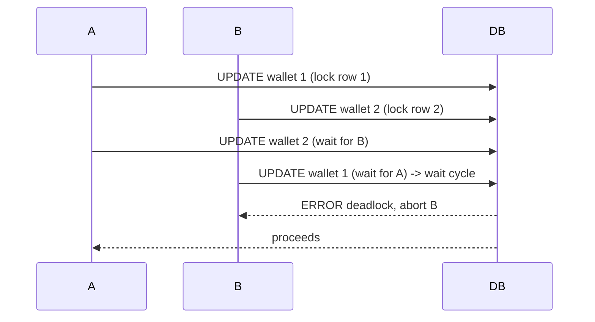

# Chương 6. Deadlock, timeout và retry

## 1. Tình huống

Hai request chuyển tiền ngược chiều: A chuyển ví 1 sang ví 2, B chuyển ví 2 sang ví 1. Mỗi bên lock dòng của mình, rồi chờ dòng của bên kia. Không ai nhường, ai cũng chờ mãi. Đó là **deadlock** (khóa chết). DB không để treo vô hạn: nó phát hiện wait cycle và hủy một transaction. Việc của bạn là (1) giảm xác suất xảy ra và (2) retry khi nó vẫn xảy ra.

## 2. Cơ chế



Điều kiện: ít nhất hai transaction, ít nhất hai tài nguyên, lấy theo thứ tự ngược nhau.

### Tái hiện (kịch bản `deadlock`)

A: `UPDATE ví 1`, ngủ 3s, `UPDATE ví 2`. B bắt đầu sau 1s: `UPDATE ví 2`, ngủ, `UPDATE ví 1`.

PostgreSQL 18.6 (lab đặt `deadlock_timeout=500ms`, mặc định là 1s):

```
ERROR:  deadlock detected
DETAIL:  Process 4656 waits for ShareLock on transaction 999; blocked by process 4655.
Process 4655 waits for ShareLock on transaction 1000; blocked by process 4656.
HINT:  See server log for query details.
CONTEXT:  while updating tuple (0,1) in relation "acct"
```

MySQL 9.7.4:

```
ERROR 1213 (40001): Deadlock found when trying to get lock; try restarting transaction
```

Trong cả hai lần, transaction còn lại hoàn tất và tổng tiền cuối cùng là 200 (không mất tiền): bên bị hủy được rollback.

### Cách DB phát hiện

| | PostgreSQL | InnoDB |
|---|---|---|
| Khi nào kiểm tra | Một transaction chờ lock quá `deadlock_timeout` (mặc định 1s) mới chạy cycle detection trong wait-for graph | Phát hiện ngay khi một transaction bắt đầu chờ (`innodb_deadlock_detect = ON`, mặc định) |
| Victim | Transaction chạy deadlock detector (thường là bên đến sau) | Transaction "rẻ nhất" theo InnoDB (ít thay đổi nhất) |
| Mã lỗi | SQLSTATE `40P01` | lỗi `1213`, SQLSTATE `40001` |
| Sau lỗi | Transaction ở trạng thái aborted, phải `ROLLBACK` | Toàn bộ transaction bị rollback |
| Xem lịch sử | log server (`log_lock_waits = on` ghi cả lần chờ lâu) | `SHOW ENGINE INNODB STATUS` mục `LATEST DETECTED DEADLOCK`; `innodb_print_all_deadlocks=ON` ghi mọi deadlock vào error log |

Lưu ý: `deadlock_timeout` còn là ngưỡng để `log_lock_waits` ghi log "process X still waiting". Đừng đặt quá nhỏ ở production vì mỗi lần kiểm tra tốn CPU.

## 3. Giảm deadlock: thứ tự lấy lock

Quy tắc vàng: **mọi transaction lấy lock theo cùng một thứ tự toàn cục**. Với chuyển tiền: luôn lock ví có `id` nhỏ trước.

```sql
BEGIN;
SELECT id FROM acct WHERE id IN (1,2) ORDER BY id FOR UPDATE;   -- lấy cả hai theo thứ tự id
UPDATE acct SET bal = bal - 10 WHERE id = 2;
UPDATE acct SET bal = bal + 10 WHERE id = 1;
COMMIT;
```

Đã chạy (`deadlock_ordered`): hai bên chuyển ngược chiều nhưng cùng lock theo `ORDER BY id`. Kết quả trên cả PG và MySQL: không lỗi, tổng tiền 200, bên đến sau chờ bên đến trước rồi chạy tiếp. Code Go tương ứng: `lab/go/transfer.go` (`slices.Sort(ids)`, `ORDER BY id FOR UPDATE`); `lab/out/go.txt` mục 5 và 6 cho thấy cả hai cách (mục 5: lock không theo thứ tự gây `40P01`, retry xử lý được).

Các thói quen khác:

1. Giữ transaction ngắn; không gọi API ngoài khi giữ lock.
2. Truy cập các bảng theo cùng một thứ tự trong mọi code path (đơn hàng trước, tồn kho sau, ở mọi nơi).
3. Lock sớm những gì chắc chắn sẽ ghi (`FOR UPDATE`) thay vì đọc rồi upgrade lock sau.
4. Có index tốt cho câu `UPDATE`/`DELETE`: không có index thì InnoDB lock nhiều dòng hơn cần thiết (chương 5) và tăng deadlock.
5. Với InnoDB: nhiều deadlock đến từ gap lock/insert intention ở `REPEATABLE READ` (chương 5). Chuyển sang `READ COMMITTED` ở các luồng ghi nặng là cách giảm thường dùng (đánh đổi: mất bảo vệ phantom ở mức lock).

Deadlock không bao giờ về 0 trên hệ có tải. Hãy coi nó như lỗi tạm thời (transient) cần retry.

## 4. Timeout

| Tham số | DB | Mặc định | Ý nghĩa |
|---|---|---|---|
| `lock_timeout` | PostgreSQL | `0` (tắt, chờ vô hạn) | Chờ lock quá ngưỡng thì câu lệnh lỗi `55P03` |
| `statement_timeout` | PostgreSQL | `0` | Giới hạn thời gian cả câu lệnh |
| `idle_in_transaction_session_timeout` | PostgreSQL | `0` | Hủy session mở transaction mà không làm gì |
| `innodb_lock_wait_timeout` | MySQL | `50` giây (đã kiểm: `@@innodb_lock_wait_timeout`) | Chờ row lock quá ngưỡng thì lỗi `1205` |

Đã chạy (`lock_timeout`): A giữ lock dòng 5 giây. B đặt timeout 1 giây rồi `UPDATE` cùng dòng.

- PG: `ERROR: canceling statement due to lock timeout` (SQLSTATE `55P03`).
- MySQL: `ERROR 1205 (HY000): Lock wait timeout exceeded; try restarting transaction`.

Khác biệt cần nhớ: với `innodb_lock_wait_timeout` mặc định, InnoDB chỉ hủy **câu lệnh** bị timeout, transaction vẫn mở với các lock cũ (hành vi này chỉnh bởi `innodb_rollback_on_timeout`, mặc định tắt). Ứng dụng nên chủ động `ROLLBACK`. Ở PG, lỗi bất kỳ đều đẩy transaction vào trạng thái aborted.

Khuyến nghị: đặt `lock_timeout` ngắn (ví dụ vài giây) cho request web và để retry quyết định. `lock_timeout = 0` mặc định nghĩa là một transaction treo có thể kéo theo cả queue chờ nó.

## 5. Retry đúng cách

Lỗi cần retry cả transaction (không chỉ câu lệnh):

| Lỗi | PostgreSQL | MySQL |
|---|---|---|
| Deadlock | `40P01` | `1213` (SQLSTATE `40001`) |
| Serialization failure | `40001` | `40001` (SERIALIZABLE, deadlock) |
| Lock wait timeout | `55P03` (nếu đặt `lock_timeout`) | `1205` |

Nguyên tắc:

1. Retry **toàn bộ transaction** từ `BEGIN`, đọc lại dữ liệu; không dùng lại giá trị đã đọc ở lần trước.
2. Giới hạn số lần (3 đến 5) và có backoff ngẫu nhiên (jitter).
3. Phần việc trong transaction phải **idempotent với bên ngoài**: không gửi email, không gọi API thanh toán bên trong (chương 10).
4. Log số lần retry; tỷ lệ retry tăng là tín hiệu sớm của vấn đề thiết kế.

`RunTx` trong `lab/go/retry.go` làm đúng điều này cho `40001` và `40P01` (chi tiết chương 10).

## 6. Trade-off

Lock theo thứ tự và giữ transaction ngắn giảm deadlock nhưng không loại bỏ. Timeout ngắn giảm thời gian treo nhưng tăng số lỗi cần xử lý. SERIALIZABLE giảm số chỗ phải suy nghĩ về lock nhưng tăng số retry.

## 7. Cạm bẫy

1. Bắt `QueryException` rồi bỏ qua: tiền đã không chuyển mà người dùng không biết.
2. Retry trong cùng transaction đã bị hủy (PG: transaction đã aborted).
3. Retry vô hạn không backoff.
4. Lock theo thứ tự tùy tiện, ví dụ `WHERE id IN (...)` không có `ORDER BY`. Thứ tự lấy lock là thứ tự dòng mà plan trả về, không được đảm bảo.
5. Tin rằng tăng `innodb_lock_wait_timeout` lên cao là "an toàn hơn".

## 8. Tóm tắt

- Deadlock là wait cycle của lock; DB hủy một transaction (PG `40P01`, MySQL `1213`).
- PG dò sau `deadlock_timeout`, InnoDB dò ngay.
- Cách chống chính là thứ tự lấy lock thống nhất; đã chạy `deadlock_ordered` không còn lỗi.
- Đặt timeout (`lock_timeout`, `innodb_lock_wait_timeout`) và retry cả transaction với backoff.
- Retry yêu cầu transaction không có side effect bên ngoài DB.

## 9. Tự kiểm tra

1. Vì sao lock theo `ORDER BY id` ngăn được deadlock chuyển tiền?
2. Khác biệt giữa deadlock và lock wait timeout?
3. Sau lỗi `40P01` trong PostgreSQL, bạn làm gì với transaction?
4. Vì sao không nên gửi email bên trong transaction có retry?

<details><summary>Đáp án</summary>

1. Mọi transaction lấy lock cùng thứ tự nên không thể tạo wait cycle.
2. Deadlock là wait cycle, không bao giờ tự giải; timeout là chờ lâu quá ngưỡng, có thể chỉ vì một transaction chậm.
3. `ROLLBACK`, rồi chạy lại toàn bộ từ đầu (đọc lại dữ liệu).
4. Mỗi lần retry sẽ gửi lại email dù transaction rốt cuộc rollback.
</details>
