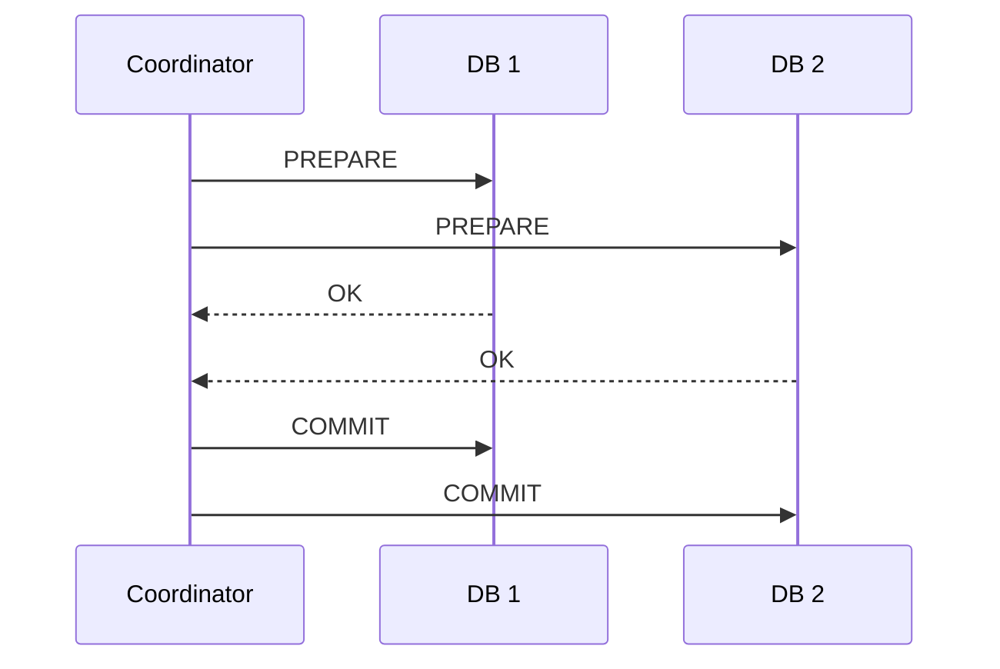

# Chương 11. Vượt ra ngoài một database: 2PC, saga, outbox

> Chương này chỉ giới thiệu. Một cuốn khác trong bộ về messaging sẽ nói kỹ. Các đoạn SQL ở đây là minh họa, **chưa chạy trong lab**.

## 1. Tình huống

Đặt hàng cần: trừ kho (DB của dịch vụ kho), tạo đơn (DB đơn hàng), trừ tiền (cổng thanh toán bên ngoài), gửi email. Không có một transaction nào bao được tất cả. Mọi thứ bạn học ở các chương trước chỉ đúng **trong một database**. Khi dữ liệu nằm ở nhiều nơi, bạn cần chiến lược khác và mỗi chiến lược đánh đổi consistency lấy availability hoặc độ phức tạp.

## 2. Two-phase commit (2PC)

Một **coordinator** hỏi mọi bên tham gia (participant) "bạn sẵn sàng commit chưa?" (pha prepare). Nếu tất cả trả "sẵn sàng" thì coordinator ra lệnh commit (pha commit); nếu bất kỳ ai từ chối thì ra lệnh rollback. Sau khi trả lời "sẵn sàng", participant **phải giữ nguyên** transaction (kể cả lock) cho tới khi nhận quyết định.



Hỗ trợ có sẵn: PostgreSQL có `PREPARE TRANSACTION 'gid'` / `COMMIT PREPARED 'gid'` / `ROLLBACK PREPARED 'gid'`, và tính năng này **tắt mặc định** (`max_prepared_transactions = 0`). MySQL có XA transactions (`XA START`, `XA END`, `XA PREPARE`, `XA COMMIT`).

Nhược điểm cốt lõi: nếu coordinator chết sau khi participant đã prepare, participant **kẹt** giữ lock cho đến khi ai đó quyết định (transaction "in-doubt"). Prepared transaction bị bỏ quên còn giữ cả việc dọn dẹp của vacuum (chương 4). Vì vậy 2PC hiếm khi dùng giữa các dịch vụ web; nó phù hợp giữa vài tài nguyên trong cùng hạ tầng tin cậy, và được dùng bên trong một số distributed DB.

## 3. Saga

Chia nghiệp vụ thành chuỗi **local transaction**, mỗi bước commit độc lập. Nếu bước sau thất bại, chạy các bước **bù trừ** (compensating action) cho những bước đã xong: hoàn kho, hoàn tiền, hủy đơn.

| Kiểu | Cách điều phối | Ưu | Nhược |
|---|---|---|---|
| Orchestration | Một orchestrator gọi từng bước | Dễ theo dõi luồng | Thêm thành phần trung tâm |
| Choreography | Mỗi dịch vụ nghe event rồi tự làm bước kế | Lỏng lẻo | Khó thấy toàn cảnh, dễ rối |

Saga **không có isolation**: giữa các bước, người khác thấy trạng thái dở dang (đơn "đang chờ thanh toán"). Bạn phải thiết kế trạng thái trung gian rõ ràng (`PENDING`, `PAID`, `CANCELLED`) và chấp nhận **eventual consistency**. Compensating action không phải rollback: không thể "thu hồi" email đã gửi, chỉ gửi email xin lỗi. Mỗi bước và mỗi compensating action cần **idempotent** (chạy lại không đổi kết quả), vì message có thể giao lặp.

## 4. Outbox

Bài toán "dual write": ghi DB rồi publish message lên broker là hai thao tác; nếu process chết giữa chúng thì mất message hoặc ngược lại. Giải pháp **transactional outbox**: trong **cùng transaction DB**, ghi dữ liệu nghiệp vụ và một dòng vào bảng `outbox`. Một tiến trình riêng (relay) đọc bảng outbox và publish lên broker, rồi đánh dấu đã gửi.

```sql
BEGIN;
UPDATE orders SET status = 'paid' WHERE id = 42;
INSERT INTO outbox(aggregate_id, type, payload) VALUES (42, 'OrderPaid', '{"id":42}');
COMMIT;
-- relay (nhiều instance cũng được, nhờ SKIP LOCKED, chương 9):
-- SELECT id, payload FROM outbox WHERE sent_at IS NULL ORDER BY id LIMIT 100 FOR UPDATE SKIP LOCKED;
-- ... publish ... rồi UPDATE outbox SET sent_at = now() WHERE id IN (...);
```

Đảm bảo là **at-least-once**: relay có thể publish rồi chết trước khi đánh dấu, nên consumer có thể nhận trùng. Consumer phải **idempotent** (lưu `message_id` đã xử lý, hoặc thao tác tự nhiên idempotent). Thứ tự chỉ đảm bảo theo từng `aggregate_id` nếu bạn thiết kế như vậy. Có thể thay relay bằng CDC (change data capture) đọc WAL/binlog; cách này nằm ngoài sách.

## 5. Chọn gì

| Nhu cầu | Gợi ý |
|---|---|
| Mọi dữ liệu trong một DB | Transaction thường, các chương 1 đến 10 |
| Ghi DB và phát event đáng tin | Outbox |
| Quy trình nhiều dịch vụ, chấp nhận trạng thái trung gian | Saga (kèm outbox cho mỗi bước) |
| Cần atomic thật giữa vài tài nguyên tin cậy | 2PC/XA, với cái giá về lock và vận hành |

## 6. Cạm bẫy

1. Gọi API thanh toán rồi ghi DB (hoặc ngược lại) không có cơ chế bù: crash giữa chừng để lại trạng thái sai.
2. Coi saga như transaction: quên rằng người khác nhìn thấy trạng thái dở dang.
3. Consumer không idempotent sau outbox: trùng message gây trừ tiền hai lần.
4. Bật `max_prepared_transactions` mà không monitor prepared transaction bị bỏ quên.
5. Compensating action cũng có thể thất bại; cần retry và alerting.

## 7. Tóm tắt

- Transaction chỉ atomic trong một DB; qua nhiều hệ thống cần cơ chế khác.
- 2PC cho atomic thật nhưng chặn và kẹt khi coordinator chết.
- Saga: chuỗi local transaction + compensating action, chấp nhận eventual consistency, mọi bước idempotent.
- Outbox: ghi event cùng transaction với dữ liệu, relay publish at-least-once.
- Idempotency là điều kiện bắt buộc ở phía nhận.

## 8. Tự kiểm tra

1. Vấn đề "dual write" là gì và outbox giải quyết thế nào?
2. Vì sao participant 2PC có thể giữ lock vô hạn?
3. Saga thiếu chữ I của ACID nghĩa là sao?
4. Vì sao outbox cần consumer idempotent?

<details><summary>Đáp án</summary>

1. Ghi DB và publish là hai thao tác không atomic. Outbox ghi event vào DB cùng transaction, publish sau.
2. Sau khi prepare, nó phải chờ quyết định; coordinator chết thì không ai quyết định.
3. Giữa các bước, trạng thái trung gian hiển thị cho người khác.
4. Relay có thể publish xong rồi chết trước khi đánh dấu, nên message có thể được giao lặp.
</details>
