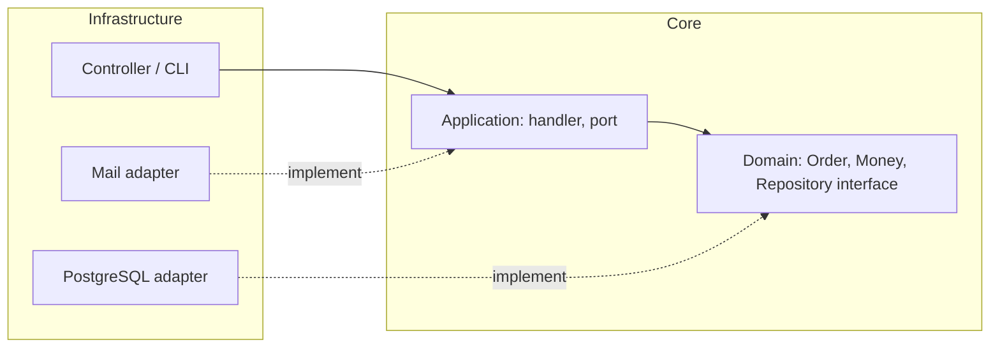

# Chapter 1. Separating Core Code from Infrastructure Code

> Mục tiêu chương: hiểu vì sao "code nghiệp vụ" nên sống độc lập với framework, database, mail, và nhìn thấy điều đó bằng một script TypeScript thuần chạy được không cần NestJS.

## 1.1 The problem: one controller does everything

Hầu hết ứng dụng web bắt đầu như sau. Khách bấm "Mua", handler của route nhận request, kiểm tra, tính tiền, ghi DB, gửi mail, rồi trả về trang. Đoạn dưới đây là **phản ví dụ cố ý viết xấu** (không nằm trong `lab/`, không chạy):

```ts
// MINH HOẠ XẤU - đừng làm theo
app.post('/orders', async (req, res) => {
  const ids: string[] = req.body.ebookIds;
  let total = 0;
  for (const id of ids) {
    const { rows } = await pool.query('SELECT price_amount FROM ebooks WHERE id = $1', [id]); // infrastructure: SQL
    total += Number(rows[0].price_amount);                                                    // nghiệp vụ: tính tiền
  }
  if (total > 5_000_000) return res.status(422).end();                                        // nghiệp vụ: hạn mức
  const created = await pool.query('INSERT INTO orders (...) VALUES (...) RETURNING id', []); // infrastructure
  await mailer.sendMail({ to: req.user.email, subject: 'Xác nhận đơn' });                     // infrastructure
  res.redirect('/orders');                                                                    // infrastructure: HTTP
});
```

Mọi thứ dính vào nhau. Hậu quả quen thuộc:

- Muốn test luật "hạn mức" phải dựng cả HTTP, DB, fake mail.
- Muốn thêm entry point CLI để nhập đơn hàng loạt, phải sao chép logic.
- Đổi cách lưu (SQL sang dịch vụ khác) kéo theo sửa cả luật tính tiền.
- Người mới đọc không phân biệt nổi đâu là "luật của cửa hàng", đâu là "chuyện kỹ thuật".

## 1.2 The solution: two kinds of code, one direction of dependency

| | Core code | Infrastructure code |
|---|---|---|
| Trả lời câu hỏi | Doanh nghiệp làm gì? Luật là gì? | Làm bằng công nghệ nào? |
| Ví dụ trong sách này | `Order`, `Money`, `EbookPurchasePolicy`, `PlaceOrderHandler` | PostgreSQL (`pg`), logger/mailer, HTTP controller, system clock |
| Biết tới framework? | Không | Có |
| Đổi khi nào? | Khi luật kinh doanh đổi | Khi công nghệ đổi |

Quy tắc duy nhất cần nhớ: **core không `import` bất cứ thứ gì của infrastructure; infrastructure được phép `import` core.** Khi core cần một thứ từ bên ngoài (lưu đơn, gửi thông báo, xem giờ), nó tự khai báo một interface, còn infrastructure viết class implement interface đó.



Mũi tên liền là "gọi/biết tới", mũi tên đứt là "implement interface". Đừng lo chi tiết ngay, các chương 5 và 6 sẽ giải thích.

## 1.3 Running example: an e-book store

Toàn bộ sách dùng **một** domain: khách đặt mua e-book. Các khái niệm cố định:

- Khách (`CustomerId`) tạo một **đơn hàng** (`Order`) gồm nhiều **dòng** (`OrderLine`) mỗi dòng ứng với một e-book (`EbookId`) và giá chụp tại lúc đặt.
- Đơn mới ở trạng thái `pending`, sau khi thanh toán thành `paid`, hoặc `cancelled`.
- Luật: đơn không rỗng, không trùng sách, không cộng lẫn tiền tệ, đã thanh toán thì không huỷ, và không mua lại sách đã sở hữu.
- Use case: `PlaceOrder` (đặt đơn), `PayOrder` (ghi nhận thanh toán), cùng một query "danh sách đơn của tôi".

Toàn bộ code core nằm trong `lab/src/domain` và `lab/src/application`, **TypeScript thuần** (không `import` NestJS, `pg` hay bất kỳ package nào). Phần của NestJS nằm riêng trong `lab/src/nest/`, adapter PostgreSQL trong `lab/src/infrastructure/postgres/`.

## 1.4 Proof: running the core without NestJS

Script `lab/script/demo.ts` lắp các class với adapter in-memory và gọi use case. Chạy trong Docker (Node.js 26 LTS; `npm ci` và `npm run build` đã chạy trước, xem README):

```bash
docker run --rm -v "$PWD/lab:/app" -v bookshop-nm:/app/node_modules -w /app node:26 npm run demo
```

Kết quả thực tế khi tác giả chạy (UUID mỗi lần một khác):

```text
Đã đặt đơn dfa568d7-bee7-4079-862f-dace64393d4b
Tổng tiền: 215.000 VND
Thông báo đã gửi: cus-1|dfa568d7-bee7-4079-862f-dace64393d4b|215.000 VND
Trạng thái: paid
Bị chặn đúng: Khách cus-1 đã mua e-book ddd-101 rồi.
Tóm tắt: paid | 215000 VND | Domain-Driven Design nhập môn + Kiến trúc lục giác | 2026-11-07 09:30
```

Không có HTTP server, không có database, không có DI container. Đó chính là lợi ích đầu tiên: **core chạy được và test được một mình**.

## 1.5 Where is the boundary? The gray areas

| Việc | Xếp vào | Lý do |
|---|---|---|
| Tính tổng tiền đơn | Core (trong `Order`) | Là luật kinh doanh |
| Kiểm tra `ebookIds` là mảng chuỗi | Infrastructure (DTO + `ValidationPipe`) | Hình dạng dữ liệu HTTP |
| "Đã sở hữu sách chưa" | Core (domain service) | Luật, dù cần dữ liệu từ repository |
| Câu SQL tìm đơn đã trả tiền | Infrastructure (adapter) | Chi tiết lưu trữ |
| Lấy giờ hiện tại | Core nói qua port `Clock`, infrastructure cung cấp | Giờ là thứ bên ngoài, chương 6 bàn kỹ |
| Sinh ID đơn | Chiến lược do core chọn (`nextIdentity()`), chương 3 | ID là khái niệm domain |
| Transaction DB | Infrastructure (adapter hoặc class bao ngoài handler) | Cơ chế lưu trữ |

Mẹo phân loại: hỏi "nếu ngày mai bỏ web, chỉ còn dòng lệnh, thứ này có còn cần không?" Còn cần thì nhiều khả năng là core.

## 1.6 Benefits and costs

Lợi ích: test nhanh (không IO), nhiều entry point dùng chung một logic, thay công nghệ cục bộ, đọc code thấy luật rõ ràng.

Cái giá, nói thẳng: nhiều file hơn, nhiều interface hơn, phải học từ vựng mới. Với màn hình CRUD thuần (danh mục, cài đặt) cách làm này thừa. Hãy dùng cho phần **lõi nghiệp vụ có luật phức tạp và sống lâu**, còn lại cứ để NestJS (hoặc Express/Fastify) đơn giản.

## 1.7 Common pitfalls

- **Tách theo thư mục chứ không theo dependency.** Tạo thư mục `domain/` nhưng trong đó vẫn `import { Injectable } from '@nestjs/common'` hay `import { Pool } from 'pg'` thì chưa tách gì cả.
- **Tách mọi thứ từ ngày đầu.** Dễ sa vào over-engineering; tách dần khi luật bắt đầu phức tạp.
- **Nhầm "không dùng framework" với "không dùng thư viện".** Core được dùng thứ có sẵn trong ngôn ngữ và runtime (`Date`, `Map`, `crypto.randomUUID()`); điều cấm là dính vào thứ gắn với infrastructure cụ thể.

## 1.8 Summary

1. Core là luật và quy trình nghiệp vụ; infrastructure là công nghệ thực hiện.
2. Dependency chỉ đi một chiều: infrastructure biết core, core không biết infrastructure.
3. Core cần gì từ ngoài thì tự khai báo interface.
4. Bằng chứng tốt nhất: chạy được core bằng TypeScript thuần.
5. Chỉ đầu tư cho phần lõi có luật phức tạp.

## 1.9 Self-check

1. Nêu hai phản ví dụ khiến controller "làm tất cả" khó test.
2. Đoạn code nào trong `lab/` chứng minh core không cần NestJS?
3. "Tính tổng tiền đơn" và "viết câu SQL lấy đơn" mỗi việc thuộc loại nào?
4. Khi nào KHÔNG nên áp dụng cách tách này?

<details>
<summary>Answer</summary>

1. Phải dựng HTTP, DB, mail để test một luật; muốn thêm entry point CLI thì phải sao chép logic.
2. `lab/script/demo.ts` và `lab/test/domain.test.ts`, `lab/test/application.test.ts` chạy trên TypeScript thuần với adapter in-memory.
3. Tổng tiền: core. Câu SQL: infrastructure.
4. Khi phần mềm chủ yếu là CRUD không có luật nghiệp vụ đáng kể, hoặc là sản phẩm thử nghiệm ngắn hạn.

</details>
