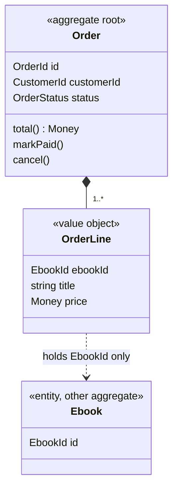
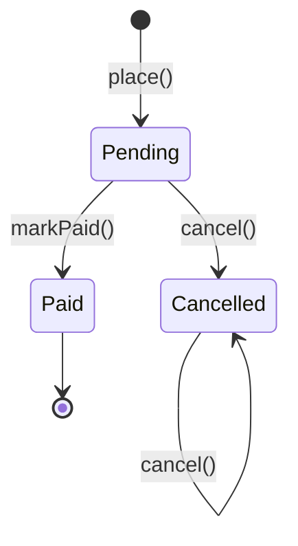

# Chương 2. Domain Model: Entity, Value Object và Aggregate

> Nguồn khái niệm: Eric Evans, *Domain-Driven Design* (2003) cho Entity, Value Object, Aggregate; Vaughn Vernon, *Implementing Domain-Driven Design* (2013) cho các quy tắc thiết kế Aggregate.

## 2.1 Vấn đề

Nếu "đơn hàng" chỉ là một object literal hoặc một row DB, thì luật về đơn hàng rải khắp nơi: controller kiểm một nửa, job kiểm nửa còn lại, và không ai chắc đã có bao nhiêu chỗ cộng tiền. Ta cần **một chỗ duy nhất** nắm giữ dữ liệu cùng luật của nó. Chỗ đó là Domain Model: các class TypeScript mô tả khái niệm nghiệp vụ bằng đúng ngôn ngữ của người làm nghiệp vụ.

## 2.2 Value Object: định nghĩa bằng giá trị

Value Object (VO) **không có identity**. Hai VO bằng nhau khi mọi property bằng nhau, và VO **immutable (bất biến)**: muốn "đổi" thì tạo object mới. Hai trăm nghìn đồng này hay hai trăm nghìn đồng kia đều như nhau, ta không cần hỏi "tờ tiền nào".

Trong TypeScript, `readonly` chỉ có tác dụng lúc compile; để bất biến cả lúc chạy ta thêm `Object.freeze(this)` ở cuối constructor. `Money` của cửa hàng (file `lab/src/domain/shared/money.ts`):

```ts
import { DomainRuleViolation, InvalidArgumentError } from './errors.js';

/**
 * Value Object: bất biến, so sánh theo giá trị. Lưu số nguyên đơn vị nhỏ nhất
 * (VND không có phần lẻ nên 1 đơn vị = 1 đồng) để tránh sai số số thực (float).
 */
export class Money {
  private constructor(
    readonly amount: number,
    readonly currency: string,
  ) {
    if (!Number.isSafeInteger(amount)) {
      throw new InvalidArgumentError('Số tiền phải là số nguyên an toàn.');
    }
    if (amount < 0) {
      throw new DomainRuleViolation('Số tiền không được âm.');
    }
    if (!/^[A-Z]{3}$/.test(currency)) {
      throw new InvalidArgumentError('Mã tiền tệ phải gồm 3 chữ in hoa.');
    }
    Object.freeze(this);
  }

  static of(amount: number, currency: string): Money {
    return new Money(amount, currency);
  }

  static vnd(amount: number): Money {
    return new Money(amount, 'VND');
  }

  static zero(currency: string): Money {
    return new Money(0, currency);
  }

  add(other: Money): Money {
    this.#assertSameCurrency(other);
    return new Money(this.amount + other.amount, this.currency);
  }

  equals(other: Money): boolean {
    return this.amount === other.amount && this.currency === other.currency;
  }

  format(): string {
    const grouped = String(this.amount).replace(/\B(?=(\d{3})+(?!\d))/g, '.');
    return `${grouped} ${this.currency}`;
  }

  #assertSameCurrency(other: Money): void {
    if (this.currency !== other.currency) {
      throw new DomainRuleViolation('Không thể cộng hai loại tiền tệ khác nhau.');
    }
  }
}
```

Chú ý bốn điều: (1) constructor `private`, bắt buộc đi qua `of`, `vnd`, `zero`, nên không tạo ra tiền âm; (2) tiền lưu bằng số nguyên để khỏi sai số số thực (float), và `Number.isSafeInteger` chặn luôn `1.5` hay `NaN`; (3) `add()` trả object mới và từ chối cộng khác tiền tệ, luật sống ngay trong VO; (4) method nội bộ dùng `#assertSameCurrency` (private field của JavaScript, thật sự private lúc chạy) thay vì từ khoá `private` của TypeScript, vì lý do ở mục 2.3.

## 2.3 Structural typing và nominal typing: vì sao TypeScript cần "brand"

Đây là điểm khác lớn nhất so với các ngôn ngữ như Java hay C#.

- **Nominal typing** (Java, C#): hai kiểu khác tên thì khác nhau, dù cùng hình dạng. `class OrderId` và `class CustomerId` không thay thế nhau được.
- **Structural typing** (TypeScript): hai kiểu tương thích nếu **hình dạng** khớp, tên không quan trọng. `type OrderId = string` và `type CustomerId = string` chỉ là hai cái tên của cùng một kiểu `string`: truyền cái này vào chỗ cái kia, compiler không phàn nàn.

Với ID, hậu quả rất thực tế: `placeFor(customerId, orderId)` và `placeFor(orderId, customerId)` đều biên dịch được nếu cả hai là `string`, còn lỗi thì chỉ lộ khi dữ liệu sai chạm tới database. File `lab/test/typing.test.ts` chứng minh từng điểm bằng code; `tsc --noEmit` kiểm tra chúng (dòng `@ts-expect-error` là một khẳng định "dòng dưới phải lỗi", nếu hết lỗi thì tsc báo lỗi ngược lại).

Có hai cách lấy lại tính nominal:

1. **Class có thành viên private** (`private` hoặc `#field`). Một class có thành viên private chỉ tương thích với chính nó, không với class khác cùng hình dạng công khai. `Money`, `Order`, `Ebook` của sách có thành viên `#private` nên không thể giả mạo bằng một object literal.
2. **Branded type**: gắn cho kiểu nền một "nhãn" chỉ tồn tại lúc compile. Rẻ hơn class vì lúc chạy vẫn là `string` trần, `JSON.stringify` và cột database không đổi.

Sách này dùng class cho VO có hành vi (`Money`, `OrderLine`) và **branded type cho ID**. Nền tảng (file `lab/src/domain/shared/identifier.ts`):

```ts
import { InvalidArgumentError } from './errors.js';

declare const brand: unique symbol;

/**
 * Branded type: một `string` mang thêm "nhãn" chỉ tồn tại lúc compile.
 * Lúc chạy nó vẫn là string trần (không tốn bộ nhớ, JSON.stringify ra đúng chuỗi).
 */
export type Brand<T, Name extends string> = T & { readonly [brand]: Name };

/**
 * Cổng duy nhất để tạo một ID: kiểm tra giá trị rồi "gắn nhãn".
 * Kiểm tra `typeof` vì kiểu của TypeScript biến mất lúc chạy (dữ liệu JSON có thể là số).
 */
export function parseIdentifier<Name extends string>(kind: Name, value: unknown): Brand<string, Name> {
  if (typeof value !== 'string' || value.trim() === '') {
    throw new InvalidArgumentError(`${kind} không được rỗng.`);
  }
  return value as Brand<string, Name>;
}
```

`declare const brand: unique symbol` chỉ là khai báo kiểu, không sinh code. `Brand<string, 'OrderId'>` là `string & { readonly [brand]: 'OrderId' }`: một chuỗi "mang nhãn" mà chuỗi trần không có. Cách duy nhất đúng để có một `OrderId` là qua `parseIdentifier`, nơi vừa kiểm tra giá trị vừa gắn nhãn. Mỗi loại ID là một file ngắn, ví dụ `lab/src/domain/order/order-id.ts`:

```ts
import { type Brand, parseIdentifier } from '../shared/identifier.js';

export type OrderId = Brand<string, 'OrderId'>;

export const OrderId = {
  of: (value: string): OrderId => parseIdentifier('OrderId', value),

  /** UUID v4. Chỉ OrderRepository.nextIdentity() được gọi hàm này. */
  generate: (): OrderId => parseIdentifier('OrderId', crypto.randomUUID()),
};
```

Tên `OrderId` vừa là kiểu vừa là giá trị (object chứa `of` và `generate`); TypeScript cho phép hai thứ cùng tên vì chúng sống ở hai "không gian" khác nhau. `CustomerId` và `EbookId` cùng khuôn. Nhờ đó:

```ts
function placeFor(customerId: CustomerId, orderId: OrderId): string { /* ... */ }

placeFor(customerId, orderId);   // ok
placeFor(orderId, customerId);   // lỗi biên dịch: OrderId không gán được cho CustomerId
placeFor(customerId, 'o-1');     // lỗi: string trần chưa qua OrderId.of
```

Ba dòng này đều có trong `typing.test.ts` dưới dạng `@ts-expect-error`. Hai giới hạn cần biết:

- **Brand chỉ bảo vệ lúc compile.** Lúc chạy `OrderId.of('a')` và `CustomerId.of('a')` đều là chuỗi `'a'`; so sánh bằng `===` cho `true`. Dữ liệu đi qua `as`, `any` hoặc `JSON.parse` thì brand không cứu được. Vì thế tên ID không có `equals()` như ở các ngôn ngữ nominal: so sánh ID cùng loại dùng `===`, còn chặn ID khác loại là việc của compiler.
- **Kiểu của TypeScript biến mất lúc chạy.** Dữ liệu từ HTTP có thể là số, `null`, hay object. Vì vậy `parseIdentifier` kiểm tra `typeof value === 'string'` và không rỗng, ném `InvalidArgumentError` nếu sai (test `ID rỗng hoặc sai kiểu lúc chạy bị từ chối`). Chương 7 nói thêm về chỗ validate dữ liệu ở rìa.

`OrderLine` là VO thứ ba: một dòng đơn hàng, chụp lại tên và giá lúc đặt. Nếu hôm sau giá sách đổi thì đơn cũ không đổi theo (`lab/src/domain/order/order-line.ts`):

```ts
import type { EbookId } from '../catalog/ebook-id.js';
import type { Money } from '../shared/money.js';

/**
 * Value Object nằm trong aggregate Order. Chụp lại tên và giá lúc đặt (snapshot);
 * tham chiếu sang Ebook chỉ bằng EbookId.
 */
export class OrderLine {
  constructor(
    readonly ebookId: EbookId,
    readonly title: string,
    readonly price: Money,
  ) {
    Object.freeze(this);
  }

  equals(other: OrderLine): boolean {
    return this.ebookId === other.ebookId && this.title === other.title && this.price.equals(other.price);
  }
}
```

## 2.4 Entity: định nghĩa bằng identity

Entity **có identity xuyên suốt lifecycle**. Property đổi nhưng nó vẫn là chính nó, và so sánh hai Entity là so sánh ID. `Ebook` là Entity vì giá có thể đổi nhưng "cuốn `ddd-101`" vẫn là cuốn đó (`lab/src/domain/catalog/ebook.ts`):

```ts
import type { Money } from '../shared/money.js';
import type { EbookId } from './ebook-id.js';

/**
 * Entity: có identity (EbookId) và vòng đời. Giá có thể đổi nhưng vẫn là cùng một e-book.
 */
export class Ebook {
  readonly #id: EbookId;
  #title: string;
  #price: Money;

  constructor(id: EbookId, title: string, price: Money) {
    this.#id = id;
    this.#title = title;
    this.#price = price;
  }

  get id(): EbookId {
    return this.#id;
  }

  get title(): string {
    return this.#title;
  }

  get price(): Money {
    return this.#price;
  }

  reprice(newPrice: Money): void {
    this.#price = newPrice;
  }

  equals(other: Ebook): boolean {
    return this.#id === other.#id;
  }
}
```

Trạng thái nằm trong `#field`, bên ngoài chỉ đọc qua getter (`ebook.price`) và chỉ đổi qua method có tên nghiệp vụ (`reprice`). Không có setter công khai.

Quy tắc kiểm tra nhanh: **một class không có ID thì không phải Entity.** Nếu bạn viết class `Address` chỉ có đường, quận, thành phố, hai địa chỉ giống hệt coi như một, thì đó là VO, đừng gọi là Entity chỉ vì nó có getter/setter hoặc map với một table.

| | Entity | Value Object |
|---|---|---|
| Identity | Có (ID) | Không |
| So sánh | Theo ID | Theo toàn bộ giá trị |
| Thay đổi | Được (qua method có nghĩa nghiệp vụ) | Không, tạo bản mới |
| Ví dụ ở đây | `Ebook`, `Order` | `Money`, `EbookId`, `OrderLine` |

## 2.5 Aggregate: consistency boundary

Aggregate (Evans 2003) là một cụm object được đối xử như một đơn vị khi thay đổi dữ liệu. Có một **aggregate root** là cửa duy nhất để bên ngoài tác động; mọi invariant (luật bất biến) của cụm do root bảo vệ. Ở đây `Order` là root, `OrderLine` nằm bên trong.

Vernon đúc kết bốn quy tắc, ba quy tắc cần thiết cho sách này:

1. Bảo vệ invariant thật sự trong aggregate boundary, bên trong một transaction.
2. Giữ aggregate nhỏ.
3. **Tham chiếu aggregate khác bằng identity, không giữ object.**

Bởi vậy `Order` giữ `CustomerId` chứ không giữ object `Customer`, và `OrderLine` giữ `EbookId` chứ không giữ `Ebook`. Lợi ích: load một đơn không kéo theo cả object graph khách và sách; transaction boundary rõ.



## 2.6 Aggregate root `Order`: luật nằm trong domain

Bản đầy đủ của `Order` (cũng là bản duy nhất dùng trong toàn sách, file `lab/src/domain/order/order.ts`):

```ts
import type { EbookId } from '../catalog/ebook-id.js';
import type { DomainEvent } from '../shared/domain-event.js';
import { DomainRuleViolation, InvalidArgumentError } from '../shared/errors.js';
import { Money } from '../shared/money.js';
import type { CustomerId } from './customer-id.js';
import { OrderPaid, OrderPlaced } from './order-events.js';
import type { OrderId } from './order-id.js';
import type { OrderLine } from './order-line.js';
import { OrderStatus } from './order-status.js';

/**
 * Aggregate root. Tham chiếu Customer bằng CustomerId, Ebook bằng EbookId (qua OrderLine).
 * Mọi quy tắc nghiệp vụ của đơn hàng, kể cả tính tổng tiền, nằm ở đây.
 */
export class Order {
  #events: DomainEvent[] = [];
  readonly #id: OrderId;
  readonly #customerId: CustomerId;
  readonly #lines: readonly OrderLine[];
  #status: OrderStatus;
  readonly #placedAt: Date;
  #paidAt: Date | null;

  private constructor(
    id: OrderId,
    customerId: CustomerId,
    lines: readonly OrderLine[],
    status: OrderStatus,
    placedAt: Date,
    paidAt: Date | null,
  ) {
    this.#id = id;
    this.#customerId = customerId;
    this.#lines = Object.freeze([...lines]);
    this.#status = status;
    // Date của JS sửa tại chỗ được (setHours...), nên luôn giữ bản sao riêng.
    this.#placedAt = new Date(placedAt);
    this.#paidAt = paidAt === null ? null : new Date(paidAt);
  }

  /**
   * Tạo đơn mới. Thời điểm do bên gọi truyền vào (lấy từ Clock ở Application),
   * nên domain không tự đọc đồng hồ.
   */
  static place(id: OrderId, customerId: CustomerId, lines: readonly OrderLine[], placedAt: Date): Order {
    if (lines.length === 0) {
      throw new DomainRuleViolation('Đơn hàng phải có ít nhất một e-book.');
    }
    const seen = new Set<string>();
    for (const line of lines) {
      if (seen.has(line.ebookId)) {
        throw new DomainRuleViolation(`E-book ${line.ebookId} xuất hiện hai lần trong đơn.`);
      }
      seen.add(line.ebookId);
    }

    const order = new Order(id, customerId, lines, OrderStatus.Pending, placedAt, null);
    order.#events.push(new OrderPlaced(id, customerId, order.total(), placedAt));
    return order;
  }

  /**
   * Dựng lại từ nơi lưu trữ. Không kiểm tra lại luật "tạo mới" và không phát event.
   * Chỉ Repository của hạ tầng nên gọi.
   */
  static reconstitute(
    id: OrderId,
    customerId: CustomerId,
    lines: readonly OrderLine[],
    status: OrderStatus,
    placedAt: Date,
    paidAt: Date | null,
  ): Order {
    return new Order(id, customerId, lines, status, placedAt, paidAt);
  }

  total(): Money {
    const [first] = this.#lines;
    if (first === undefined) {
      throw new InvalidArgumentError('Đơn dựng lại từ nơi lưu trữ không có dòng nào.');
    }
    return this.#lines.reduce((sum, line) => sum.add(line.price), Money.zero(first.price.currency));
  }

  markPaid(paymentReference: string, at: Date): void {
    if (paymentReference.trim() === '') {
      throw new DomainRuleViolation('Thiếu mã tham chiếu thanh toán.');
    }
    if (this.#status !== OrderStatus.Pending) {
      throw new DomainRuleViolation(`Chỉ đơn đang chờ mới thanh toán được (hiện: ${this.#status}).`);
    }
    this.#status = OrderStatus.Paid;
    this.#paidAt = new Date(at);
    this.#events.push(new OrderPaid(this.#id, this.#customerId, at));
  }

  cancel(): void {
    if (this.#status === OrderStatus.Paid) {
      throw new DomainRuleViolation('Đơn đã thanh toán không thể huỷ.');
    }
    this.#status = OrderStatus.Cancelled;
  }

  contains(ebookId: EbookId): boolean {
    return this.#lines.some((line) => line.ebookId === ebookId);
  }

  releaseEvents(): DomainEvent[] {
    const events = this.#events;
    this.#events = [];
    return events;
  }

  get id(): OrderId {
    return this.#id;
  }

  get customerId(): CustomerId {
    return this.#customerId;
  }

  get lines(): readonly OrderLine[] {
    return this.#lines;
  }

  get status(): OrderStatus {
    return this.#status;
  }

  get placedAt(): Date {
    return new Date(this.#placedAt);
  }

  get paidAt(): Date | null {
    return this.#paidAt === null ? null : new Date(this.#paidAt);
  }

  equals(other: Order): boolean {
    return this.#id === other.#id;
  }
}
```

Đọc kỹ những điểm sau.

- **Luật nghiệp vụ nằm trong Entity.** `total()` tính tổng bằng cách cộng giá các dòng; `place()` từ chối đơn rỗng hoặc trùng sách; `markPaid()` chỉ cho phép từ `pending`. Các chương sau (Application, NestJS) sẽ **không** tính lại tiền ở bất kỳ đâu, chỉ gọi `order.total()`.
- **Constructor `private`, tạo đơn qua `Order.place(...)`**: một tên có nghĩa nghiệp vụ, kèm kiểm tra luật.
- **Thời gian được truyền vào** (`placedAt`). Domain không tự gọi `new Date()`, nên test không cần fake global clock. Ai cấp giờ? Port `Clock`, chương 6.
- **`Date` của JavaScript là mutable** (`setFullYear`, `setHours`...), nên `Order` giữ bản sao và getter trả bản sao mới. Test `Sửa Date lấy ra không làm đổi trạng thái của Order` kiểm chứng điều này. (Nếu runtime của bạn đã có `Temporal`, kiểu bất biến thật sự, có thể dùng nó thay `Date`.)
- `reconstitute()` và `releaseEvents()` chưa cần hiểu lúc này: cái đầu phục vụ Repository (chương 3), cái sau phục vụ Domain Event (chương 8).
- **`OrderStatus` là const object + union type**, ba trạng thái (file `lab/src/domain/order/order-status.ts`). Dùng union thay chuỗi trần để không gõ nhầm `"piad"`: compiler báo lỗi ngay. Sách không dùng `enum` vì `enum` sinh code lúc chạy và không "erasable" (Node.js có thể chạy file `.ts` bằng cách xoá kiểu, và cách đó không hỗ trợ `enum`); hàm `parseOrderStatus` kiểm tra lại giá trị đọc từ database, vì lúc đó nó chỉ là `string`.

```ts
import { InvalidArgumentError } from '../shared/errors.js';

/** Const object + union: không dùng enum (enum sinh code lúc chạy, không "erasable"). */
export const OrderStatus = {
  Pending: 'pending',
  Paid: 'paid',
  Cancelled: 'cancelled',
} as const;

export type OrderStatus = (typeof OrderStatus)[keyof typeof OrderStatus];

/** Dùng khi đọc từ nơi lưu trữ: dữ liệu ngoài là string, phải kiểm tra trước khi tin. */
export function parseOrderStatus(value: string): OrderStatus {
  const known: string[] = Object.values(OrderStatus);
  if (!known.includes(value)) {
    throw new InvalidArgumentError(`Trạng thái đơn không hợp lệ: ${value}.`);
  }
  return value as OrderStatus;
}
```

Trạng thái đi như sau:



## 2.7 Domain Model là gì, không là gì

Domain Model **không** phải DB table và không phải row do ORM trả về. Table model phục vụ persistence; domain model phục vụ biểu đạt luật. Hai thứ có thể giống nhau nhưng được phép khác: ví dụ `orders` và `order_lines` là hai table, còn trong code là một aggregate. Chương 3 cho thấy adapter làm nhiệm vụ dịch qua lại.

## 2.8 Cạm bẫy thường gặp

- **Anemic model**: `Order` chỉ có getter/setter, còn logic nằm ở `OrderService`. Khi đó bất kỳ ai cũng có thể gán `order.status = 'paid'` bỏ qua luật. Hãy đưa hành vi vào Entity.
- **Entity "không có ID"**: đã nói ở 2.4.
- **Aggregate quá to**: để `Customer` giữ danh sách mọi `Order` là cách nhanh nhất để mỗi lần sửa khách đều lock cả lịch sử mua hàng.
- **Giữ object aggregate khác** thay vì ID, dẫn tới load thừa và transaction boundary mờ.
- **Setter công khai trên Entity**: mỗi setter là một cửa sau vào invariant. Chỉ mở method có tên nghiệp vụ (`markPaid`, `reprice`).
- **Nhầm VO với Entity về database**: VO cũng có thể lưu thành column; "có table" không đồng nghĩa "có identity".
- **ID là `string` trần** khắp nơi: structural typing cho phép truyền nhầm mà không báo lỗi (mục 2.3). Dùng brand hoặc class.
- **Tin vào `as`**: `value as OrderId` bỏ qua mọi kiểm tra. Chỉ cho phép `as` ở đúng một chỗ (`parseIdentifier`).

## 2.9 Tóm tắt

1. VO: không ID, so sánh theo giá trị, immutable (`readonly` cộng `Object.freeze`).
2. Entity: có ID, so sánh theo ID, đổi trạng thái qua method nghiệp vụ.
3. Aggregate: cụm có một root bảo vệ invariant; thay đổi theo đơn vị transaction.
4. Aggregate tham chiếu aggregate khác bằng ID.
5. Luật (kể cả tính tổng tiền) nằm trong Entity/Aggregate, không ở service.
6. TypeScript là structural typing: dùng branded type (hoặc class có `#private`) để chặn truyền nhầm ID; brand chỉ có tác dụng lúc compile.

## 2.10 Tự kiểm tra

1. `Address` gồm đường, quận, thành phố, không có ID: Entity hay VO? Vì sao?
2. Tại sao `Order` giữ `CustomerId` chứ không phải `Customer`?
3. Vì sao `Money.add()` trả `Money` mới thay vì sửa chính nó?
4. Ai chịu trách nhiệm tính tổng tiền đơn trong sách này, và vì sao không phải service?
5. Với `type OrderId = string` và `type CustomerId = string`, hàm nhận `(customerId: CustomerId, orderId: OrderId)` bị gọi đảo thứ tự: compiler có báo lỗi không? Còn với branded type?
6. `OrderId.of('a') === CustomerId.of('a')` lúc chạy cho kết quả gì, và điều đó nói lên giới hạn nào của brand?

<details>
<summary>Đáp án</summary>

1. VO: không có identity, hai địa chỉ giống hệt coi như một, nên immutable và so sánh theo giá trị.
2. Quy tắc aggregate: tham chiếu aggregate khác bằng identity để giữ aggregate nhỏ và transaction boundary rõ.
3. Để VO immutable: chia sẻ an toàn, không ai vô tình làm đổi số tiền đang nằm trong dòng đơn khác.
4. `Order.total()`. Nếu đặt ở service thì mô hình thành anemic và luật có thể bị gọi bỏ qua hoặc lặp ở nhiều service.
5. Với alias `string`: không báo lỗi, vì structural typing coi hai kiểu là một. Với branded type: báo lỗi biên dịch, vì nhãn khác nhau.
6. `true`, vì lúc chạy cả hai chỉ là chuỗi `'a'`. Brand chỉ là thông tin lúc compile, không bảo vệ khi dữ liệu đi qua `as`, `any` hoặc JSON.

</details>
