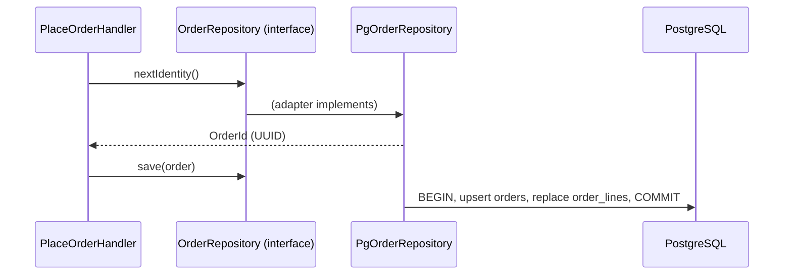

# Chương 3. Repository

> Nguồn: Martin Fowler, *Patterns of Enterprise Application Architecture* (2002); Evans (2003) đặt Repository vào ngôn ngữ DDD; Vernon (2013) phân tích hai kiểu thiết kế.

## 3.1 Vấn đề

Chương 2 cho ta `Order` thuần domain. Nhưng đơn hàng phải sống qua nhiều request, tức phải lưu và load lại. Nếu handler gọi thẳng `pool.query('INSERT INTO orders ...')` hay một ORM, core lập tức dính vào driver/ORM: không chạy được script thuần, test phải có DB.

## 3.2 Giải pháp: Repository

Fowler định nghĩa Repository là thành phần "**mediates between the domain and data mapping layers using a collection-like interface for accessing domain objects**" (PoEAA). Tức là đứng giữa domain và data mapping layer, cho domain một interface giống một collection các object, che đi chuyện lưu trữ. Với domain, repository đơn hàng trông như "một collection Order" chứ không phải SQL table.

Quy tắc phân chia:

- **Interface** `OrderRepository` thuộc **domain** (core), nói bằng ngôn ngữ nghiệp vụ.
- **Implementation** (`InMemory...`, `Pg...`) thuộc **infrastructure**.
- Mỗi **aggregate root** có một repository; không có repository riêng cho `OrderLine`.

## 3.3 Hai phong cách thiết kế (Vernon)

Vernon mô tả hai cách thiết kế interface:

| | Collection-oriented | Persistence-oriented |
|---|---|---|
| Hình dạng | Giống `Set`: `add()`, `remove()`, `get()` | Giống một store: `save()`, `get()`, `delete()` |
| Thay đổi sau khi lấy ra | Tự được theo dõi (Unit of Work, như Hibernate hay các ORM có change tracking); không cần gọi lại | Phải gọi `save()` rõ ràng |
| Hợp với | ORM có theo dõi thay đổi | Driver SQL/query builder, key-value, document store |
| Điểm cần nhớ | Object ra khỏi scope biến KHÔNG tự bị xoá khỏi repository; xoá chỉ bằng `remove()` | Quên `save()` là mất thay đổi |

Cửa hàng này chọn **persistence-oriented** (`save`), vì adapter thật dùng driver `pg` thuần, không có Unit of Work. Lựa chọn nào cũng được, miễn nhất quán trong một dự án và thể hiện đúng ý: nhà phát triển core không biết bên dưới là SQL hay file.

## 3.4 Sinh ID: một chiến lược duy nhất

Ta chọn **ID sinh ở phía ứng dụng, trước khi lưu** (UUID v4, bằng `crypto.randomUUID()` có sẵn trong Node.js), thông qua `OrderRepository.nextIdentity()`. Lý do:

- `Order.place()` cần ID ngay lúc tạo, để aggregate hợp lệ từ khi sinh ra và domain event mang theo ID đúng.
- Không phụ thuộc auto-increment của DB, nên không phải `save()` rồi mới biết ID.
- InMemory và PostgreSQL sinh ID giống nhau.

Đánh đổi: UUID ngẫu nhiên (v4) làm index DB phân tán; nếu cần cục bộ theo thời gian, đổi nội dung `OrderId.generate()` sang UUID v7, các chỗ khác không phải sửa. Đó là lợi ích của việc gom chiến lược vào một nơi.

Vì vậy interface **phải có** `nextIdentity()`: handler gọi nó, nên nó thuộc contract.

## 3.5 Interface `OrderRepository`

> **Tiến hoá qua các chương.** Ở lần đầu (chương này) interface chỉ cần `nextIdentity`, `save`, `get`. Sang chương 4, luật "không mua lại sách đã sở hữu" cần thêm method thứ tư `customerHasPaidFor`. Để code khớp với `lab/`, ta trình bày bản cuối.

Các method truy cập dữ liệu đều trả `Promise` vì I/O thật (PostgreSQL) là bất đồng bộ; `nextIdentity()` không I/O nên đồng bộ. File `lab/src/domain/order/order-repository.ts`:

```ts
import type { EbookId } from '../catalog/ebook-id.js';
import type { CustomerId } from './customer-id.js';
import type { Order } from './order.js';
import type { OrderId } from './order-id.js';

/**
 * Repository kiểu persistence-oriented (save). Chứa đủ mọi method mà core gọi.
 */
export interface OrderRepository {
  /** Sinh ID mới ở phía ứng dụng (UUID v4), trước khi lưu. */
  nextIdentity(): OrderId;

  save(order: Order): Promise<void>;

  /** @throws OrderNotFound */
  get(id: OrderId): Promise<Order>;

  /** Khách này đã có đơn ĐÃ THANH TOÁN chứa e-book này chưa? */
  customerHasPaidFor(customerId: CustomerId, ebookId: EbookId): Promise<boolean>;
}
```

Nguyên tắc: interface **chứa đủ mọi method mà core gọi, và chỉ những method đó**. Bốn method trên đều có người gọi: `nextIdentity` và `save` ở `PlaceOrderHandler`, `get` ở `PayOrderHandler`, `customerHasPaidFor` ở `EbookPurchasePolicy`. Trong TypeScript, method code gọi mà interface thiếu thì `tsc` báo lỗi ngay; nhưng nếu bạn gọi qua `any` hoặc `as`, lỗi chỉ lộ ở runtime khi đổi adapter. Đừng để lọt.

Lưu ý `customerHasPaidFor` là câu hỏi nghiệp vụ ("đã trả tiền cho sách này chưa?") chứ không phải `where(...)` chung chung. Lý do ở chương 6 mục 6.5.

## 3.6 Adapter in-memory

Dùng cho test và cho `demo.ts`. Gọn, không IO (file `lab/src/infrastructure/in-memory/in-memory-order-repository.ts`):

```ts
import type { EbookId } from '../../domain/catalog/ebook-id.js';
import type { CustomerId } from '../../domain/order/customer-id.js';
import { OrderNotFound } from '../../domain/order/errors.js';
import type { Order } from '../../domain/order/order.js';
import { OrderId } from '../../domain/order/order-id.js';
import type { OrderRepository } from '../../domain/order/order-repository.js';
import { OrderStatus } from '../../domain/order/order-status.js';

export class InMemoryOrderRepository implements OrderRepository {
  readonly #orders = new Map<string, Order>();

  nextIdentity(): OrderId {
    return OrderId.generate();
  }

  async save(order: Order): Promise<void> {
    this.#orders.set(order.id, order);
  }

  async get(id: OrderId): Promise<Order> {
    const order = this.#orders.get(id);
    if (order === undefined) {
      throw OrderNotFound.withId(id);
    }
    return order;
  }

  async customerHasPaidFor(customerId: CustomerId, ebookId: EbookId): Promise<boolean> {
    return [...this.#orders.values()].some(
      (order) => order.customerId === customerId && order.status === OrderStatus.Paid && order.contains(ebookId),
    );
  }

  /** Chỉ dùng cho adapter đọc in-memory. */
  all(): readonly Order[] {
    return [...this.#orders.values()];
  }
}
```

Nhờ contract chung, mọi test của use case chạy trên cái này với tốc độ mili-giây. Cái bẫy của in-memory là nó giữ nguyên object: nếu bạn sửa `Order` sau khi `get()` mà chưa `save()`, thay đổi vẫn "dính". Adapter thật sẽ không như vậy; nên trong code ứng dụng luôn gọi `save()` sau khi sửa để test không che lỗi.

## 3.7 Chọn công cụ truy cập PostgreSQL

Yêu cầu của adapter: ghi cả aggregate trong một transaction, đọc dựng lại aggregate, và một câu query gom (join, group by) cho read model. Tra trạng thái tháng 11/2026 trên npm registry:

| Lựa chọn | Phiên bản (ngày cập nhật gần nhất) | Nhận xét |
|---|---|---|
| `pg` (node-postgres) | 8.23.1 (30/09/2026) | Driver thuần, còn được cập nhật đều, ít phụ thuộc |
| `kysely` | 0.29.8 (01/11/2026) | Query builder an toàn kiểu, còn được cập nhật, vẫn chưa 1.0 |
| `drizzle-orm` | 0.45.4 (21/10/2026) | ORM/query builder nhẹ, còn được cập nhật, vẫn chưa 1.0 |

**Sách chọn `pg` thuần.** Lý do: (1) ít dependency nhất, theo nguyên tắc ưu tiên thư viện nhỏ; (2) repository đã là chỗ dịch aggregate sang table, nên một ORM mapping thêm một lớp nữa không giúp gì nhiều; (3) SQL hiện ngay trong adapter, người đọc thấy `BEGIN ... COMMIT` và câu `GROUP BY` thật. Cái giá: tự viết SQL và tự ép kiểu (driver trả cột `bigint` và `numeric` dưới dạng `string`, nên adapter dùng `Number(...)`). Nếu muốn kiểm tra tên cột lúc compile, `kysely` là bước kế tiếp hợp lý và không ảnh hưởng core, vì chỉ adapter đổi. Sách không thử các ORM khác, nên không đưa ra nhận định về chúng.

Schema (file `lab/db/schema.sql`, áp dụng bằng `psql` hoặc bằng test):

```sql
CREATE TABLE IF NOT EXISTS ebooks (
  id             varchar(64) PRIMARY KEY,
  title          text        NOT NULL,
  price_amount   bigint      NOT NULL CHECK (price_amount >= 0),
  price_currency char(3)     NOT NULL
);

CREATE TABLE IF NOT EXISTS orders (
  id          uuid        PRIMARY KEY,
  customer_id varchar(64) NOT NULL,
  status      varchar(16) NOT NULL,
  placed_at   timestamptz NOT NULL,
  paid_at     timestamptz
);
CREATE INDEX IF NOT EXISTS orders_customer_id_idx ON orders (customer_id);

CREATE TABLE IF NOT EXISTS order_lines (
  order_id       uuid        NOT NULL REFERENCES orders (id) ON DELETE CASCADE,
  position       smallint    NOT NULL,
  ebook_id       varchar(64) NOT NULL,
  title          text        NOT NULL,
  price_amount   bigint      NOT NULL CHECK (price_amount >= 0),
  price_currency char(3)     NOT NULL,
  PRIMARY KEY (order_id, position)
);
```

## 3.8 Adapter PostgreSQL

Phần này chạy thật trên PostgreSQL 18.6 trong Docker (xem README và chương 8). Adapter chỉ là "bản ghi lưu trữ": các row `OrderRow`, `LineRow` không phải Entity. File `lab/src/infrastructure/postgres/pg-order-repository.ts`:

```ts
import type { Pool } from 'pg';
import { EbookId } from '../../domain/catalog/ebook-id.js';
import { CustomerId } from '../../domain/order/customer-id.js';
import { OrderNotFound } from '../../domain/order/errors.js';
import { Order } from '../../domain/order/order.js';
import { OrderId } from '../../domain/order/order-id.js';
import { OrderLine } from '../../domain/order/order-line.js';
import type { OrderRepository } from '../../domain/order/order-repository.js';
import { parseOrderStatus } from '../../domain/order/order-status.js';
import { Money } from '../../domain/shared/money.js';

interface OrderRow {
  customer_id: string;
  status: string;
  placed_at: Date;
  paid_at: Date | null;
}

interface LineRow {
  ebook_id: string;
  title: string;
  price_amount: string; // bigint: driver pg trả về string
  price_currency: string;
}

/** Adapter persistence-oriented: save() ghi cả aggregate (đơn + các dòng) trong một transaction. */
export class PgOrderRepository implements OrderRepository {
  constructor(private readonly pool: Pool) {}

  nextIdentity(): OrderId {
    return OrderId.generate();
  }

  async save(order: Order): Promise<void> {
    const client = await this.pool.connect();
    try {
      await client.query('BEGIN');
      await client.query(
        `INSERT INTO orders (id, customer_id, status, placed_at, paid_at)
         VALUES ($1, $2, $3, $4, $5)
         ON CONFLICT (id) DO UPDATE
           SET customer_id = EXCLUDED.customer_id, status = EXCLUDED.status,
               placed_at = EXCLUDED.placed_at, paid_at = EXCLUDED.paid_at`,
        [order.id, order.customerId, order.status, order.placedAt, order.paidAt],
      );
      await client.query('DELETE FROM order_lines WHERE order_id = $1', [order.id]);
      for (const [position, line] of order.lines.entries()) {
        await client.query(
          `INSERT INTO order_lines (order_id, position, ebook_id, title, price_amount, price_currency)
           VALUES ($1, $2, $3, $4, $5, $6)`,
          [order.id, position, line.ebookId, line.title, line.price.amount, line.price.currency],
        );
      }
      await client.query('COMMIT');
    } catch (error) {
      await client.query('ROLLBACK');
      throw error;
    } finally {
      client.release();
    }
  }

  async get(id: OrderId): Promise<Order> {
    const orderResult = await this.pool.query<OrderRow>(
      'SELECT customer_id, status, placed_at, paid_at FROM orders WHERE id = $1',
      [id],
    );
    const row = orderResult.rows[0];
    if (row === undefined) {
      throw OrderNotFound.withId(id);
    }

    const lineResult = await this.pool.query<LineRow>(
      'SELECT ebook_id, title, price_amount, price_currency FROM order_lines WHERE order_id = $1 ORDER BY position',
      [id],
    );
    const lines = lineResult.rows.map(
      (r) => new OrderLine(EbookId.of(r.ebook_id), r.title, Money.of(Number(r.price_amount), r.price_currency)),
    );

    return Order.reconstitute(id, CustomerId.of(row.customer_id), lines, parseOrderStatus(row.status), row.placed_at, row.paid_at);
  }

  async customerHasPaidFor(customerId: CustomerId, ebookId: EbookId): Promise<boolean> {
    const result = await this.pool.query<{ paid: boolean }>(
      `SELECT EXISTS (
         SELECT 1 FROM orders o JOIN order_lines l ON l.order_id = o.id
         WHERE o.customer_id = $1 AND o.status = 'paid' AND l.ebook_id = $2
       ) AS paid`,
      [customerId, ebookId],
    );
    return result.rows[0]?.paid === true;
  }
}
```

Điểm đáng nhìn:

- `save()` ghi **cả aggregate** trong một transaction: một row `orders` (upsert bằng `ON CONFLICT`) và các row `order_lines` (xoá rồi chèn lại). Lỗi ở giữa thì `ROLLBACK`; test `save lỗi giữa chừng thì rollback` kiểm chứng điều này trên PostgreSQL thật. Phải `client.release()` trong `finally`, nếu không pool cạn dần.
- `get()` dựng lại bằng `Order.reconstitute(...)`, đường riêng cho infrastructure: không chạy lại luật "tạo mới" và không phát event (nếu không, mỗi lần load đơn cũ sẽ phát lại `OrderPlaced`).
- Adapter dịch giữa hai mô hình: relational table <-> aggregate. Dữ liệu đọc từ DB đi qua `parseOrderStatus`, `CustomerId.of`, `EbookId.of`: lúc này chúng chỉ là `string`, phải "gắn brand" qua cổng kiểm tra chứ không `as`.
- Mọi giá trị đi vào câu SQL là tham số (`$1`, `$2`...), không nối chuỗi, nên không có SQL injection.
- Chưa có kiểm soát đồng thời: hai request cùng `save` một đơn thì request sau thắng. Cần thì thêm cột `version` (optimistic locking) trong adapter.

Hai adapter nhỏ còn lại (`pg-ebook-catalog.ts`, `pg-order-summary-reader.ts`) nằm cùng thư mục; read model ở chương 4.



## 3.9 Contract test: một bộ test cho mọi adapter

Làm sao biết `InMemoryOrderRepository` và `PgOrderRepository` cư xử giống nhau? Viết **một** bộ khẳng định (file `lab/test/order-repository.contract.ts`) rồi chạy trên cả hai:

```ts
import assert from 'node:assert/strict';
import { describe, test } from 'node:test';
import { EbookId } from '../src/domain/catalog/ebook-id.js';
import { CustomerId } from '../src/domain/order/customer-id.js';
import { OrderNotFound } from '../src/domain/order/errors.js';
import { Order } from '../src/domain/order/order.js';
import { OrderId } from '../src/domain/order/order-id.js';
import { OrderLine } from '../src/domain/order/order-line.js';
import type { OrderRepository } from '../src/domain/order/order-repository.js';
import { OrderStatus } from '../src/domain/order/order-status.js';
import { Money } from '../src/domain/shared/money.js';

const t0 = new Date('2026-11-07T09:30:00Z');
const t1 = new Date('2026-11-07T10:00:00Z');

/**
 * Contract test: một bộ khẳng định chung cho mọi implementation của OrderRepository.
 * `create` trả về repository MỚI, rỗng cho mỗi test.
 */
export function orderRepositoryContract(name: string, create: () => Promise<OrderRepository>, options: { skip?: boolean } = {}): void {
  describe(`OrderRepository contract: ${name}`, { skip: options.skip === true }, () => {
    const lines = [
      new OrderLine(EbookId.of('e1'), 'Sách 1', Money.vnd(100)),
      new OrderLine(EbookId.of('e2'), 'Sách 2', Money.vnd(250)),
    ];

    test('save rồi get ra đơn bằng nhau (kể cả thứ tự dòng)', async () => {
      const repo = await create();
      const order = Order.place(repo.nextIdentity(), CustomerId.of('c1'), lines, t0);
      await repo.save(order);

      const loaded = await repo.get(order.id);
      assert.ok(loaded.equals(order));
      assert.equal(loaded.customerId, 'c1');
      assert.equal(loaded.status, OrderStatus.Pending);
      assert.equal(loaded.placedAt.getTime(), t0.getTime());
      assert.equal(loaded.paidAt, null);
      assert.ok(loaded.total().equals(Money.vnd(350)));
      assert.equal(loaded.lines.length, 2);
      loaded.lines.forEach((line, index) => assert.ok(line.equals(lines[index] as OrderLine)));
    });

    test('get dựng lại không phát lại event', async () => {
      const repo = await create();
      const order = Order.place(repo.nextIdentity(), CustomerId.of('c1'), lines, t0);
      await repo.save(order);
      order.releaseEvents(); // như handler: save xong thì phát event
      assert.deepEqual((await repo.get(order.id)).releaseEvents(), []);
    });

    test('save lần hai cập nhật trạng thái và giờ thanh toán', async () => {
      const repo = await create();
      const order = Order.place(repo.nextIdentity(), CustomerId.of('c1'), lines, t0);
      await repo.save(order);
      order.markPaid('PAY-1', t1);
      await repo.save(order);

      const loaded = await repo.get(order.id);
      assert.equal(loaded.status, OrderStatus.Paid);
      assert.equal(loaded.paidAt?.getTime(), t1.getTime());
      assert.equal(loaded.lines.length, 2);
    });

    test('get id lạ ném OrderNotFound', async () => {
      const repo = await create();
      await assert.rejects(repo.get(OrderId.generate()), OrderNotFound);
    });

    test('customerHasPaidFor chỉ đúng khi đơn đã trả tiền và có sách đó', async () => {
      const repo = await create();
      const order = Order.place(repo.nextIdentity(), CustomerId.of('c1'), lines, t0);
      await repo.save(order);
      assert.equal(await repo.customerHasPaidFor(CustomerId.of('c1'), EbookId.of('e1')), false);

      order.markPaid('PAY-1', t1);
      await repo.save(order);
      assert.equal(await repo.customerHasPaidFor(CustomerId.of('c1'), EbookId.of('e1')), true);
      assert.equal(await repo.customerHasPaidFor(CustomerId.of('c1'), EbookId.of('khac')), false);
      assert.equal(await repo.customerHasPaidFor(CustomerId.of('c2'), EbookId.of('e1')), false);
    });
  });
}
```

`in-memory-order-repository.test.ts` gọi `orderRepositoryContract('InMemory', ...)`, còn `postgres-adapters.test.ts` gọi với `PgOrderRepository` (chỉ chạy khi có biến `DATABASE_URL`). Cả hai cùng qua 5 test: đó là bằng chứng các test use case trên in-memory phản ánh đúng adapter thật.

## 3.10 Cạm bẫy thường gặp

- **Repository trả về builder/row của ORM**: rò rỉ infrastructure vào core. Trả về aggregate hoặc kiểu domain.
- **Một repository cho mỗi table** thay vì mỗi aggregate root.
- **Nhét luật nghiệp vụ vào repository** (ví dụ tính giảm giá khi `save`). Repository chỉ lưu và load.
- **Hiểu lầm collection-oriented**: tưởng object hết được tham chiếu thì bị xoá khỏi repository. Không; phải `remove()`.
- **Quên `nextIdentity()`** trong interface rồi gọi `OrderId.generate()` thẳng trong handler, khiến chiến lược ID rải rác.
- **Repository có `findAll()` trả hàng nghìn aggregate để vẽ danh sách**: dùng read model (chương 4).
- **Quên `client.release()`** hoặc quên `ROLLBACK`: connection bị giữ, pool cạn.
- **Tin `Number(row.price_amount)` mãi mãi**: số vượt `Number.MAX_SAFE_INTEGER` sẽ mất chính xác. `Money` chặn bằng `Number.isSafeInteger`; nếu cần tiền lớn hơn, đổi sang `bigint`.

## 3.11 Tóm tắt

1. Repository cho domain một interface giống collection, che chuyện lưu trữ (định nghĩa của Fowler).
2. Interface ở domain, implementation ở infrastructure, một repository cho mỗi aggregate root.
3. Hai kiểu: collection-oriented (`add/remove`) và persistence-oriented (`save`); sách này dùng `save`.
4. ID sinh ở ứng dụng bằng `nextIdentity()`, nên interface phải có method đó.
5. Interface chứa đủ mọi method core gọi; contract test chạy chung cho mọi adapter.
6. Adapter PostgreSQL dùng `pg` thuần: transaction trong `save`, tham số hoá câu SQL, `reconstitute` khi đọc.

## 3.12 Tự kiểm tra

1. Trích đúng ý định nghĩa Repository của Fowler.
2. Vì sao `OrderRepository` có `nextIdentity()`?
3. Với repository kiểu collection-oriented, nếu biến `order` ra khỏi scope, đơn có bị xoá khỏi repository không?
4. Vì sao `get()` của adapter dùng `reconstitute()` thay vì `place()`?
5. Contract test giải quyết rủi ro gì?

<details>
<summary>Đáp án</summary>

1. Repository làm trung gian giữa domain layer và data mapping layer, bằng một interface giống collection để truy cập domain object.
2. Vì ID được sinh phía ứng dụng và handler gọi nó. Interface phải chứa mọi method code gọi tới.
3. Không. Chỉ `remove()` mới xoá; ra khỏi phạm vi biến chỉ nghĩa là garbage collector giải phóng object trong bộ nhớ.
4. `place()` kiểm tra luật tạo mới và phát `OrderPlaced`; load lại đơn cũ không được làm vậy.
5. Rủi ro adapter in-memory (dùng trong test) cư xử khác adapter thật, khiến test use case xanh nhưng production lỗi.

</details>
