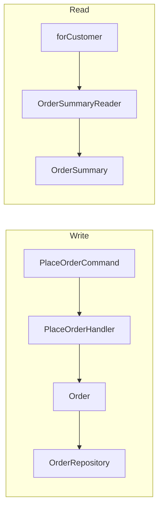

# Chapter 4. Application Service, Command, Domain Service and Read Model

## 4.1 The problem

Ta đã có `Order` (luật) và `OrderRepository` (lưu trữ). Còn thiếu người **dàn dựng một use case**: nhận yêu cầu "khách X mua các sách Y", load sách từ catalog, kiểm tra luật mua lại, tạo đơn, lưu, báo tin. Nếu việc đó nằm trong controller thì ta quay lại chương 1: không dùng lại được cho CLI, khó test.

## 4.2 Application Service (handler)

Application Service là layer mỏng điều phối một use case: load dữ liệu qua port, gọi domain, lưu, phát event. Nó **không chứa luật nghiệp vụ** (luật ở `Order` và domain service). Mỗi use case một class, gọi là **handler** để tên nói lên việc: `PlaceOrderHandler`, `PayOrderHandler`.

Đầu vào của handler là **Command**: một message mô tả ý định (file `lab/src/application/place-order/place-order-command.ts`).

```ts
/**
 * Command message (DTO) theo nghĩa CQS/CQRS: chỉ mang dữ liệu, không có execute().
 * Dùng kiểu nguyên thuỷ để adapter (HTTP, CLI) dựng dễ; handler đổi sang ID branded.
 */
export interface PlaceOrderCommand {
  readonly customerId: string;
  readonly ebookIds: readonly string[];
}
```

### A command message is not the GoF Command

Hai thứ cùng tên nhưng khác bản chất, rất hay bị nhầm:

| | Command trong GoF (1994) | Command message trong CQS/CQRS |
|---|---|---|
| Là gì | Object đóng gói **hành động**, có `execute()`, có thể undo | DTO immutable chỉ **mang dữ liệu** của ý định |
| Ai làm việc | Chính nó | Handler riêng |
| Dùng để | Queueing, undo, macro | Chuyển yêu cầu từ adapter vào use case |

`PlaceOrderCommand` hoàn toàn thuộc loại thứ hai: chỉ có property `readonly`, không có `execute()`. Việc làm do `PlaceOrderHandler` đảm nhận. (Ý niệm CQS, Command-Query Separation, của Bertrand Meyer: một method hoặc thay đổi trạng thái, hoặc trả dữ liệu, không làm cả hai; CQRS mở rộng nguyên tắc đó ra write model và read model riêng.)

Command dùng kiểu nguyên thuỷ (`string`, `readonly string[]`) để adapter nào cũng dựng được dễ, kể cả một object literal; handler đổi sang ID branded (`CustomerId.of`, `EbookId.of`), nên dữ liệu sai kiểu lọt qua rìa vẫn bị chặn ở đó (test `Dữ liệu sai kiểu lọt qua rìa bị chặn ở handler`). **Command phải khớp handler**: handler đọc `command.customerId` và `command.ebookIds`, và đúng hai property đó tồn tại; nếu lệch, `tsc` báo lỗi ngay. Vì Command là `interface`, ta không cần class: với TypeScript, hình dạng là đủ.

## 4.3 The complete handler

File `lab/src/application/place-order/place-order-handler.ts`:

```ts
import type { EbookCatalog } from '../../domain/catalog/ebook-catalog.js';
import { EbookId } from '../../domain/catalog/ebook-id.js';
import { CustomerId } from '../../domain/order/customer-id.js';
import type { EbookPurchasePolicy } from '../../domain/order/ebook-purchase-policy.js';
import { Order } from '../../domain/order/order.js';
import type { OrderId } from '../../domain/order/order-id.js';
import { OrderLine } from '../../domain/order/order-line.js';
import type { OrderRepository } from '../../domain/order/order-repository.js';
import type { PlaceOrderUseCase } from '../port/in/place-order-use-case.js';
import type { Clock } from '../port/out/clock.js';
import type { EventPublisher } from '../port/out/event-publisher.js';
import type { PlaceOrderCommand } from './place-order-command.js';

/** Phối hợp use case. Không chứa luật nghiệp vụ: luật ở Order và EbookPurchasePolicy. */
export class PlaceOrderHandler implements PlaceOrderUseCase {
  constructor(
    private readonly orders: OrderRepository,
    private readonly catalog: EbookCatalog,
    private readonly policy: EbookPurchasePolicy,
    private readonly clock: Clock,
    private readonly events: EventPublisher,
  ) {}

  async handle(command: PlaceOrderCommand): Promise<OrderId> {
    const customerId = CustomerId.of(command.customerId);
    const ebookIds = command.ebookIds.map(EbookId.of);

    await this.policy.assertCanBuy(customerId, ebookIds);

    const lines: OrderLine[] = [];
    for (const ebookId of ebookIds) {
      const ebook = await this.catalog.get(ebookId);
      lines.push(new OrderLine(ebook.id, ebook.title, ebook.price));
    }

    const order = Order.place(this.orders.nextIdentity(), customerId, lines, this.clock.now());
    await this.orders.save(order);

    for (const event of order.releaseEvents()) {
      await this.events.publish(event);
    }

    return order.id;
  }
}
```

Đọc từng bước:

1. Đổi primitive type thành ID branded (`CustomerId`, `EbookId`).
2. Hỏi domain service xem khách có được mua không.
3. Load từng `Ebook` từ `EbookCatalog` rồi chụp thành `OrderLine` (tên và giá lúc đặt).
4. `Order.place(...)` tạo aggregate; ID đến từ `nextIdentity()`, giờ đến từ `Clock`.
5. `save`, rồi phát các event mà aggregate ghi nhận (chương 8).

Handler **không** cộng tiền: `place()` đã tự tính và đưa vào `OrderPlaced`. Ở chương 2 ta nói luật ở Entity; ở đây nó được giữ đúng như vậy.

Handler là class TypeScript thuần: không có decorator, không `@Injectable`, dependency đi vào qua constructor bằng kiểu interface. Chương 7 sẽ cho thấy NestJS dựng nó bằng `useFactory` mà không đụng vào file này.

Ghi chú tiến hoá: dòng `implements PlaceOrderUseCase` ở bản cuối là kết quả của chương 6, nơi ta đặt tên cho inbound port. Trong chương này cứ hiểu handler là một class có method `handle(command)`.

`PayOrderHandler` có cùng khuôn: load đơn bằng `get()`, gọi `markPaid()`, `save`, phát event. Xem `lab/src/application/pay-order/`.

## 4.4 Domain service: when a rule doesn't belong to one Entity

Luật "không mua lại sách mình đã sở hữu" cần dữ liệu của **nhiều đơn** của khách, không thuộc riêng `Order` nào. Evans gọi chỗ chứa các luật kiểu này là **Domain Service**: stateless, tên theo ngôn ngữ nghiệp vụ, nằm trong domain (file `lab/src/domain/order/ebook-purchase-policy.ts`).

```ts
import type { EbookId } from '../catalog/ebook-id.js';
import type { CustomerId } from './customer-id.js';
import { AlreadyPurchased } from './errors.js';
import type { OrderRepository } from './order-repository.js';

/**
 * Domain service: luật "không mua lại e-book đã sở hữu" cần dữ liệu của nhiều đơn,
 * không thuộc về một Order cụ thể. Phụ thuộc interface OrderRepository của domain
 * nên vẫn là core thuần.
 */
export class EbookPurchasePolicy {
  constructor(private readonly orders: OrderRepository) {}

  /** @throws AlreadyPurchased */
  async assertCanBuy(customerId: CustomerId, ebookIds: readonly EbookId[]): Promise<void> {
    for (const ebookId of ebookIds) {
      if (await this.orders.customerHasPaidFor(customerId, ebookId)) {
        throw AlreadyPurchased.by(customerId, ebookId);
      }
    }
  }
}
```

Nó phụ thuộc `OrderRepository`, **một interface nằm trong domain**. Điều đó hoàn toàn hợp lệ và không làm nó "dính infrastructure": domain service chỉ biết contract, không biết implementation nào đứng sau. Nó chỉ trở thành vấn đề nếu bạn `import` một class `PgOrderRepository` concrete. Đây cũng là lý do `customerHasPaidFor` bổ sung vào repository ở chương 3.

Phân biệt ba loại "service":

| Loại | Chứa | Ví dụ |
|---|---|---|
| Domain Service | Luật nghiệp vụ không gắn một Entity | `EbookPurchasePolicy` |
| Application Service | Điều phối use case, không luật | `PlaceOrderHandler` |
| Infrastructure Service/Adapter | Kỹ thuật | `LogOrderNotifier`, `PgOrderRepository` |

## 4.5 Read Model: the read side doesn't need aggregates

Màn hình "đơn của tôi" cần: mã đơn, trạng thái, tổng, danh sách tên sách, giờ đặt. Nếu load từng aggregate rồi map ra thì chậm và gò ép. Nguyên lý CQRS: **read side có model riêng**, hình dạng do màn hình quyết định.

File `lab/src/application/query/order-summary.ts`:

```ts
/** Read model: hình dạng do màn hình cần, không phải aggregate. */
export interface OrderSummary {
  readonly orderId: string;
  readonly status: string;
  readonly totalAmount: number;
  readonly currency: string;
  readonly titles: readonly string[];
  readonly placedAt: string;
}
```

File `lab/src/application/query/order-summary-reader.ts`:

```ts
import type { OrderSummary } from './order-summary.js';

/** Port phía đọc (query side). Không trả về Order. */
export interface OrderSummaryReader {
  /** Mới nhất trước. */
  forCustomer(customerId: string): Promise<readonly OrderSummary[]>;
}
```

`OrderSummaryReader` là một port của read side; nó không trả `Order`. Adapter in-memory (để test) và adapter PostgreSQL (một câu query có `JOIN` và `GROUP BY`, xem `lab/src/infrastructure/postgres/pg-order-summary-reader.ts`) đều trả `OrderSummary`. Read model không có hành vi và không đi qua luật domain, vì nó không thay đổi dữ liệu. Adapter PostgreSQL:

```ts
import type { Pool } from 'pg';
import type { OrderSummary } from '../../application/query/order-summary.js';
import type { OrderSummaryReader } from '../../application/query/order-summary-reader.js';
import { formatPlacedAt } from '../format-placed-at.js';

interface SummaryRow {
  id: string;
  status: string;
  placed_at: Date;
  total_amount: string; // SUM(bigint) là numeric: driver pg trả về string
  currency: string;
  titles: string[];
}

/** Phía đọc: query thẳng ra read model, không dựng aggregate. */
export class PgOrderSummaryReader implements OrderSummaryReader {
  constructor(private readonly pool: Pool) {}

  async forCustomer(customerId: string): Promise<readonly OrderSummary[]> {
    const result = await this.pool.query<SummaryRow>(
      `SELECT o.id, o.status, o.placed_at,
              SUM(l.price_amount)                    AS total_amount,
              MIN(l.price_currency)                  AS currency,
              array_agg(l.title ORDER BY l.position) AS titles
         FROM orders o
         JOIN order_lines l ON l.order_id = o.id
        WHERE o.customer_id = $1
        GROUP BY o.id
        ORDER BY o.placed_at DESC`,
      [customerId],
    );
    return result.rows.map((r) => ({
      orderId: r.id,
      status: r.status,
      totalAmount: Number(r.total_amount),
      currency: r.currency,
      titles: r.titles,
      placedAt: formatPlacedAt(r.placed_at),
    }));
  }
}
```

Hai chi tiết riêng của TypeScript và `pg`: `SUM(bigint)` trả `numeric`, driver đưa về `string` nên phải `Number(...)`; còn `array_agg(... ORDER BY position)` được driver tự đổi thành mảng JavaScript.



Lưu ý rằng chỉ tách read/write model ở mức class như thế này chưa phải CQRS "đầy đủ" với hai database riêng; đây là bước nhẹ nhất và đã đủ lợi ích.

## 4.6 Common pitfalls

- **Handler phình ra thành "God class"** chứa luật. Nếu thấy `if` nghiệp vụ trong handler, hãy chuyển vào Entity hoặc domain service.
- **Chuyển luật tính tiền ra service sau khi đã dạy nó nằm trong Entity**: gây hai source of truth. Ở đây chỉ `Order.total()` tính tiền.
- **Truyền thẳng `Request` của framework vào handler**: kéo infrastructure vào core. Adapter dựng Command.
- **Command có `execute()`**: lẫn với GoF Command; bản chất DTO bị mất.
- **Lấy giờ bằng `new Date()` trong handler**: dùng port `Clock` (chương 6).
- **Đọc danh sách bằng cách load aggregate** rồi lặp: dùng read model.
- **Domain service import class `Pg...` concrete**: phụ thuộc interface của domain mới hợp lệ.
- **Quên `await`**: handler bất đồng bộ; thiếu `await` ở `save()` hay `publish()` khiến lỗi trôi thành unhandled rejection và event phát trước khi lưu xong. Bật rule `no-floating-promises` của linter để bắt.

## 4.7 Summary

1. Handler điều phối một use case, mỗi use case một class, không chứa luật.
2. Command message là DTO mang ý định, khác Command của GoF (có `execute()`).
3. Command và handler phải khớp nhau về property.
4. Luật nhiều-entity vào domain service, phụ thuộc interface repository của domain là hợp lệ.
5. Read side có read model riêng, trả DTO, không trả aggregate.

## 4.8 Self-check

1. Hai điểm khác nhau chính giữa Command của GoF và `PlaceOrderCommand`.
2. Vì sao `EbookPurchasePolicy` được phép phụ thuộc `OrderRepository`?
3. Handler gọi `order.total()` hay tự cộng giá các dòng? Vì sao?
4. Khi nào nên dùng read model thay vì `OrderRepository.get`?

<details>
<summary>Answer</summary>

1. GoF Command đóng gói hành động có `execute()` (có thể undo); `PlaceOrderCommand` chỉ là DTO dữ liệu, việc làm do handler. 
2. Vì `OrderRepository` là interface thuộc domain; phụ thuộc contract chứ không phải implementation thì core vẫn thuần.
3. Gọi `Order.total()`; luật tính tiền chỉ có một nơi là Entity.
4. Khi cần dữ liệu để hiển thị hoặc báo cáo, nhất là nhiều đơn, không nhằm thay đổi chúng.

</details>
