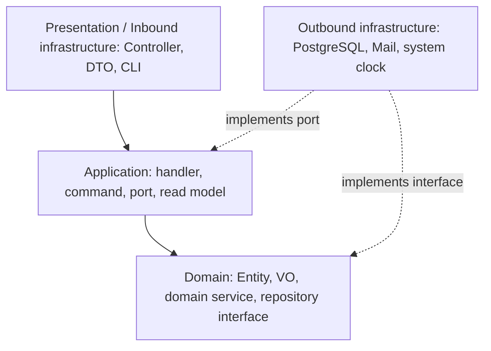
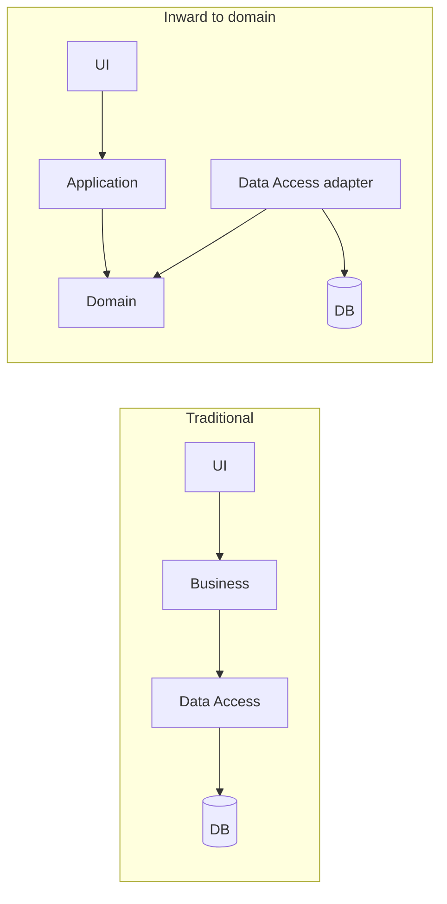
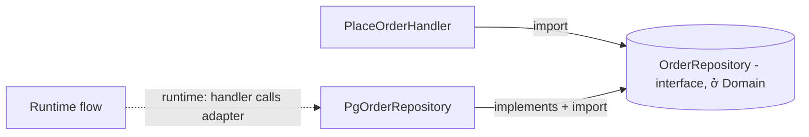

# Chương 5. Layered Architecture

> Nguồn đối chiếu: Evans (2003) mô tả bốn layer của DDD; Jeffrey Palermo, *Onion Architecture* (2008); Robert C. Martin, *The Clean Architecture* (bài viết 2012, sách 2017); Martin còn là người đặt tên Dependency Inversion Principle.

## 5.1 Vấn đề

Ta đã có nhiều loại class: Entity, handler, repository, controller, adapter. Nếu để chúng gọi nhau tuỳ ý, vài tháng sau domain sẽ `import` controller và mọi nỗ lực chương 1 đổ sông. Cần một **luật tổ chức**: layer nào được biết layer nào.

## 5.2 Đừng nhầm layered với 3-tier

Hai thứ này thường bị trộn:

| | 3-tier | Layered |
|---|---|---|
| Là gì | Chia **vật lý** lúc deployment | Chia **logic** trong mã nguồn |
| Đơn vị | Máy/process: browser, application server, database server | Nhóm class/module (thư mục) |
| Ví dụ | Browser - Node.js server - PostgreSQL | `Domain`, `Application`, `Infrastructure` |

Một ứng dụng NestJS chạy trên một máy duy nhất vẫn có thể tách layer rất rõ; ngược lại hệ thống 3-tier vẫn có thể trộn lẫn mã. Hai khái niệm trực giao.

## 5.3 Bốn layer của ví dụ



| Layer | Chứa | Được biết |
|---|---|---|
| Domain | `Order`, `Money`, `OrderRepository` (interface), `EbookPurchasePolicy` | Chỉ chính nó |
| Application | `PlaceOrderHandler`, `PlaceOrderCommand`, port `Clock`, `OrderNotifier`, read model | Domain |
| Infrastructure (adapter) | `PgOrderRepository`, `LogOrderNotifier`, `SystemClock`, **controller** | Application và Domain |

Hai điểm chốt cho cả sách:

- **Controller thuộc outermost layer** (primary/driving adapter). Nó **không** thuộc Application. Nhiều tài liệu xếp controller vào "application layer" theo nghĩa "web application tier", nhưng trong kiến trúc ở đây Application là layer chứa use case, còn controller chỉ dịch HTTP.
- Application layer **chỉ biết port (interface)**, không `import` class concrete của Infrastructure.

Trong `lab/` điều này kiểm chứng được bằng một lệnh: trong `src/domain` và `src/application` không có chuỗi `@nestjs`, `pg` hay `infrastructure`: `grep -rE "@nestjs|from .pg.|infrastructure" src/domain src/application` không in ra dòng nào.

## 5.4 Hai cách hiểu "layering"

**Strict layering truyền thống** (kiểu 3-layer cũ): chỉ được gọi layer ngay bên dưới, trên xuống dưới: UI -> Business -> Data Access -> DB. Business layer **phụ thuộc** data access layer: `OrderService` gọi `OrderDao` concrete. Hệ quả: logic nghiệp vụ bị buộc vào công nghệ lưu trữ ở dưới.

**DDD / Onion / Clean**: dependency **hướng vào trung tâm**, tức hướng vào domain. Infrastructure (kể cả data access) nằm ở outer ring và phụ thuộc vào domain, chứ không phải ngược lại. Điều này đạt được nhờ Dependency Inversion.



Cả Onion (Palermo) và Clean (Martin) cùng ý tưởng nền: "domain/entities ở giữa, dependency chĩa vào trong". Khác biệt chủ yếu là từ vựng và số ring: Onion nói Domain Model, Domain Services, Application Services, Infrastructure; Clean nói Entities, Use Cases, Interface Adapters, Frameworks & Drivers. Ví dụ này (Domain - Application - Infrastructure) là phiên bản gọn của cùng họ đó, và cùng tinh thần với Hexagonal (chương 6).

## 5.5 Dependency Inversion Principle và Dependency Injection: hai thứ khác nhau

- **DIP** (nguyên tắc, chữ D trong SOLID): high-level module không nên phụ thuộc low-level module; cả hai phụ thuộc abstraction. Điểm cốt lõi: **đảo hướng dependency của source code**. Nhìn vào các dòng `import` ở đầu file là thấy.
- **DI** (kỹ thuật): object nhận dependency từ bên ngoài (qua constructor) thay vì tự `new`. DI chỉ là **cơ chế chọn implementation lúc runtime**.

Có thể DI mà không DIP: `PlaceOrderHandler` nhận `PgOrderRepository` qua constructor là DI nhưng vẫn phụ thuộc concrete. Và DIP là việc đặt interface đúng chỗ (trong domain/application, không trong infrastructure).

Thực tế trong dự án:



Luồng gọi lúc chạy đi từ handler xuống PostgreSQL adapter, nhưng mũi tên **source code** của adapter chĩa ngược lên interface của domain. Đó là "đảo". Đoạn lắp ráp dưới đây (composition root của script thuần, trích từ `lab/script/demo.ts`, dòng 20 đến 34) thể hiện phần DI: nơi duy nhất chọn adapter nào:

```ts
// 1. Lắp ráp (composition root)
const orders = new InMemoryOrderRepository();
const catalog = new InMemoryEbookCatalog();
catalog.add(new Ebook(EbookId.of('ddd-101'), 'Domain-Driven Design nhập môn', Money.vnd(120_000)));
catalog.add(new Ebook(EbookId.of('hexa-201'), 'Kiến trúc lục giác', Money.vnd(95_000)));

const clock = new FixedClock(new Date('2026-11-07T09:30:00Z'));
const notifier = new RecordingOrderNotifier();
const events = new SynchronousEventPublisher();
const listener = new SendOrderConfirmationWhenOrderPlaced(notifier);
events.subscribe(OrderPlaced, (event) => listener.handle(event));

const placeOrder = new PlaceOrderHandler(orders, catalog, new EbookPurchasePolicy(orders), clock, events);
const payOrder = new PayOrderHandler(orders, clock, events);
const reader = new InMemoryOrderSummaryReader(orders);
```

Đổi sang production chỉ cần composition root khác (chương 7 làm bằng module của NestJS); handler và domain không sửa dòng nào.

## 5.6 Quy tắc dễ kiểm tra

1. Domain không `import` Application hay Infrastructure.
2. Application không `import` Infrastructure; chỉ `import` Domain và interface do chính nó định nghĩa (port).
3. Infrastructure `import` được cả hai, và là nơi duy nhất `import` framework.
4. Composition root (module của NestJS hoặc script khởi động) là chỗ duy nhất nối port với adapter.
5. Một class đặt ở đâu do **nó phụ thuộc gì và đóng vai gì**, không do thư mục trông đẹp.

## 5.7 Cạm bẫy thường gặp

- **Hiểu 3-tier là layered** hoặc ngược lại (mục 5.2).
- **Đặt interface repository trong thư mục Infrastructure**: DIP bị phá, vì domain lại phải `import` infrastructure để biết interface.
- **Layered "một chiều" cứng nhắc** khiến domain biết infrastructure; trong DDD/Onion/Clean chiều dependency là hướng vào trong.
- **Gọi DI là DIP**: có container tự inject không có nghĩa bạn đã đảo dependency.
- **Application `import` một class mail/ORM cụ thể** "cho nhanh"; từ đó mọi test của use case cần mail/DB.
- **Quá nhiều layer trung gian cho CRUD**: layered cũng có chi phí; áp dụng có chọn lọc như chương 1.
- **Controller ghi luật** vì thấy "tiện": nó là adapter, chỉ dịch.

## 5.8 Tóm tắt

1. 3-tier là chia vật lý khi triển khai; layered là chia logic trong code.
2. Strict layering truyền thống đi trên xuống dưới; DDD/Onion/Clean đảo để dependency hướng vào domain.
3. DIP đảo hướng dependency source code; DI chỉ chọn implementation lúc chạy.
4. Domain không biết ai; Application chỉ biết Domain và port; Infrastructure biết cả hai.
5. Controller ở outermost layer, không thuộc Application.

## 5.9 Tự kiểm tra

1. Một ứng dụng chạy trên đúng một máy có thể "layered" không? Có "3-tier" không?
2. Khác biệt dependency direction giữa strict layering và Onion/Clean?
3. `PlaceOrderHandler` nhận `PgOrderRepository` qua constructor: DI hay DIP?
4. Controller thuộc layer nào trong sách này?

<details>
<summary>Đáp án</summary>

1. Có layered (chia code). Không 3-tier theo nghĩa vật lý nếu chạy cùng một máy.
2. Strict: nghiệp vụ phụ thuộc data access ở dưới. Onion/Clean: infrastructure phụ thuộc domain, mọi mũi tên chĩa vào trung tâm.
3. Là DI (được inject) nhưng không phải DIP, vì vẫn phụ thuộc class concrete.
4. Outermost layer, primary/driving adapter, gọi vào Application.

</details>
