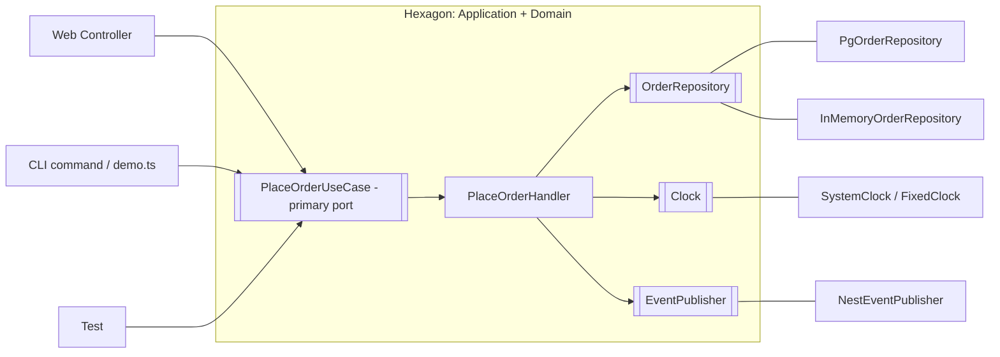

# Chương 6. Ports & Adapters (Hexagonal Architecture)

> Nguồn: Alistair Cockburn, *Hexagonal Architecture* (2005, còn gọi Ports and Adapters).

## 6.1 Vấn đề

Chương 5 cho luật "ai biết ai". Nhưng khi core cần nói chuyện ra ngoài (lưu đơn, gửi tin, xem giờ) hoặc khi bên ngoài cần gọi vào (web, CLI, test), ta cần một **hình thức giao tiếp chuẩn**, không để từng chỗ tự tiện.

## 6.2 Động cơ của Cockburn

Điều Cockburn muốn giải quyết là: ứng dụng hay bị trộn logic với UI code, đến mức không điều khiển được bằng cách nào khác ngoài UI đó. Ý định của ông: cho phép ứng dụng **được điều khiển như nhau bởi người dùng, chương trình khác, test tự động hay batch script**, và được phát triển, test **độc lập với device và database lúc chạy thật**. Testability chỉ là **hệ quả** của việc cô lập đó, không phải mục tiêu gốc.

Hình lục giác chỉ là hình vẽ chừa chỗ cho nhiều cạnh; số cạnh sáu không có ý nghĩa đặc biệt.

## 6.3 Hai loại port

**Port** là một "cổng" do ứng dụng định nghĩa, bằng interface. **Adapter** là mảnh code dịch giữa một công nghệ bên ngoài và port.

| | Primary (driving) | Secondary (driven) |
|---|---|---|
| Hướng | Bên ngoài **gọi vào** ứng dụng | Ứng dụng **gọi ra** bên ngoài |
| Port là | API của ứng dụng: interface use case | Thứ ứng dụng cần: lưu, gửi, xem giờ |
| Ai implement | **Handler của ứng dụng** implement | **Adapter** implement |
| Adapter | Controller, lệnh CLI, test, job: **gọi** port | `PgOrderRepository`, `LogOrderNotifier`... |
| Ví dụ | `PlaceOrderUseCase` | `OrderRepository`, `OrderNotifier`, `Clock`, `EventPublisher` |

Chỗ hay nhầm: với primary port, controller **không implement** port; nó **gọi** port. Cái implement port là `PlaceOrderHandler`. Với secondary port thì ngược lại, adapter mới implement.



## 6.4 Primary port: API của ứng dụng

File `lab/src/application/port/in/place-order-use-case.ts`:

```ts
import type { OrderId } from '../../../domain/order/order-id.js';
import type { PlaceOrderCommand } from '../../place-order/place-order-command.js';

/** Primary port: một phần API của ứng dụng. Adapter bên ngoài GỌI vào đây. */
export interface PlaceOrderUseCase {
  handle(command: PlaceOrderCommand): Promise<OrderId>;
}
```

`PlaceOrderHandler implements PlaceOrderUseCase` (chương 4). Bất kỳ ai cũng chỉ cần biết interface này. Adapter CLI của ta là `lab/script/demo.ts`, adapter test là các file trong `lab/test/`, adapter web là controller. Dưới đây là controller của NestJS (file `lab/src/nest/order.controller.ts`; decorator, DI token và module được giải thích ở chương 7):

```ts
import {
  Body,
  Controller,
  Get,
  Headers,
  HttpCode,
  Inject,
  Post,
  UnauthorizedException,
  UnprocessableEntityException,
} from '@nestjs/common';
import type { PlaceOrderUseCase } from '../application/port/in/place-order-use-case.js';
import type { OrderSummary } from '../application/query/order-summary.js';
import type { OrderSummaryReader } from '../application/query/order-summary-reader.js';
import { DomainRuleViolation } from '../domain/shared/errors.js';
import { PlaceOrderDto } from './place-order.dto.js';
import { ORDER_SUMMARY_READER, PLACE_ORDER_USE_CASE } from './tokens.js';

/**
 * Primary (driving) adapter: dịch HTTP thành Command rồi GỌI vào primary port.
 * Nó không implement port và không chứa luật nghiệp vụ.
 *
 * Danh tính khách lấy từ header x-customer-id để ví dụ gọn; ứng dụng thật dùng Guard
 * xác thực (JWT, session...) rồi đặt customerId vào request.
 */
@Controller('orders')
export class OrderController {
  constructor(
    @Inject(PLACE_ORDER_USE_CASE) private readonly placeOrder: PlaceOrderUseCase,
    @Inject(ORDER_SUMMARY_READER) private readonly reader: OrderSummaryReader,
  ) {}

  @Get()
  async index(@Headers('x-customer-id') customerId: string | undefined): Promise<readonly OrderSummary[]> {
    return this.reader.forCustomer(this.requireCustomer(customerId));
  }

  @Post()
  @HttpCode(201)
  async store(
    @Headers('x-customer-id') customerId: string | undefined,
    @Body() body: PlaceOrderDto,
  ): Promise<{ orderId: string }> {
    try {
      const orderId = await this.placeOrder.handle({
        customerId: this.requireCustomer(customerId),
        ebookIds: body.ebookIds,
      });
      return { orderId };
    } catch (error) {
      if (error instanceof DomainRuleViolation) {
        throw new UnprocessableEntityException(error.message);
      }
      throw error;
    }
  }

  private requireCustomer(customerId: string | undefined): string {
    if (customerId === undefined || customerId.trim() === '') {
      throw new UnauthorizedException('Thiếu danh tính khách.');
    }
    return customerId;
  }
}
```

Controller nằm ở outermost layer (chương 5). Nó: nhận body đã được `ValidationPipe` kiểm hình dạng, dựng `PlaceOrderCommand`, **gọi** port, đổi `DomainRuleViolation` thành HTTP 422, rồi trả kết quả. Không một dòng luật nghiệp vụ nào. Chú ý kiểu của hai thuộc tính constructor: `PlaceOrderUseCase` và `OrderSummaryReader` là interface của core, controller không biết `PlaceOrderHandler` hay adapter nào đứng sau.

## 6.5 Secondary port: thứ ứng dụng cần

### Clock là một port, không phải Factory

Core cần biết "bây giờ" để ghi `placedAt`. Gọi `new Date()` rải rác làm test phải đoán giờ. Giải pháp: một port `Clock`.

```ts
/** Secondary port: core chỉ lấy "bây giờ" qua đây. */
export interface Clock {
  now(): Date;
}
```

`Clock` là **secondary port**, và hai implementation là hai adapter: `SystemClock` (đồng hồ thật), `FixedClock` (đứng yên cho test). Nó **không phải** Factory pattern: Factory tạo ra object; `Clock` là port tới một nguồn bên ngoài (thời gian) có thể thay thế. Adapter cho test (file `lab/src/infrastructure/time/fixed-clock.ts`):

```ts
import type { Clock } from '../../application/port/out/clock.js';

/** Adapter dành cho test: đồng hồ đứng yên, có thể chỉnh tay. */
export class FixedClock implements Clock {
  #now: Date;

  constructor(now: Date) {
    this.#now = new Date(now);
  }

  now(): Date {
    return new Date(this.#now);
  }

  advanceTo(now: Date): void {
    this.#now = new Date(now);
  }
}
```

Quy tắc nhất quán: **chỉ handler (Application) hỏi Clock, rồi truyền thời điểm xuống domain** (`Order.place(..., this.clock.now())`, `markPaid(ref, this.clock.now())`). Domain không tự gọi giờ, nên không có chỗ nào trong core đọc đồng hồ ngầm. Vì `Date` mutable, `FixedClock` luôn trả bản sao mới.

### Port hướng nghiệp vụ, không hướng công nghệ

Port nên diễn đạt **điều ứng dụng cần**, không phải **công cụ sẽ dùng**.

```ts
import type { CustomerId } from '../../../domain/order/customer-id.js';
import type { OrderId } from '../../../domain/order/order-id.js';
import type { Money } from '../../../domain/shared/money.js';

/**
 * Secondary port hướng nghiệp vụ: nói "gửi xác nhận đơn", không nói gửi bằng gì.
 */
export interface OrderNotifier {
  sendOrderConfirmation(customerId: CustomerId, orderId: OrderId, total: Money): Promise<void>;
}
```

`OrderNotifier.sendOrderConfirmation(...)` là hướng nghiệp vụ. So sánh với hai thiết kế hướng công nghệ (minh hoạ xấu, không nằm trong lab):

```ts
interface Connection { insert(table: string, row: Record<string, unknown>): Promise<void>; } // SQL
interface Mailer     { send(to: string, subject: string, html: string): Promise<void>; }
```

Các interface này vẫn là interface, nhưng **rò rỉ infrastructure**: gọi `insert('orders', {...})` buộc core biết tên table và column, tức biết lưu bằng relational table; gọi `send(to, subject, html)` buộc core biết tin nhắn là email có tiêu đề và HTML, nên đổi sang SMS hay đẩy thông báo thì phải sửa core. Interface hướng nghiệp vụ cho phép đổi công nghệ mà core không đổi: một adapter gửi email, adapter khác gửi SMS.

## 6.6 Listener ở Application không biết mail

Khi `OrderPlaced` xảy ra, ta muốn gửi xác nhận. Listener nằm trong Application, nên chỉ được phụ thuộc port (file `lab/src/application/listener/send-order-confirmation-when-order-placed.ts`):

```ts
import type { OrderPlaced } from '../../domain/order/order-events.js';
import type { OrderNotifier } from '../port/out/order-notifier.js';

/** Chỉ phụ thuộc port OrderNotifier, không biết mail hay SMS. */
export class SendOrderConfirmationWhenOrderPlaced {
  constructor(private readonly notifier: OrderNotifier) {}

  async handle(event: OrderPlaced): Promise<void> {
    await this.notifier.sendOrderConfirmation(event.customerId, event.orderId, event.total);
  }
}
```

Nó nhận `OrderNotifier` (port), **không** import thư viện mail hay logger trực tiếp. Còn adapter chạy cùng NestJS trong lab (file `lab/src/nest/log-order-notifier.ts`):

```ts
import { Injectable, Logger } from '@nestjs/common';
import type { OrderNotifier } from '../application/port/out/order-notifier.js';
import type { CustomerId } from '../domain/order/customer-id.js';
import type { OrderId } from '../domain/order/order-id.js';
import type { Money } from '../domain/shared/money.js';

/**
 * Adapter của OrderNotifier: ghi log thay vì gửi mail để lab không cần SMTP.
 * Adapter thật (nodemailer, SES, SMS...) chỉ cần implement cùng interface.
 */
@Injectable()
export class LogOrderNotifier implements OrderNotifier {
  readonly #logger = new Logger(LogOrderNotifier.name);

  async sendOrderConfirmation(customerId: CustomerId, orderId: OrderId, total: Money): Promise<void> {
    this.#logger.log(`Gửi xác nhận cho ${customerId}: đơn ${orderId}, tổng ${total.format()}`);
  }
}
```

Lab ghi log thay vì gửi mail thật để không cần SMTP; adapter thật (nodemailer, dịch vụ email, SMS) chỉ cần implement cùng interface và đổi một dòng trong module (chương 7). Điều này vá một lỗi hay gặp: Application layer gọi trực tiếp class concrete của Infrastructure. Ở đây hướng source code chĩa vào port.

## 6.7 Adapter test là first-class citizen

Vì mọi thứ bên ngoài đều ở sau port, test chỉ việc cắm fake adapter. `RecordingOrderNotifier` ghi lại thay vì gửi (file `lab/src/infrastructure/in-memory/recording-order-notifier.ts`):

```ts
import type { OrderNotifier } from '../../application/port/out/order-notifier.js';
import type { CustomerId } from '../../domain/order/customer-id.js';
import type { OrderId } from '../../domain/order/order-id.js';
import type { Money } from '../../domain/shared/money.js';

/** Adapter test: ghi lại thay vì gửi thật. */
export class RecordingOrderNotifier implements OrderNotifier {
  readonly sent: string[] = [];

  async sendOrderConfirmation(customerId: CustomerId, orderId: OrderId, total: Money): Promise<void> {
    this.sent.push(`${customerId}|${orderId}|${total.format()}`);
  }
}
```

Nhờ đó `lab/test/application.test.ts` kiểm "gửi đúng một thông báo với tổng 350 VND" mà không cần mạng.

## 6.8 Cạm bẫy thường gặp

- **Cho controller `implements` primary port.** Controller là adapter gọi vào; handler mới implement.
- **Port hướng công nghệ** (`insert`, `send(html)`), mục 6.5.
- **Một port "to" gom mọi thứ** (`ExternalServices`); mỗi nhu cầu một port nhỏ.
- **Lẫn Clock với Factory**, hoặc lấy giờ ở nửa core này bằng `Clock`, nửa kia bằng `new Date()`.
- **Adapter chứa luật.** Adapter chỉ dịch; luật ở core.
- **Port quá sớm.** Chỉ tạo port khi có thứ ngoài đáng cô lập (DB, mail, giờ, mạng).
- **Liệt kê "testability" làm mục tiêu số một.** Cockburn nhắm tới việc điều khiển ứng dụng từ nhiều phía và cô lập khỏi thiết bị; test dễ là hệ quả.

## 6.9 Tóm tắt

1. Động cơ Cockburn: ứng dụng được điều khiển như nhau bởi người dùng, chương trình, test, batch và cô lập khỏi DB/thiết bị; testability là hệ quả.
2. Primary port = API ứng dụng (use case); controller/CLI/test là adapter GỌI vào, handler implement.
3. Secondary port = thứ ứng dụng cần; adapter implement.
4. `Clock` là secondary port, không phải Factory; chỉ handler hỏi giờ rồi truyền xuống.
5. Port hướng nghiệp vụ (`OrderNotifier`) giữ core sạch; port hướng công nghệ (`Connection.insert`) rò rỉ infrastructure.

## 6.10 Tự kiểm tra

1. Ai implement `PlaceOrderUseCase`? Controller làm gì với nó?
2. `Clock` thuộc loại port nào? Vì sao không phải Factory?
3. Vì sao `Connection.insert(table, row)` vẫn rò rỉ infrastructure dù là interface?
4. Động cơ gốc của Cockburn là gì, test dễ là gì?
5. Listener ở Application có được gọi thư viện mail trực tiếp không?

<details>
<summary>Đáp án</summary>

1. `PlaceOrderHandler` implement; controller dựng command và gọi `handle()`.
2. Secondary (driven) port, vì nó là nguồn bên ngoài mà core cần. Factory tạo object, Clock không tạo gì cả mà cung cấp thời điểm hiện tại.
3. Nó bắt core biết tên table và column, tức công nghệ lưu trữ relational; đổi công nghệ phải sửa core.
4. Cho phép ứng dụng được người dùng, chương trình, test và batch điều khiển như nhau và cô lập khỏi thiết bị/DB; test dễ là hệ quả.
5. Không; chỉ qua port `OrderNotifier`, còn adapter mới dùng thư viện mail.

</details>
