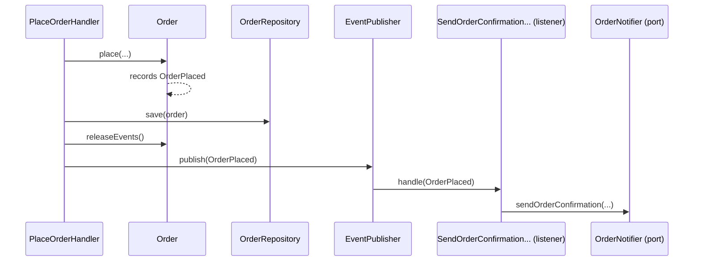

# Chương 8. Domain Event và testing theo từng layer

> Domain Event: Evans đề cập trong các bài về sau, Vernon mô tả chi tiết ở *Implementing DDD* (2013). Testing: áp dụng các chương trước.

## 8.1 Vấn đề

Sau khi đơn được đặt, cần gửi email xác nhận. Nếu `PlaceOrderHandler` gọi thẳng "gửi email", handler biết nhiều việc không phải của nó, và mỗi nhu cầu mới (cộng điểm thưởng, báo kho, ghi log) lại sửa handler. Ta cần cách nói "**chuyện này vừa xảy ra**" mà không buộc người nói phải biết ai quan tâm.

## 8.2 Domain Event

Domain Event là một sự kiện đã xảy ra trong domain, đặt tên ở **thì quá khứ**, immutable: `OrderPlaced`, `OrderPaid`. Mỗi event là một class (để `instanceof` và `event.constructor` nhận ra loại), mọi property `readonly` và `Object.freeze` (file `lab/src/domain/order/order-events.ts`):

```ts
import type { DomainEvent } from '../shared/domain-event.js';
import type { Money } from '../shared/money.js';
import type { CustomerId } from './customer-id.js';
import type { OrderId } from './order-id.js';

export class OrderPlaced implements DomainEvent {
  constructor(
    readonly orderId: OrderId,
    readonly customerId: CustomerId,
    readonly total: Money,
    readonly occurredAt: Date,
  ) {
    Object.freeze(this);
  }
}

export class OrderPaid implements DomainEvent {
  constructor(
    readonly orderId: OrderId,
    readonly customerId: CustomerId,
    readonly occurredAt: Date,
  ) {
    Object.freeze(this);
  }
}
```

Aggregate **ghi nhận** event vào danh sách nội bộ khi trạng thái đổi (`Order.place()` thêm `OrderPlaced`, `markPaid()` thêm `OrderPaid`). Handler sau khi `save()` thì lấy event ra bằng `releaseEvents()` và đẩy sang port `EventPublisher` (file `lab/src/application/port/out/event-publisher.ts`):

```ts
import type { DomainEvent } from '../../../domain/shared/domain-event.js';

/** Secondary port: phát domain event ra ngoài core. */
export interface EventPublisher {
  publish(event: DomainEvent): Promise<void>;
}
```

`publish` trả `Promise<void>` vì listener có thể bất đồng bộ (gọi mạng, ghi DB). Có hai nhóm implementation: bản synchronous cho script/test thuần, và bản của NestJS.

Bản synchronous không cần thư viện (file `lab/src/infrastructure/in-memory/synchronous-event-publisher.ts`). Kiểu `EventClass<E>` cho phép `subscribe(OrderPlaced, listener)` và compiler suy ra `listener` nhận `OrderPlaced`:

```ts
import type { EventPublisher } from '../../application/port/out/event-publisher.js';
import type { DomainEvent } from '../../domain/shared/domain-event.js';

type EventClass<E extends DomainEvent> = abstract new (...args: never[]) => E;
type Listener<E extends DomainEvent> = (event: E) => void | Promise<void>;

export class SynchronousEventPublisher implements EventPublisher {
  readonly #listeners = new Map<EventClass<DomainEvent>, Listener<DomainEvent>[]>();

  subscribe<E extends DomainEvent>(eventClass: EventClass<E>, listener: Listener<E>): void {
    const list = this.#listeners.get(eventClass) ?? [];
    list.push(listener as Listener<DomainEvent>);
    this.#listeners.set(eventClass, list);
  }

  async publish(event: DomainEvent): Promise<void> {
    for (const listener of this.#listeners.get(event.constructor as EventClass<DomainEvent>) ?? []) {
      await listener(event);
    }
  }
}
```

Với NestJS, cơ chế phù hợp là package `@nestjs/event-emitter` (bọc `EventEmitter2`, cập nhật 11/2026: 12.0.2). Adapter của port là một class mỏng (file `lab/src/nest/nest-event-publisher.ts`); tên event là tên class. `emitAsync` đợi mọi listener xong rồi mới trả về, nên handler có thể `await` được:

```ts
import { Injectable } from '@nestjs/common';
import { EventEmitter2 } from '@nestjs/event-emitter';
import type { EventPublisher } from '../application/port/out/event-publisher.js';
import type { DomainEvent } from '../domain/shared/domain-event.js';

/**
 * Adapter của port EventPublisher dựa trên EventEmitter2 của @nestjs/event-emitter.
 * Tên event = tên class (OrderPlaced). emitAsync đợi mọi listener xong rồi mới trả về.
 */
@Injectable()
export class NestEventPublisher implements EventPublisher {
  constructor(private readonly emitter: EventEmitter2) {}

  async publish(event: DomainEvent): Promise<void> {
    await this.emitter.emitAsync(event.constructor.name, event);
  }
}
```

Phía nhận: Nest tìm decorator `@OnEvent` để đăng ký listener, nhưng listener thật (`SendOrderConfirmationWhenOrderPlaced`) nằm trong core và không được có decorator. Vì vậy ta viết một **subscriber mỏng** ở lớp NestJS, chỉ chuyển tiếp (file `lab/src/nest/order-confirmation.subscriber.ts`):

```ts
import { Inject, Injectable } from '@nestjs/common';
import { OnEvent } from '@nestjs/event-emitter';
import type { SendOrderConfirmationWhenOrderPlaced } from '../application/listener/send-order-confirmation-when-order-placed.js';
import { OrderPlaced } from '../domain/order/order-events.js';
import { SEND_ORDER_CONFIRMATION } from './tokens.js';

/**
 * Cầu nối mỏng: Nest tìm @OnEvent để đăng ký, còn việc thật do listener của core làm.
 * Nhờ vậy core không phải import decorator nào của Nest.
 */
@Injectable()
export class OrderConfirmationSubscriber {
  constructor(@Inject(SEND_ORDER_CONFIRMATION) private readonly listener: SendOrderConfirmationWhenOrderPlaced) {}

  // suppressErrors: false để lỗi của listener truyền ngược về emitAsync (mặc định Nest chỉ log và nuốt lỗi).
  @OnEvent(OrderPlaced.name, { suppressErrors: false })
  async onOrderPlaced(event: OrderPlaced): Promise<void> {
    await this.listener.handle(event);
  }
}
```

Lưu ý `suppressErrors: false`: mặc định `@OnEvent` bắt và chỉ log lỗi của listener, `emitAsync` vẫn thành công. Ở đây ta muốn lỗi truyền ngược lên handler (và lên HTTP 500) nên tắt chế độ nuốt lỗi; bạn chọn ngược lại nếu thông báo chỉ là việc phụ không được làm hỏng use case.



Listener (chương 6) chỉ biết port `OrderNotifier`. Handler không biết có listener nào. Thêm hành vi mới nghĩa là thêm listener mới, không sửa handler.

## 8.3 Các điểm tinh tế

- **Phát sau khi lưu.** Nếu phát trước `save()` và việc lưu lỗi, người dùng nhận email cho đơn không tồn tại.
- **Nhưng phát sau lưu cũng có lỗ hổng:** nếu process chết giữa `save()` và `publish()`, event mất. Cách chuẩn khi cần chắc chắn là **outbox pattern**: ghi event vào table cùng transaction với aggregate, rồi một process khác phát đi. Sách này dừng ở bản synchronous để dễ học; hãy biết giới hạn của nó. `EventEmitter2` chạy trong cùng process và không bền: không phải message queue.
- **Event nhỏ và đủ dùng:** `OrderPlaced` mang `orderId`, `customerId`, `total`, thời điểm. Listener cần gì thêm thì tự hỏi qua port, đừng nhét cả aggregate vào event.
- **Event cũng tham chiếu bằng ID**, như aggregate (chương 2).
- **Đẩy listener sang queue** (BullMQ, message broker...) là việc của adapter `EventPublisher` khác; core không đổi.
- **Quên `await`** khi phát event: lỗi của listener thành unhandled rejection. Handler `await this.events.publish(...)`.

## 8.4 Testing theo từng layer

Vì mỗi layer phụ thuộc có giới hạn, mỗi layer có kiểu test rẻ riêng. Sách dùng test runner có sẵn của Node.js (`node:test`) và `node:assert/strict`, không thêm thư viện test nào; `@nestjs/testing` chỉ dùng để dựng module.

| Layer | Test gì | Dùng gì | Ví dụ trong lab |
|---|---|---|---|
| Domain | Luật của Entity/VO | Không cần gì ngoài TypeScript | `lab/test/domain.test.ts`: `Money` cộng khác tiền tệ ném lỗi; `Order` rỗng bị từ chối; tổng 350 |
| Kiểu (compile-time) | Brand chặn truyền nhầm ID | `tsc --noEmit` và `@ts-expect-error` | `lab/test/typing.test.ts` |
| Application | Use case từ đầu đến cuối | Adapter InMemory + `FixedClock` + `RecordingOrderNotifier` | `lab/test/application.test.ts`: đặt đơn, trả tiền, chặn mua lại, thông báo đúng một lần |
| Infrastructure adapter | Adapter đúng contract của port | PostgreSQL thật trong Docker | `lab/test/postgres-adapters.test.ts` chạy contract test và rollback |
| Primary adapter | Dịch HTTP đúng | `@nestjs/testing` + `fetch` (NestJS), `app.inject` (Fastify) | `lab/test/nest.e2e.test.ts`, `lab/test/fastify.test.ts`: thiếu body trả 400 |
| End-to-end | Vài kịch bản chính | Module thật + PostgreSQL thật | `lab/test/nest.postgres.test.ts`: đặt đơn rồi đọc read model |

Tinh thần: **nhiều test domain và application (nhanh), vừa phải test adapter, ít end-to-end test.** Phần lớn độ tin cậy đến từ hai layer đầu, chạy trong mili-giây.

Chạy bộ test trong lab (chi tiết trong README). Không có PostgreSQL thì các test PostgreSQL tự bỏ qua (skip); có PostgreSQL thì chạy đủ. Kết quả thực tế khi tác giả chạy:

```text
Không có DATABASE_URL:  tests 42, pass 42, fail 0  (hai suite PostgreSQL bị skip)
Có PostgreSQL 18.6:     tests 51, pass 51, fail 0
```

`tsc --noEmit` chạy sạch, không lỗi kiểu, trong đó có các dòng `@ts-expect-error` của `typing.test.ts` (nếu brand ngừng chặn, các dòng đó hết lỗi và `tsc` sẽ báo lỗi).

**Contract test** (đã nói ở chương 3, file `lab/test/order-repository.contract.ts`) là bộ khẳng định chung cho `OrderRepository`, chạy lần lượt trên `InMemoryOrderRepository` và `PgOrderRepository`. Khi cả hai cùng qua bộ test, bạn mới yên tâm rằng các test use case chạy trên in-memory phản ánh đúng adapter thật.

Với NestJS, test event thường dùng `EventEmitter2` thật như trong `nest.e2e.test.ts`: gửi request, rồi kiểm `RecordingOrderNotifier.sent`. Ở core, ta assert bằng chính `SynchronousEventPublisher` cộng `RecordingOrderNotifier`, nên không cần framework.

## 8.5 Cạm bẫy thường gặp

- **Đặt tên event ở thì mệnh lệnh** (`PlaceOrder`) thay vì quá khứ (`OrderPlaced`): lẫn với Command.
- **Cho event mang cả aggregate** rồi listener sửa nó: hai nơi thay đổi aggregate.
- **Phát event trước khi lưu.**
- **Tin tuyệt đối vào publish đồng bộ**, quên outbox khi cần độ chắc chắn.
- **Test use case bằng DB thật mọi lần**: chậm; chỉ dùng DB thật để kiểm adapter.
- **Chỉ test ở HTTP layer**: mọi luật phải kiểm qua request, chậm và khó định vị lỗi.
- **Test adapter in-memory để "chứng minh" adapter PostgreSQL đúng**: cần bộ contract test chạy trên cả hai.
- **Test chạy song song dùng chung một database**: `node --test` chạy mỗi file trong một process riêng; lab dùng `--test-concurrency=1` vì các file PostgreSQL cùng xoá và tạo lại bảng.
- **Dùng `as` trong test để "lách" kiểu** rồi quên rằng kiểu chỉ kiểm lúc compile: dùng `@ts-expect-error` để *khẳng định* lỗi kiểu, đừng im lặng bỏ qua.

## 8.6 Tóm tắt

1. Domain Event là sự kiện quá khứ, immutable; aggregate ghi nhận, handler phát sau khi lưu.
2. Handler chỉ gọi port `EventPublisher`; listener ở Application chỉ biết port của nó. Với NestJS, adapter dựa trên `@nestjs/event-emitter` và một subscriber mỏng có `@OnEvent`.
3. Thêm hành vi phụ = thêm listener, không sửa handler.
4. Outbox pattern là hướng khi cần độ chắc chắn tuyệt đối.
5. Test nhiều ở domain/application bằng adapter InMemory, ít ở adapter và end-to-end; `node:test` và `tsc --noEmit` là đủ để bắt đầu.

## 8.7 Tự kiểm tra

1. Vì sao `OrderPlaced` đặt ở thì quá khứ?
2. Vì sao handler phát event sau khi `save()`?
3. Điều gì xảy ra nếu process chết giữa `save()` và `publish()`? Cách khắc phục?
4. Layer nào nên có nhiều test nhất và vì sao?
5. Vì sao listener trong core không dùng `@OnEvent` trực tiếp mà đi qua subscriber?

<details>
<summary>Đáp án</summary>

1. Vì nó mô tả điều đã xảy ra, không phải yêu cầu làm gì; lệnh yêu cầu là Command.
2. Để không thông báo cho đơn chưa chắc đã tồn tại.
3. Event bị mất. Dùng outbox: ghi event cùng transaction với aggregate rồi phát bằng process riêng.
4. Domain và application: nhanh, không IO, định vị lỗi chính xác.
5. `@OnEvent` là decorator của `@nestjs/event-emitter`; đặt nó trong core là kéo framework vào core. Subscriber mỏng ở lớp NestJS làm cầu nối.

</details>
