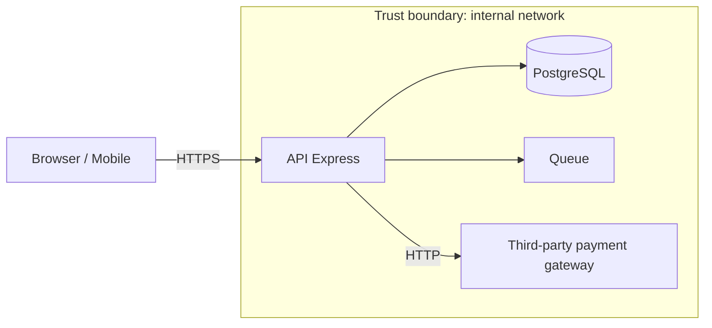

# Chương 1. Tư duy bảo mật

## 1. Vấn đề

Bạn đã viết một API đặt hàng chạy tốt: test xanh, response nhanh. Nhưng "chạy đúng với người dùng tốt" khác hẳn "không bị phá bởi người dùng xấu". Lỗi bảo mật gần như luôn nằm ở chỗ **code làm đúng điều mình viết, nhưng mình đã giả định sai về input hoặc về caller**.

Ví dụ xuyên suốt của cả cuốn: một shop sách nhỏ (`Book`, `Order`, `User`, `Comment`) viết bằng TypeScript/Node.js (Express 5, PostgreSQL), có REST API `/api/orders/:id`, `/api/books?q=`, `/api/comments`. Các chương sau sẽ phá và vá chính những endpoint này, và phần lab chạy thật.

## 2. Khái niệm

### 2.1 Ba mục tiêu: CIA

- **Confidentiality** (bí mật): chỉ người được phép mới đọc được.
- **Integrity** (toàn vẹn): dữ liệu không bị sửa trái phép.
- **Availability** (sẵn sàng): hệ thống dùng được khi cần.

Mỗi vulnerability phá ít nhất một trong ba. SQL injection đọc dữ liệu: phá C; mass assignment tự nâng quyền: phá I; ReDoS hay upload file khổng lồ: phá A.

### 2.2 Threat modeling với STRIDE

Threat modeling là việc ngồi xuống TRƯỚC khi code (hoặc khi review thiết kế) và hỏi: "Cái gì có thể sai?" Bốn câu hỏi của Shostack: Ta đang xây gì? Cái gì có thể sai? Ta làm gì với nó? Ta đã làm đủ tốt chưa?

STRIDE là bộ gợi ý cho câu hỏi thứ hai, mỗi chữ là một loại threat, đối ứng một security property bị vi phạm:

| Chữ | Threat | Thuộc tính bị phá | Ví dụ ở shop sách | Đối phó điển hình |
|---|---|---|---|---|
| S | Spoofing (giả mạo danh tính) | Authentication | Dùng lại token bị đánh cắp | MFA, session an toàn |
| T | Tampering (sửa dữ liệu) | Integrity | Sửa `price` trong request đặt hàng | Server tự tính giá, validation, chữ ký |
| R | Repudiation (chối bỏ) | Non-repudiation | "Tôi không hủy đơn đó" | Audit log không sửa được |
| I | Information disclosure | Confidentiality | IDOR đọc đơn của người khác | Authorization, encryption |
| D | Denial of service | Availability | Gọi `/search` hàng nghìn lần | Rate limit, timeout, quota |
| E | Elevation of privilege | Authorization | User thường gọi `/admin` | Kiểm tra quyền mọi nơi, least privilege |

Cách làm thực dụng cho team nhỏ (30–60 phút):

1. Vẽ **Data Flow Diagram** (DFD): ai/cái gì gọi vào, dữ liệu đi đâu, kho dữ liệu nào.
2. Đánh dấu **trust boundary** (ranh giới tin cậy): nơi dữ liệu chuyển từ vùng ít tin cậy sang nhiều tin cậy (Internet → API; API → DB; API → third-party service).
3. Với mỗi mũi tên cắt qua trust boundary, duyệt STRIDE.
4. Ghi rủi ro, quyết định (giảm, chấp nhận, chuyển giao, tránh), gán người chịu trách nhiệm.

Mũi tên `B → G` nhận cả 6 loại STRIDE; mũi tên `G → P` thì đáng nghĩ đến Spoofing (webhook giả) và Tampering (số tiền bị sửa).

### 2.3 Defense in depth

Defense in depth (phòng thủ nhiều lớp): không có layer nào hoàn hảo, nên xếp nhiều layer độc lập để một layer thủng thì layer khác còn chặn. Với SQL injection:

1. Validate input (layer 1).
2. Parameterized query (layer 2, layer chính).
3. Tài khoản DB chỉ có quyền `SELECT/INSERT/UPDATE` trên bảng cần thiết (layer 3: nếu bị injection, thiệt hại giới hạn).
4. WAF/monitoring log bất thường (layer 4: phát hiện).

Quan trọng: các layer phải **độc lập**. Hai layer cùng dựa vào một giả định (ví dụ cùng tin header `X-Forwarded-For`) thì chỉ là một layer.

### 2.4 Least privilege

Least privilege (đặc quyền tối thiểu): mỗi user, service, token, DB account chỉ có permission tối thiểu để làm việc của nó.

- DB user của ứng dụng web không cần `DROP`, `GRANT`, `FILE`.
- Migration chạy bằng user khác với runtime.
- Token API cấp scope hẹp (`orders:read`) thay vì "full access".
- Container chạy non-root, filesystem read-only khi có thể.

### 2.5 Secure by default

Cấu hình mặc định phải an toàn; muốn nới lỏng phải chủ động và có lý do. Ví dụ: field mới thêm vào model mặc định **không** mass-assignable (validate body bằng schema allowlist như zod `strictObject`, thay vì spread `req.body` vào ORM hay câu UPDATE); endpoint mới mặc định yêu cầu đăng nhập (middleware xác thực gắn ở router gốc, route công khai là ngoại lệ được liệt kê); cookie session mặc định `HttpOnly`, `Secure`, `SameSite`.

### 2.6 Các nguyên tắc khác nên thuộc lòng

- **Never trust input** (không tin dữ liệu từ client): kể cả header, cookie, tên file, JWT claim chưa verify.
- **Fail securely** (lỗi thì đóng): khi lỗi kiểm tra quyền, từ chối thay vì cho qua.
- **Complete mediation**: kiểm tra quyền ở mỗi request, mỗi resource, không cache "đã được phép" ở client.
- **Keep it simple** (economy of mechanism): code bảo mật càng đơn giản càng ít lỗi; đừng tự viết crypto.
- **Separation of duties**: người deploy không tự duyệt thay đổi nhạy cảm.

## 3. Ví dụ: threat model nhanh cho `POST /api/orders`

| Threat | Kịch bản | Biện pháp |
|---|---|---|
| T | Client gửi `{"price": 1}` | Server lấy giá từ DB, bỏ qua `price` từ client |
| E | Client gửi `{"user_id": 1, "is_admin": true}` | schema allowlist (zod `strictObject`, chương 10), policy |
| I | `GET /api/orders/123` của người khác | Policy `view` trên Order (chương 9) |
| D | Spam tạo đơn | Rate limit theo user + IP |
| R | Khách chối đã đặt | Audit log (chương 13) |
| S | Replay token cũ | Token ngắn hạn, rotation (chương 7) |

Một buổi như vậy thường tìm ra 5–10 việc cần làm, rẻ hơn nhiều so với patch sau khi bị exploit.

## 4. Trade-off: khi nào làm, khi nào không

- Threat model đầy đủ cho mỗi tính năng là quá nặng. Hãy làm khi: thêm một trust boundary mới (tích hợp third-party, API công khai), xử lý dữ liệu nhạy cảm (thanh toán, y tế), hoặc đổi kiến trúc.
- Với thay đổi nhỏ, một checklist 5 câu hỏi (ai gọi? dữ liệu của ai? input nào tin được? lỗi thì sao? log gì?) là đủ.
- Bảo mật có chi phí: thêm layer = thêm latency, độ phức tạp, ma sát cho user. Cân theo mức rủi ro, không áp tối đa cho mọi thứ.

## 5. Cạm bẫy

- "Security through obscurity": tin rằng URL `/admin-x7f3` không ai biết. Sai.
- Chỉ bảo vệ ở UI (ẩn nút), quên bảo vệ API.
- Coi bảo mật là việc cuối dự án, hoặc việc của "team security".
- Threat model xong cất vào ngăn kéo, không cập nhật khi kiến trúc đổi.
- Chống đúng một vector (ví dụ SQLi) mà bỏ layer 3 (DB user quyền root).

## 6. Tóm tắt

- Bảo mật = bảo vệ C-I-A; lỗi thường đến từ giả định sai về input/caller.
- STRIDE là danh sách gợi ý giúp duyệt nhanh các loại threat trên mỗi trust boundary.
- Defense in depth: nhiều layer độc lập; Least privilege: quyền tối thiểu; Secure by default: mặc định an toàn.
- Threat model nhẹ, làm sớm, làm lại khi kiến trúc đổi.

## 7. Câu hỏi tự kiểm tra

1. STRIDE gồm những chữ nào, và chữ nào đối ứng với property Authorization?
2. Trust boundary là gì? Cho một ví dụ ở API Express.
3. Vì sao hai layer phòng thủ cùng dựa vào một giả định không được tính là defense in depth?
4. `Object.assign(user, req.body)` (hay `...req.body` vào ORM) vi phạm nguyên tắc nào?

Đáp án

1. Spoofing, Tampering, Repudiation, Information disclosure, Denial of service, Elevation of privilege. Chữ E (Elevation of privilege) đối ứng Authorization.
2. Ranh giới nơi dữ liệu chuyển giữa các vùng có mức tin cậy khác nhau, ví dụ Internet → route handler Express, hoặc API → third-party payment gateway.
3. Vì chung điểm yếu: giả định sai thì cả hai cùng thủng, nên thực chất chỉ là một layer.
4. Secure by default (và least privilege): mọi field mới tự động bị gán được từ input.

