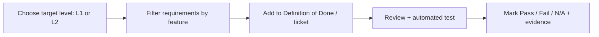

# Chương 2. OWASP Top 10 (2025) và ASVS

## 1. Vấn đề

"Nên bảo vệ cái gì trước?" và "thế nào là đủ an toàn?" là hai câu hỏi mà cảm tính trả lời rất tệ. OWASP cung cấp hai công cụ bổ sung nhau: **Top 10** (nhận thức: những rủi ro phổ biến nhất) và **ASVS** (kiểm chứng: danh sách yêu cầu cụ thể để kiểm tra).

## 2. OWASP Top 10: phiên bản 2025

Tra cứu ngày 08/11/2026 tại `top10.owasp.org/2025`: trang gọi mình là bản **OWASP Top 10:2025** (phát hành cuối 2025, trang không ghi ngày chính xác; xác minh ngày phát hành cụ thể: chưa xác minh). Bản trước là 2021. Danh sách 2025:

| # | Hạng mục 2025 | Gặp ở chương |
|---|---|---|
| A01 | Broken Access Control | 9, 10 |
| A02 | Security Misconfiguration | 11 |
| A03 | Software Supply Chain Failures | 12 |
| A04 | Cryptographic Failures | 6, 11 |
| A05 | Injection | 3, 4 |
| A06 | Insecure Design | 1 |
| A07 | Authentication Failures | 6, 7, 8 |
| A08 | Software or Data Integrity Failures | 10, 12 |
| A09 | Security Logging and Alerting Failures | 13 |
| A10 | Mishandling of Exceptional Conditions | 13 (và xử lý lỗi, chương 11) |

So với 2021 (theo cách nhớ và đối chiếu tên): Security Misconfiguration lên hạng 2; "Vulnerable and Outdated Components" được mở rộng thành **Software Supply Chain Failures**; **Mishandling of Exceptional Conditions** là mục mới (xử lý error/exception sai dẫn đến lộ thông tin hoặc fail-open). SSRF của 2021 không còn là mục riêng: CWE-918 (SSRF) nằm trong danh sách CWE của A01 Broken Access Control (đã xác minh trên trang A01:2025). Hãy đọc trang gốc để xem dữ liệu và CWE từng mục.

Cách dùng đúng Top 10: là **tài liệu đào tạo và ưu tiên**, không phải checklist đầy đủ. Một ứng dụng "đã chống đủ 10 mục" vẫn có thể có lỗi logic nghiệp vụ.

## 3. OWASP ASVS

**Application Security Verification Standard** là danh sách yêu cầu bảo mật có đánh số, có thể kiểm tra được. Phiên bản hiện tại: **ASVS 5.0.0**, "Stable release", phát hành **30/05/2025** (tra tại `asvs.owasp.org`). Bản 4.0.3 là bản cũ.

Cấu trúc 5.0 gồm 17 chương (xác minh qua cây thư mục repo `OWASP/ASVS`, tag v5.0.0):

| Chương | Tên | Chương | Tên |
|---|---|---|---|
| V1 | Encoding and Sanitization | V10 | OAuth and OIDC |
| V2 | Validation and Business Logic | V11 | Cryptography |
| V3 | Web Frontend Security | V12 | Secure Communication |
| V4 | API and Web Service | V13 | Configuration |
| V5 | File Handling | V14 | Data Protection |
| V6 | Authentication | V15 | Secure Coding and Architecture |
| V7 | Session Management | V16 | Security Logging and Error Handling |
| V8 | Authorization | V17 | WebRTC |
| V9 | Self-contained Tokens | | |

Mỗi yêu cầu có mã `v<phiên bản>-<chương>.<mục>.<yêu cầu>`, ví dụ `v5.0.0-6.2.1` (chương Authentication). Mỗi yêu cầu gắn **level** 1, 2 hoặc 3:

- **L1**: mức tối thiểu cho mọi ứng dụng; có thể kiểm bằng pen test/ZAP và review cơ bản.
- **L2**: khuyến nghị cho phần lớn ứng dụng chứa dữ liệu nhạy cảm.
- **L3**: ứng dụng rủi ro cao (tài chính, y tế, hạ tầng quan trọng).

(Số lượng yêu cầu chính xác mỗi level: chưa xác minh trong lần tra này; tải bản Excel/CSV của ASVS để đếm.)

Một điểm khác bản 4.x: 5.0 tách riêng các chương Self-contained Tokens (JWT...), OAuth/OIDC, và coi **tài liệu hóa quyết định bảo mật** là một phần yêu cầu (nhiều yêu cầu mở đầu bằng "Verify that documentation defines..."). Điều này đồng nghĩa: ASVS không chỉ kiểm code mà kiểm cả quy trình.

### Dùng ASVS làm checklist trong thực tế

1. **Chọn level**: shop sách có thanh toán và dữ liệu cá nhân → bắt đầu với L1 toàn bộ, rồi L2 cho các chương Authentication, Session, Authorization.
2. **Lọc theo tính năng**: làm tính năng upload thì lấy V5; làm login thì V6, V7. Đừng đọc cả 17 chương một lần.
3. **Biến thành acceptance criteria**: ví dụ ticket "Đổi password" có tiêu chí "password mới tối thiểu 8 ký tự (ASVS V6), không giới hạn tối đa quá thấp, không bắt quy tắc thành phần" (kiểm đúng số cụ thể trong bản ASVS bạn dùng).
4. **Ghi bằng chứng**: mỗi dòng có trạng thái, link PR/test. Bằng chứng tự động (test, CI) tốt hơn "đã review".
5. **Đánh dấu N/A có lý do**: không dùng WebRTC thì V17 là N/A.

Mẫu bảng theo dõi:

| Yêu cầu | Level | Trạng thái | Bằng chứng |
|---|---|---|---|
| V6 (password hash Argon2id/bcrypt) | 1 | Pass | `src/auth/password.ts`, test `password.test.ts` |
| V8 (authorization check ở service layer) | 1 | Fail | IDOR ở `/api/orders/{id}` (ticket SEC-12) |
| V17 | 1 | N/A | không dùng WebRTC |

Số hiệu yêu cầu cụ thể: hãy copy từ file ASVS 5.0.0 chính thức thay vì tin ví dụ trong sách này.

## 4. Trade-off

- Top 10 dễ nhớ, rẻ, tốt cho đào tạo cả team; nhưng thô.
- ASVS chi tiết, kiểm chứng được; nhưng nặng. Đừng cố đạt L3 cho blog cá nhân.
- Kết hợp: Top 10 để mở đầu cuộc nói chuyện, ASVS để làm việc hằng ngày, và Cheat Sheet Series của OWASP để biết cách cài đặt từng mục.

## 5. Cạm bẫy

- Dùng bản cũ (Top 10 2021, ASVS 4.0.3) mà không ghi rõ phiên bản; khi audit phải ghi `ASVS 5.0.0` để tái lập.
- Tích đủ ô nhưng không có bằng chứng.
- Coi Top 10 là "tiêu chuẩn tuân thủ". Nó không phải.
- Bỏ qua thứ tự ưu tiên: sửa lỗi hiếm trước lỗi Broken Access Control.

## 6. Tóm tắt

- OWASP Top 10:2025 có A01 Broken Access Control đứng đầu; supply chain và xử lý exception là các mục nổi bật mới.
- ASVS 5.0.0 (30/05/2025) có 17 chương, 3 level; là checklist kiểm chứng được.
- Chọn level, lọc theo tính năng, biến thành acceptance criteria, ghi bằng chứng.

## 7. Câu hỏi tự kiểm tra

1. Hạng mục đứng đầu Top 10:2025 là gì?
2. ASVS 5.0.0 có bao nhiêu chương, và các level là gì?
3. Vì sao nên ghi rõ phiên bản ASVS khi báo cáo?
4. Tại sao "đã chống đủ Top 10" chưa có nghĩa là an toàn?

Đáp án

1. A01:2025 Broken Access Control.
2. 17 chương (V1 đến V17), 3 level (L1, L2, L3).
3. Vì số hiệu và nội dung yêu cầu thay đổi giữa các phiên bản; ghi phiên bản để người khác tái lập kết quả.
4. Top 10 là danh sách rủi ro phổ biến để nâng nhận thức, không bao phủ lỗi logic nghiệp vụ hay các yêu cầu cụ thể.

