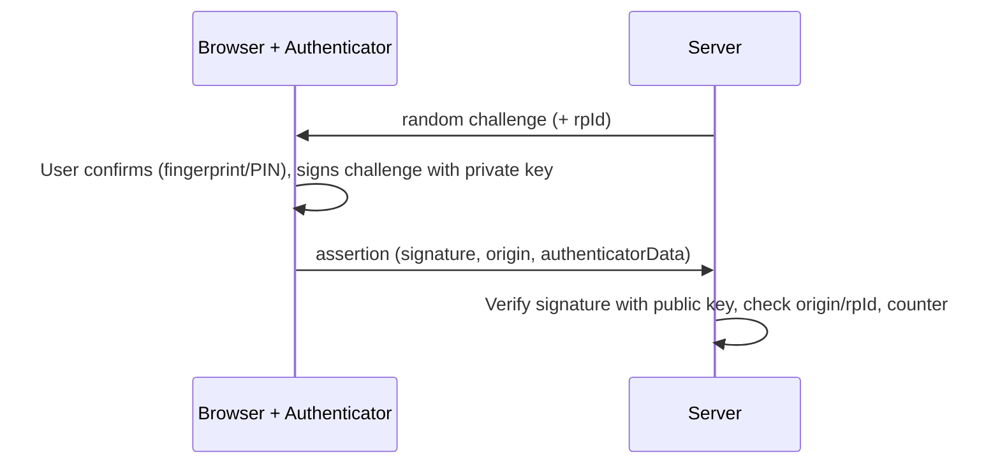

# Chương 6. Authentication

## 1. Vấn đề

Authentication (xác thực) trả lời "bạn là ai?". Đây là cửa chính của hệ thống, và là nơi attacker không cần khai thác lỗi code: chỉ cần thử password bị lộ từ nơi khác (**credential stuffing**), dụ người dùng (phishing) hoặc lợi dụng luồng quên password. Chương này nói cách lưu password, thêm yếu tố thứ hai, đi tới passkeys, và làm cứng các luồng xung quanh.

## 2. Lưu password

Password **không bao giờ** lưu thô, không encrypt hai chiều, không dùng hash nhanh (MD5, SHA-1, SHA-256 trần). Dùng hàm hash password **chậm, có salt, tốn bộ nhớ**:

| Algorithm | Vị trí trong khuyến nghị OWASP | Parameter tối thiểu (OWASP Password Storage Cheat Sheet, tra 11/2026) |
|---|---|---|
| **Argon2id** | Ưu tiên | m = 19456 KiB (19 MiB), t = 2, p = 1 (hoặc cặp tương đương: 46 MiB/t=1, 12 MiB/t=3, 9 MiB/t=4, 7 MiB/t=5) |
| scrypt | Khi không có Argon2id | N = 2^17, r = 8, p = 1 |
| **bcrypt** | Hệ thống cũ | work factor >= 10; giới hạn input 72 byte |
| PBKDF2 | Khi bắt buộc FIPS-140 | HMAC-SHA256: 600000 vòng |

Salt ngẫu nhiên riêng mỗi password do library tự sinh và nhúng vào chuỗi hash; bạn không tự quản.

### Node.js: package `argon2`

Node.js chuẩn (`node:crypto`) có `scrypt` và `pbkdf2` nhưng không có Argon2. Package phổ biến là `argon2` (0.45.2 tại thời điểm kiểm tra 08/11/2026, được release tuần này, binding tới implementation tham chiếu). Code dưới đây là `lab/snippets/password.ts`, đã chạy thật trên Node 26:

```ts
import argon2 from "argon2";

export const ARGON2_OPTIONS = {
  type: argon2.argon2id,
  memoryCost: 19456, // KiB
  timeCost: 2,
  parallelism: 1,
} as const;

export const hashPassword = (plain: string): Promise<string> => argon2.hash(plain, ARGON2_OPTIONS);

// newHash có giá trị khi hash cũ cần nâng parameter (di trú dần khi login)
export async function verifyPassword(stored: string, plain: string): Promise<{ ok: boolean; newHash?: string }> {
  if (!(await argon2.verify(stored, plain))) return { ok: false };
  if (argon2.needsRehash(stored, ARGON2_OPTIONS)) return { ok: true, newHash: await hashPassword(plain) };
  return { ok: true };
}
```

Kết quả chạy thật (`lab/snippets/demo-password.ts`):

```
hash: $argon2id$v=19$m=19456,t=2,p=1$OIR4OHZzIk+C6UqNHKp2SQ$1lT0v7vi2KCt6WL7OeqfgkoIKUcXOzsUlXUPPZgUsKU
hash ms: 269
verify đúng: true
verify sai: false
weak: $argon2id$v=19$m=4096,t=1,p=1$l7LQz5Hs3s
weak verify ok: true | có newHash: true | $argon2id$v=19$m=19456,t=2,p=1$d7G8QlYJr
```

Chuỗi hash tự mô tả algorithm, parameter và salt (`$argon2id$v=19$m=19456,t=2,p=1$<salt>$<hash>`). `argon2.needsRehash` so parameter trong chuỗi với parameter bạn cấu hình, nên cho phép **di trú sang parameter mạnh hơn (hoặc từ algorithm cũ) mà không bắt người dùng đổi password**: mỗi lần login thành công, nếu `newHash` có giá trị thì ghi đè vào DB. Với hash bcrypt cũ, bạn kiểm tra tiền tố (`$2b$`) rồi verify bằng package `bcrypt`/`bcryptjs`, sau đó hash lại bằng Argon2id.

Số đo 269 ms là một lần chạy trong container, gồm cả lần gọi đầu tiên; không phải benchmark.

Parameter "tối thiểu" của OWASP là sàn. Hãy đo trên server thật: mục tiêu thường là ~100-500 ms mỗi lần hash mà tải login vẫn chịu được; nếu hash quá chậm, nó tự thành vector DoS (xem rate limit).

### Chính sách password

Theo hướng dẫn hiện đại (NIST SP 800-63B, ASVS V6): ưu tiên **độ dài** hơn quy tắc thành phần (không bắt "1 hoa, 1 số, 1 ký tự đặc biệt"); cho phép dán (paste) để dùng password manager; không buộc đổi định kỳ; chặn password nằm trong danh sách bị lộ (ví dụ API Pwned Passwords dùng k-anonymity: gửi 5 ký tự đầu của SHA-1 và so khớp phần còn lại phía bạn; kiểm tra bằng `fetch` tới `api.pwnedpasswords.com/range/<prefix>`); cho phép độ dài tối đa đủ lớn (với bcrypt: nhớ giới hạn 72 byte, hoặc pre-hash cẩn thận; validate độ dài bằng zod, ví dụ `z.string().min(12).max(256)`).

## 3. MFA (xác thực đa yếu tố)

Yếu tố: thứ bạn biết (password), thứ bạn có (điện thoại, security key), thứ bạn là (sinh trắc học). Mức an toàn các cách thứ hai:

| Cách | Chống credential stuffing | Chống phishing |
|---|---|---|
| SMS OTP | Có | Yếu (SIM swap, chuyển tiếp OTP) |
| TOTP (app Authenticator, RFC 6238) | Có | Yếu (attacker relay mã trong 30 giây) |
| Push approval | Có | Yếu (MFA fatigue) |
| **WebAuthn/passkey, FIDO2 key** | Có | **Mạnh** (gắn với origin) |

Thực hành: lưu secret TOTP **encrypted** (mã hóa bằng AES-256-GCM của `node:crypto` với key từ secret store; library TOTP phổ biến: `otplib`, 13.6.0 tại thời điểm kiểm tra), cấp 8-10 mã khôi phục dùng một lần (lưu dạng hash), giới hạn thử mã sai, và khi bật/tắt MFA phải yêu cầu nhập lại password.

## 4. Passkeys và WebAuthn

**WebAuthn** (chuẩn W3C) cho phép login bằng asymmetric key pair: private key nằm trên thiết bị/trình quản lý passkey, server chỉ giữ public key. **Passkey** là credential WebAuthn có thể đồng bộ giữa thiết bị (iCloud Keychain, Google Password Manager, trình quản lý password...) và dùng được cho cả login không password.



Lý do chống phishing: chữ ký ràng buộc với **origin**, trang giả `shop-evil.example` không tạo được assertion hợp lệ cho `shop.example`. Server không giữ bí mật dùng chung nên lộ DB không lộ credential dùng lại được.

Cách tích hợp: dùng library đã kiểm chứng (ví dụ `@simplewebauthn/server` cho Node, 14.1.0 tại thời điểm kiểm tra; `@simplewebauthn/browser` phía client; chưa chạy trong lab) thay vì tự cài đặt xác minh. Giữ **phương án khôi phục** (passkey thứ hai, mã khôi phục), vì mất thiết bị là tình huống thật.

## 5. Quên password

Luồng an toàn:

1. Người dùng nhập email. Response **giống nhau** dù email có tồn tại hay không ("Nếu email tồn tại, chúng tôi đã gửi hướng dẫn") để không lộ danh sách tài khoản (user enumeration). Chú ý cả **response time**.
2. Token đặt lại: cryptographically random (>=128 bit), **chỉ lưu hash** trong DB, dùng một lần, hết hạn ngắn (vd 15-60 phút), invalidate khi có yêu cầu mới.
3. Link đặt lại không chứa thông tin nhạy cảm; trang đặt lại gửi `Referrer-Policy: no-referrer` để token không rò qua Referer sang third-party resource.
4. Sau khi đổi: hủy mọi session và refresh token đang có, gửi email thông báo, không tự login kèm bỏ qua MFA.
5. **Host header injection**: tạo link reset từ cấu hình `APP_URL` cố định, không từ header `Host` của request.

Express không có sẵn luồng này, bạn tự dựng và phải đủ các điểm trên. Sinh token và lưu hash:

```ts
import { randomBytes, createHash } from "node:crypto";
const token = randomBytes(32).toString("base64url");              // gửi trong email
const tokenHash = createHash("sha256").update(token).digest("hex"); // chỉ lưu giá trị này + expires_at
```

SHA-256 đủ ở đây vì token đã có 256 bit entropy (khác password do con người đặt).

## 6. Rate limit, account lockout và credential stuffing

**Brute force** nhắm một tài khoản, nhiều password. **Credential stuffing** nhắm nhiều tài khoản, mỗi tài khoản vài cặp (email, password) rò từ nơi khác; mỗi IP chỉ vài lần nên rate limit theo tài khoản không bắt được.

Biện pháp phối hợp:

- Rate limit **theo cả (tài khoản) và (IP)**. Với `express-rate-limit` (8.7.3 tại thời điểm kiểm tra; đoạn này theo tài liệu package, chưa chạy trong lab): `rateLimit({ windowMs: 60_000, limit: 5, keyGenerator: (req) => `${String(req.body?.email)}|${ipKeyGenerator(req.ip!)}` })`, trong đó `ipKeyGenerator` là helper của package để gom địa chỉ IPv6 theo subnet. Store mặc định nằm trong bộ nhớ process; chạy nhiều instance thì cần store dùng chung (Valkey/Redis).
- Tránh account lockout vĩnh viễn (attacker lockout nạn nhân hàng loạt = DoS). Dùng lockout tạm / trễ lũy tiến (exponential backoff), CAPTCHA khi nghi ngờ.
- Chặn password bị lộ lúc đăng ký/đổi; MFA là biện pháp hiệu quả nhất chống stuffing.
- Phát hiện: nhiều login thất bại trên nhiều tài khoản, tỷ lệ thất bại tăng đột biến, ASN/IP lạ (chương 13).
- Thông báo lỗi chung: "Email hoặc password không đúng".
- Thông báo cho người dùng khi có login từ thiết bị mới.

## 7. Trade-off

- Argon2id mạnh hơn bcrypt chống GPU nhưng cần RAM/CPU; parameter quá cao với lưu lượng lớn làm server nghẹt. Bcrypt còn chấp nhận được cho hệ thống cũ với cost >= 10 (kiểm tra cost thực tế trong chuỗi hash đang lưu).
- Passkey xóa password nhưng đòi hỏi trải nghiệm khôi phục tốt; nhiều hệ thống deploy song song với password + MFA.
- SMS OTP tốt hơn không có MFA, nhưng không chống phishing.

## 8. Cạm bẫy

- Hash nhanh (`md5`, `sha256`) hoặc tự tạo "salt + sha".
- So sánh token/HMAC bằng `===` thay vì `crypto.timingSafeEqual` (timing); với hash password thì dùng `argon2.verify`, đừng tự so chuỗi hash. Hàm `safeEqual` trong `lab/snippets/password.ts` hash hai chuỗi về cùng độ dài rồi gọi `timingSafeEqual` (hàm này ném lỗi nếu độ dài buffer khác nhau).
- Lộ user enumeration qua thông báo lỗi, response time, hay trang đăng ký ("email đã tồn tại").
- Không invalidate session sau đổi password.
- Token reset lưu thô trong DB; link reset dựng từ `Host` header.
- Cho phép MFA bị bỏ qua qua đường "quên password".

## 9. Tóm tắt

- Lưu password bằng Argon2id (m=19 MiB, t=2, p=1 là sàn) hoặc bcrypt (cost >= 10) và dùng `needsRehash` để nâng cấp dần.
- MFA chống stuffing; WebAuthn/passkey còn chống cả phishing.
- Luồng quên password: response đồng nhất, token hash/một lần/ngắn hạn, hủy session sau khi đổi.
- Rate limit theo tài khoản và IP, tránh lockout vĩnh viễn, phát hiện bất thường.

## 10. Câu hỏi tự kiểm tra

1. Tham số Argon2id tối thiểu theo OWASP là gì?
2. Credential stuffing khác brute force ở đâu, và vì sao rate limit theo IP chưa đủ?
3. Vì sao passkey chống được phishing?
4. Nêu ba điều cần làm với token đặt lại password.

<details><summary>Đáp án</summary>

1. m=19456 KiB (19 MiB), t=2, p=1 (hoặc tổ hợp tương đương trong cheat sheet).
2. Stuffing dùng cặp (email, password) bị lộ từ nơi khác trên nhiều tài khoản, mỗi IP/tài khoản chỉ thử ít lần, nên khó bị ngưỡng theo IP hoặc theo tài khoản riêng lẻ phát hiện; cần MFA, chặn password bị lộ, phát hiện bất thường.
3. Chữ ký gắn với origin/rpId; trang giả mạo có origin khác không thể tạo assertion hợp lệ.
4. Sinh ngẫu nhiên mạnh và chỉ lưu hash; dùng một lần, hết hạn ngắn; sau khi đổi thì hủy mọi session/refresh token (và dựng link từ cấu hình cố định, không từ Host header).
</details>
