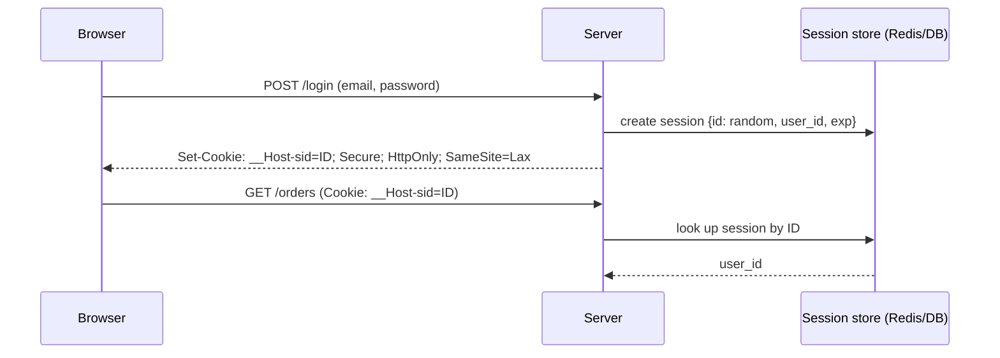
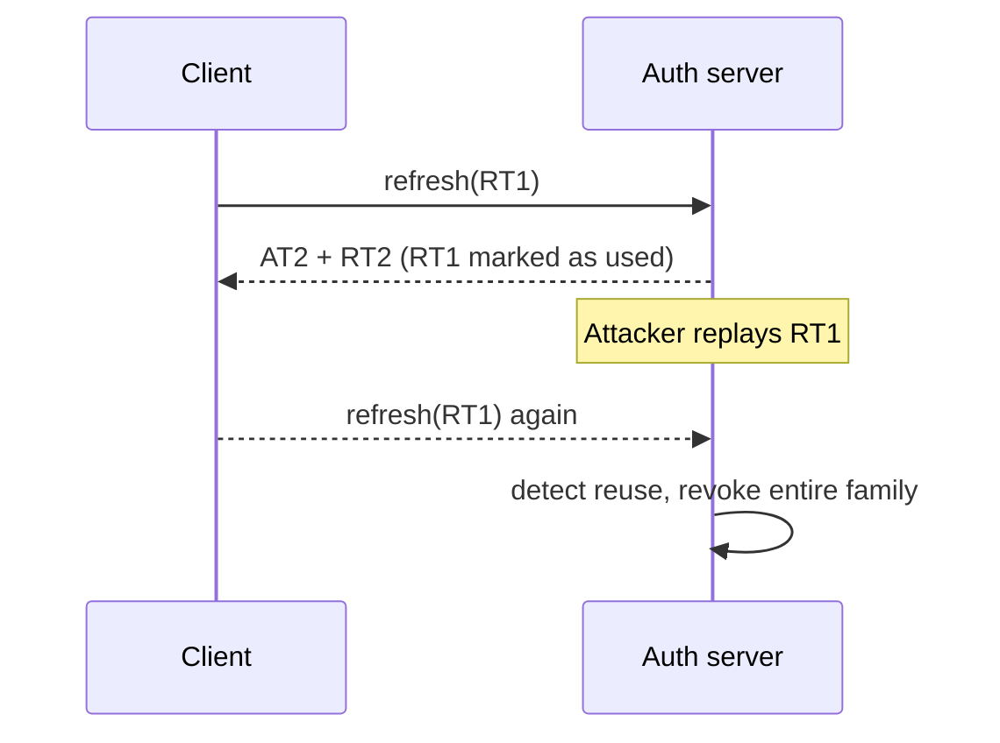

# Chương 7. Session và JWT

## 1. Vấn đề

HTTP không có trạng thái; sau khi login, mỗi request tiếp theo phải chứng minh "tôi là người đã login". Hai họ giải pháp: **session phía server** (cookie chứa ID ngẫu nhiên, trạng thái ở server) và **token tự chứa** như JWT (trạng thái nằm trong chính token, server chỉ verify chữ ký). Chọn sai hoặc dùng sai JWT là nguồn lỗi rất phổ biến.

## 2. Session phía server



Yêu cầu cho session ID: sinh bằng CSPRNG, đủ dài (ASVS yêu cầu tối thiểu 128 bit entropy), không chứa thông tin, không đặt trong URL.

Session lifecycle an toàn:

- **Đổi session ID khi login** (và khi nâng quyền) để chống **session fixation** (attacker cài sẵn ID rồi chờ nạn nhân login). Với `express-session`: gọi `req.session.regenerate(cb)` sau khi authenticate, rồi gán `req.session.userId` trong callback (đoạn này theo tài liệu package, chưa chạy trong lab).
- **Logout = hủy phía server**: `req.session.destroy(cb)` (xóa khỏi store) rồi `res.clearCookie(...)`. Cookie bị xóa phía client chưa đủ.
- **Timeout**: idle timeout (ví dụ 30 phút cho ứng dụng nhạy cảm) và absolute timeout (ví dụ 12-24 giờ).
- Liệt kê và revoke session theo thiết bị ("logout khỏi mọi thiết bị"), tự hủy khi đổi password.
- Cookie flag như chương 5.

Ưu điểm lớn: **revoke tức thì** (xóa session trong store). Nhược điểm: cần store dùng chung khi scale ngang (Redis).

## 3. JWT

**JSON Web Token** (RFC 7519) gồm ba phần Base64URL: `header.payload.signature`. Thường là JWS (RFC 7515, có chữ ký). Payload chứa claim như `sub`, `exp`, `iss`, `aud`. **Payload chỉ được ký, không được encrypt**: ai cầm token đều đọc được; đừng để dữ liệu nhạy cảm vào.

Khi dùng đúng: truyền danh tính giữa service, token ngắn hạn cho API, OIDC `id_token`. Thực hành tốt nhất cho JWT hiện đại: RFC 8725 (JWT Best Current Practices) và RFC 9068 (JWT profile cho access token).

### 3.1 Cạm bẫy của JWT

| Cạm bẫy | Mô tả | Cách chống |
|---|---|---|
| `alg: none` | Library cũ chấp nhận token không chữ ký | Server **tự quy định** algorithm cho phép; từ chối `none` |
| Algorithm confusion (RS256 → HS256) | Attacker ký HS256 dùng *public key* làm secret | Gắn key với một algorithm cố định, không lấy `alg` từ token để chọn |
| `kid`/`jku`/`x5u` tùy tiện | Header trỏ tới key do attacker chọn (injection vào key lookup, SSRF) | Whitelist nguồn key, validate `kid` |
| Không kiểm tra `exp`, `iss`, `aud` | Token dùng sai nơi/hết hạn vẫn được nhận | Verify đầy đủ; mỗi API xác định `aud` của mình |
| Secret HS256 yếu | Brute force offline | Secret ngẫu nhiên >= 256 bit, hoặc dùng bất đối xứng (RS256/ES256/EdDSA) |
| Nhầm loại token | Dùng `id_token` như access token | Phân biệt qua `typ`/`aud` (RFC 8725, 9068) |
| Không revoke được | Token hợp lệ đến khi `exp` dù user bị lockout | Xem 3.2 |
| Lưu ở nơi sai | `localStorage` bị XSS đọc | Xem 3.3 |

Luôn dùng library đã được kiểm chứng ở bản mới. Với Node.js hiện nay nên chọn **`jose`** (6.2.15 tại thời điểm kiểm tra 08/11/2026): không có dependency, dùng Web Crypto nên chạy trên Node, Deno, Bun và browser, API ép bạn khai báo key và algorithm. `jsonwebtoken` (9.0.3) vẫn được dùng rộng rãi, nhưng các bản 8.x có advisory critical/high (lab chạy `npm audit` ở chương 12 thấy `jsonwebtoken <=8.5.1` báo "signature validation bypass due to insecure default algorithm" và "Forgeable Public/Private Tokens from RSA to HMAC"); nếu còn dùng thì phải ở 9.x. Code dưới đây là `lab/snippets/jwt.ts`, đã chạy thật:

```ts
import { SignJWT, jwtVerify, generateSecret } from "jose";

const secret = await generateSecret("HS256"); // lab: sinh ngẫu nhiên; thực tế lấy từ secret store

export const signAccessToken = (sub: string) =>
  new SignJWT({ role: "user" })
    .setProtectedHeader({ alg: "HS256" })
    .setSubject(sub).setIssuer("https://shop.example").setAudience("shop-api")
    .setIssuedAt().setExpirationTime("10m")
    .sign(secret);

export async function verifyAccessToken(token: string) {
  const { payload } = await jwtVerify(token, secret, {
    algorithms: ["HS256"],           // ghim algorithm, không đọc từ header của token
    issuer: "https://shop.example",
    audience: "shop-api",
  });
  return payload;
}
```

Kết quả chạy thật: token hợp lệ được nhận; ba kiểu tấn công đều bị từ chối.

```
verify ok: user-1
alg=none rejected: JOSEAlgNotAllowed
forged rejected: JWSSignatureVerificationFailed
wrong aud rejected: JWTClaimValidationFailed
```

(`alg=none`: cắt chữ ký và đổi header; `forged`: ký bằng key khác với claim `role: admin`; `wrong aud`: token ký đúng nhưng cho API khác.) Với access token do bên khác phát hành (OIDC, chương 8), dùng `createRemoteJWKSet(new URL(jwksUri))` thay cho secret chung và vẫn ghim `algorithms`, `issuer`, `audience`. `jwt.decode` kiểu "chỉ đọc không verify" tương ứng với `decodeJwt` của `jose`: chỉ dùng cho việc không liên quan tới quyết định bảo mật.

### 3.2 Revoke token

Điểm yếu cốt lõi: token tự chứa nên server không phải tra store, và cũng vì vậy **không revoke được**. Cách giảm:

1. **Access token sống ngắn** (5-15 phút) + **refresh token** (xem 4) để cấp mới.
2. **Denylist** theo `jti` hoặc theo `user_id + thời điểm phát hành` (token phát hành trước mốc "revoke lúc T" bị từ chối). Cần store nhanh (Redis); lúc này bạn đã gần với session có trạng thái.
3. **Token versioning**: cột `token_version` ở user, nhúng vào claim, tăng khi đổi password/logout mọi nơi.
4. Với hệ thống một ứng dụng web đơn giản: **dùng session**, đừng dùng JWT chỉ vì "hiện đại".

### 3.3 Lưu token ở đâu (browser)

| Nơi lưu | XSS đọc được? | CSRF? | Ghi chú |
|---|---|---|---|
| `localStorage`/`sessionStorage` | Có | Không | Token bị trộm và dùng ở nơi khác |
| Cookie `HttpOnly; Secure; SameSite` | Không đọc được (nhưng XSS vẫn gọi API được) | Có thể, cần SameSite/CSRF token | Lựa chọn phổ biến an toàn nhất cho web |
| Bộ nhớ JS (biến) | Có thể (attacker chạy cùng context) | Không | Mất khi reload; kết hợp refresh token trong cookie HttpOnly |

Khuyến nghị: web first-party dùng **cookie session HttpOnly** (hoặc JWT đặt trong cookie HttpOnly). Mobile/native lưu trong Keychain/Keystore. SPA cùng domain dùng cookie session; token Bearer ngắn hạn cho client third-party/mobile.

## 4. Refresh token và rotation

Access token ngắn hạn kèm **refresh token** dài hạn lưu an toàn hơn, chỉ gửi tới endpoint cấp token.

**Refresh token rotation**: mỗi lần dùng refresh token, server cấp cặp mới và invalidate token cũ. Nếu token cũ bị dùng lại (reuse) thì có khả năng bị đánh cắp, nên **revoke cả chuỗi (token family)** và buộc login lại.



Thực hành: lưu **hash** refresh token trong DB; gắn với thiết bị/IP-ASN; có absolute lifetime (ví dụ 30 ngày) và idle timeout; ràng buộc người gửi nếu có thể (DPoP, mTLS) cho client công khai.

## 5. Session hay JWT: chọn thế nào

| Tiêu chí | Session server | JWT |
|---|---|---|
| Revoke tức thì | Dễ | Khó, cần denylist/ngắn hạn |
| Scale ngang không store chung | Cần Redis/DB | Tự nhiên |
| Dùng giữa nhiều service/third-party | Khó | Phù hợp |
| Misconfiguration surface | Thấp | Cao hơn (algorithm, claim) |
| Phù hợp web first-party | Rất tốt | Không cần thiết |

Quy tắc ngón tay cái: web monolith/SPA cùng domain dùng session; API cho service khác/mobile dùng token ngắn hạn chuẩn (OAuth, chương 8) với revoke được.

## 6. Cạm bẫy

- Chọn JWT "để stateless" rồi tự xây denylist, mất lợi thế, thêm lỗi.
- Không đổi session ID sau login; session timeout vô hạn.
- Đặt dữ liệu nhạy cảm/role vào JWT rồi tin mãi dù quyền đã đổi.
- `jwt.decode` (không verify) dùng thay `verify`.
- Refresh token không rotation, hoặc lưu thô.
- Cho phép algorithm từ header token.

## 7. Tóm tắt

- Session: ID ngẫu nhiên, cookie an toàn, regenerate sau login, hủy phía server khi logout, revoke dễ.
- JWT: chỉ ký, không encrypt; cố định algorithm, verify `exp/iss/aud`; khó revoke nên cho sống ngắn.
- Lưu token ưu tiên cookie HttpOnly thay vì localStorage.
- Refresh token cần rotation và phát hiện reuse.

## 8. Câu hỏi tự kiểm tra

1. Vì sao `alg: none` và nhầm lẫn RS256/HS256 xảy ra, và chống thế nào?
2. Revoke JWT bằng những cách nào? Cách nào làm mất tính stateless?
3. Session fixation là gì và cách chữa với express-session?
4. Refresh token rotation phát hiện đánh cắp bằng cách nào?

<details><summary>Đáp án</summary>

1. Server tin trường `alg` trong header do attacker kiểm soát; chống bằng cách server cố định algorithm và key cho từng loại token, từ chối `none`.
2. Token ngắn hạn, denylist theo `jti`/mốc thời gian, `token_version`. Denylist và version cần tra store mỗi request nên mất tính stateless.
3. Attacker đặt trước session ID cho nạn nhân rồi dùng nó sau khi nạn nhân login; chữa bằng `req.session.regenerate()` sau khi authenticate.
4. Mỗi refresh token chỉ dùng một lần; thấy token cũ bị dùng lại tức có bản sao, nên revoke cả family và buộc login lại.
</details>
