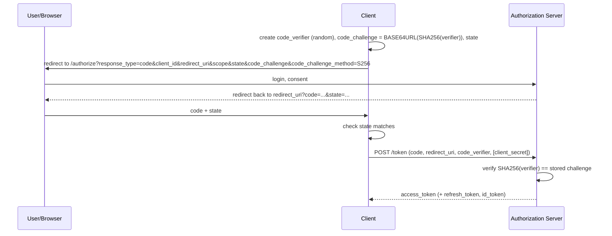

# Chương 8. OAuth 2.0 và OpenID Connect cho developer

## 1. Vấn đề

Bạn muốn "Login bằng Google" hoặc cho ứng dụng third-party đọc đơn hàng của user mà **không lấy password của họ**. Đây là việc của OAuth 2.0 (authorization) và OpenID Connect (authentication, dựng trên OAuth). Hai cái nhầm lẫn kinh điển: dùng OAuth như authentication, và dùng flow đã lỗi thời.

## 2. Phân biệt

- **OAuth 2.0** (RFC 6749): framework **authorization**: client nhận **access token** để gọi API thay mặt user, với phạm vi (`scope`) hẹp.
- **OpenID Connect (OIDC)**: layer authentication trên OAuth 2.0; thêm **ID token** (một JWT chứa `sub`, `iss`, `aud`, `exp`, `nonce`) cho biết ai đã login, và endpoint `userinfo`.

Bốn vai trò: Resource Owner (user), Client (ứng dụng của bạn), Authorization Server (IdP: Google, Keycloak...), Resource Server (API).

## 3. Authorization Code + PKCE

Flow chuẩn hiện nay cho gần như mọi loại client (web server, SPA, mobile):



Các security parameter:

- **PKCE** (RFC 7636, Proof Key for Code Exchange): chống kẻ chặn được `code` (mở ứng dụng độc trên mobile, rò qua log/Referer) vì không có `code_verifier` thì không đổi được token. Dùng `S256`, không dùng `plain`. Với client công khai (SPA, mobile) là **bắt buộc**; với client bí mật (server) vẫn **khuyến nghị**.
- **`state`**: giá trị ngẫu nhiên gắn với session browser, kiểm tra khi quay về, chống CSRF vào login flow (login CSRF).
- **`nonce`** (OIDC): ràng buộc ID token với request, chống replay ID token.
- **`redirect_uri`**: server so khớp **chính xác** với danh sách đăng ký trước (không wildcard, không "bắt đầu bằng"), nếu không code bị chuyển tới attacker.
- Verify ID token: chữ ký (key từ JWKS của IdP), `iss`, `aud` = client_id của bạn, `exp`, `nonce`.

## 4. OAuth 2.1: trạng thái hiện tại

OAuth 2.1 là nỗ lực **gộp** RFC 6749, RFC 6750 và các best practice bảo mật (RFC 9700, "OAuth 2.0 Security Best Current Practice") thành một đặc tả. Theo tra cứu ngày 08/11/2026: nó **vẫn là Internet-Draft** của IETF (`draft-ietf-oauth-v2-1`, bản mới nhất mà tôi thấy là -14 hoặc -15 năm 2026; nguồn thứ cấp nói chưa thành RFC; chưa xác nhận trực tiếp từ datatracker). Vì vậy: hãy gọi nó là "hướng đi", còn cái bạn tuân thủ hôm nay là RFC 6749 cộng RFC 9700 (BCP), cùng cách triển khai theo tinh thần 2.1.

Những thay đổi chính của 2.1 (theo draft):

| Thay đổi | Ý nghĩa |
|---|---|
| PKCE bắt buộc cho authorization code flow | Mọi client |
| Bỏ **Implicit grant** | Token trả qua URL fragment, dễ lộ, không chống được replay |
| Bỏ **Resource Owner Password Credentials (ROPC)** | Client thấy password user, phá nguyên lý OAuth, không hỗ trợ MFA |
| `redirect_uri` so khớp chuỗi chính xác | Chống open redirect/code leak |
| Bearer token không được đặt trong query string | Tránh lộ qua log/Referer |
| Refresh token của client công khai phải sender-constrained hoặc rotation | Xem chương 7 |

Các flow vẫn dùng: **Authorization Code + PKCE** (user tương tác), **Client Credentials** (máy với máy, không có user), **Device Authorization** (RFC 8628, TV/CLI). Đã bị bỏ/không khuyến nghị: Implicit, ROPC.

## 5. Dùng trong Node.js/TypeScript

- **`openid-client`** (6.8.9 tại thời điểm kiểm tra 08/11/2026, cùng tác giả với `jose`): client OIDC/OAuth 2 certified, dùng Web Crypto, hỗ trợ discovery, Authorization Code + PKCE, kiểm tra `state`/`nonce`/chữ ký ID token. API major 6 là kiểu hàm (`import * as client from "openid-client"`), khác hẳn các bản 5.x dạng class `Issuer`/`Client`; hãy đối chiếu README bản bạn cài.
- **Authorization Server**: **đừng tự viết**. Dùng IdP có sẵn (Keycloak, Auth0, Entra ID, Cognito...). Nếu bắt buộc tự vận hành thì dùng một server đã được kiểm chứng (ví dụ `oidc-provider` của cùng tác giả; chưa xác minh trạng thái chi tiết trong lần viết này) thay vì tự cài đặt từng endpoint.
- Passport.js (`passport`) là middleware xác thực đa chiến lược, không phải Authorization Server; đừng nhầm hai thứ.

Ví dụ tối giản phía client (`openid-client` 6.x, Authorization Code + PKCE S256, `state`, `nonce`). Đoạn này theo README của package, **chưa chạy trong lab** (cần một IdP thật hoặc dựng Keycloak, ngoài phạm vi lab):

```ts
import * as client from "openid-client";

const config = await client.discovery(new URL(process.env.OIDC_ISSUER!), process.env.OIDC_CLIENT_ID!, process.env.OIDC_CLIENT_SECRET!);

app.get("/auth/redirect", async (req, res) => {
  const codeVerifier = client.randomPKCECodeVerifier();
  const state = client.randomState();
  const nonce = client.randomNonce();
  req.session.oidc = { codeVerifier, state, nonce };            // lưu trong session phía server
  res.redirect(client.buildAuthorizationUrl(config, {
    redirect_uri: "https://shop.example/auth/callback",         // khớp chính xác với đăng ký ở IdP
    scope: "openid email",
    code_challenge: await client.calculatePKCECodeChallenge(codeVerifier),
    code_challenge_method: "S256",
    state, nonce,
  }).href);
});

app.get("/auth/callback", async (req, res) => {
  const { codeVerifier, state, nonce } = req.session.oidc;
  const tokens = await client.authorizationCodeGrant(
    config, new URL(req.originalUrl, "https://shop.example"),
    { pkceCodeVerifier: codeVerifier, expectedState: state, expectedNonce: nonce },  // ném lỗi nếu state/nonce/chữ ký sai
  );
  const claims = tokens.claims()!;                              // đã verify iss, aud, exp, chữ ký
  const user = await findOrCreateByIdpSub(claims.iss, claims.sub); // định danh theo (iss, sub)
  req.session.regenerate(() => { req.session.userId = user.id; res.redirect("/"); });
});
```

Lưu ý: định danh người dùng theo `sub` (kèm `iss`) của IdP, **không** theo email chưa xác minh (tấn công "account pre-hijacking/takeover" khi email không được IdP xác minh); chỉ liên kết với tài khoản local có sẵn sau khi chứng minh quyền sở hữu.

## 6. Trade-off

- SSO bằng IdP ngoài: giảm gánh nặng lưu password/MFA nhưng phụ thuộc IdP.
- Tự làm Authorization Server: linh hoạt nhưng bạn chịu trách nhiệm vận hành bảo mật; IdP chuyên dụng thường tốt hơn.
- Scope quá rộng cho tiện: vi phạm least privilege.

## 7. Cạm bẫy

- Dùng access token như bằng chứng login (phải dùng ID token/OIDC, và verify `aud`).
- Không kiểm tra `state`/`nonce`; không verify chữ ký ID token.
- `redirect_uri` có wildcard.
- Dùng Implicit/ROPC cho "đơn giản".
- Lưu client secret trong SPA/mobile (không thể giữ bí mật; client công khai không có secret).
- Liên kết tài khoản theo email chưa xác minh.

## 8. Tóm tắt

- OAuth = authorization, OIDC = authentication; ID token cho biết "ai", access token cho biết "được làm gì".
- Dùng Authorization Code + PKCE (S256), `state`, `nonce`, redirect URI khớp chính xác.
- OAuth 2.1 vẫn là draft (tra 11/2026); thực hành theo RFC 6749 + RFC 9700; Implicit và ROPC đã bị bỏ.
- Đừng tự viết Authorization Server; liên kết tài khoản theo `sub`.

## 9. Câu hỏi tự kiểm tra

1. PKCE giải quyết threat nào?
2. Vì sao Implicit và ROPC bị loại?
3. `state` và `nonce` khác nhau thế nào?
4. Vì sao không nên liên kết tài khoản chỉ theo email từ IdP?

<details><summary>Đáp án</summary>

1. Kẻ chặn được authorization code không đổi được token vì thiếu `code_verifier`.
2. Implicit: token lộ qua URL, không chống replay; ROPC: client nhìn thấy password, không hỗ trợ MFA, trái nguyên lý authorization.
3. `state` chống CSRF ở redirect flow (gắn với session browser); `nonce` ràng buộc ID token với request để chống replay ID token.
4. Email có thể chưa được IdP xác minh hoặc bị attacker đăng ký trước, dẫn đến chiếm tài khoản; dùng `sub` và yêu cầu chứng minh quyền sở hữu khi liên kết.
</details>
