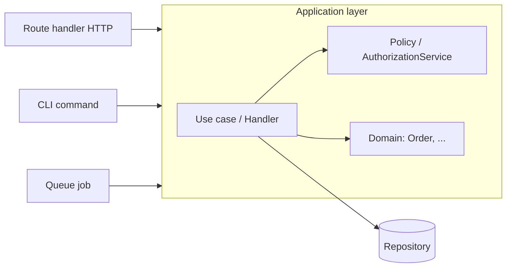

# Chapter 9. Authorization: RBAC/ABAC/ReBAC, IDOR/BOLA

## 1. The problem

Authentication hỏi "bạn là ai", **authorization** hỏi "bạn được làm gì, với resource nào". Broken Access Control đứng đầu OWASP Top 10:2025 (A01) vì nó dễ mắc và khó phát hiện tự động: scanner không biết đơn hàng nào của ai. Lỗi kinh điển: `GET /api/orders/2` trả đơn của người khác chỉ vì user đã login. Phần lab của sách chạy đúng lỗi này (mục "Lab" bên dưới).

## 2. IDOR and BOLA

- **IDOR** (Insecure Direct Object Reference): tham chiếu trực tiếp tới object (ID trong URL/body) mà không kiểm tra ownership.
- **BOLA** (Broken Object Level Authorization): tên mà OWASP API Security Top 10 dùng cho cùng class lỗi, đứng đầu danh sách API Security (bản 2023; kiểm tra xem đã có bản mới hơn chưa trên `owasp.org/API-Security`: chưa xác minh).
- Biến thể: **BFLA** (Broken Function Level Authorization: user thường gọi hàm admin, ví dụ `POST /api/admin/refund`), **BOPLA** (Broken Object Property Level Authorization: đọc/ghi trường không được phép; mass assignment ở chương 10 là một dạng).

Dùng ID ngẫu nhiên (UUID) **không phải** là access control: nó làm khó đoán, không làm mất lỗi; ID lộ qua log/email/Referer là bị truy cập. Hãy coi UUID là giảm nhiễu, quyền vẫn phải kiểm tra.

## 3. Authorization models

| Mô hình | Ý tưởng | Ví dụ | Khi dùng |
|---|---|---|---|
| **RBAC** (role-based) | Gán quyền cho role, gán role cho user | `admin`, `support`, `customer` | Tổ chức rõ role, ít điều kiện context |
| **ABAC** (attribute-based) | Quyết định theo attribute của subject, resource, environment | "Nhân viên được xem đơn của chi nhánh mình trong giờ làm việc" | Quy tắc phong phú, nhiều context |
| **ReBAC** (relationship-based) | Quyết định theo relationship graph | "Xem được tài liệu nếu là thành viên của team sở hữu thư mục cha" (kiểu Google Zanzibar; hiện thực: OpenFGA, SpiceDB) | Chia sẻ phân cấp, đa tenant, cộng tác |

Thực tế thường kết hợp: RBAC cho "được vào tính năng nào", ABAC/ownership cho "với bản ghi nào".

Với shop sách: `customer` chỉ xem đơn có `user_id` của mình (attribute sở hữu: ABAC đơn giản); `support` xem mọi đơn nhưng không đổi giá (RBAC + quyền hành động); `admin` được hoàn tiền.

## 4. Which layer should enforce authorization checks

Nguyên tắc: **quyết định quyền nằm ở nơi mọi đường vào đều phải đi qua**, không chỉ ở một route handler.



Gắn với kiến trúc Hexagonal (port-adapter):

- **Route handler/adapter** (entry layer): authenticate identity, dựng `Actor`/`Principal`; có thể kiểm tra thô (đã login, đúng role) bằng middleware.
- **Application service/use case**: **nơi gọi policy**. Mọi adapter (HTTP, CLI, queue, GraphQL) cùng gọi use case nên cùng chịu một kiểm tra; quên ở route handler không gây vulnerability.
- **Domain**: giữ **business rule** gắn với quyền khi nó là bất biến của domain (ví dụ "đơn đã giao không thể hủy", "chỉ chủ đơn hoặc staff mới đổi địa chỉ"). Policy là hàm thuần trên `(Actor, Order)`, dễ unit test.
- **Repository**: có thể **scope query** theo subject (`WHERE user_id = :actor`), đây là cách chống IDOR bền vững nhất vì không có đường lấy bản ghi của người khác.

Ví dụ TypeScript: policy là hàm thuần trên `(Actor, Order)`, use case mới là nơi gọi policy (minh họa kiến trúc, không nằm trong lab):

```ts
// policies/order-policy.ts
export type Actor = { id: number; roles: readonly string[] };
export type Order = { id: number; userId: number };

export const orderPolicy = {
  view: (actor: Actor, order: Order): boolean => actor.id === order.userId || actor.roles.includes("support"),
  refund: (actor: Actor, _order: Order): boolean => actor.roles.includes("admin"),
};

export class NotFoundError extends Error {}

// Use case (application layer), không phải route handler, mới là nơi quyết định
export function makeGetOrder(orders: { findById(id: number): Promise<Order | null> }) {
  return async (actor: Actor, orderId: number): Promise<Order> => {
    const order = await orders.findById(orderId);
    if (!order || !orderPolicy.view(actor, order)) throw new NotFoundError(); // 404 cho cả "không có" lẫn "không được xem"
    return order;
  };
}
```

Kiểu "scoping" thay vì check-sau-khi-lấy. Đây chính là bản sửa của lab (`/fixed/orders/:id` trong `lab/app/server.ts`), điều kiện sở hữu nằm ngay trong câu SQL:

```ts
const { rows } = await pool.query(
  "SELECT * FROM orders WHERE id = $1 AND ($3 = 1 OR user_id = $2)",
  [req.params.id, user.id, user.is_admin],
);
if (!rows[0]) return res.status(404).json({ error: "not found" });   // 404 nếu của người khác
```

Response: trả `404` thay `403` khi muốn không lộ sự tồn tại của resource (cũng là cách bản "fixed" của lab làm); với chức năng mà user biết tồn tại (hoàn tiền), `403` hợp lý hơn.

Với thư viện: `casl` (`@casl/ability`) và `accesscontrol` cho RBAC/ABAC trong process; OpenFGA, SpiceDB cho ReBAC (có SDK JavaScript). Chưa xác minh phiên bản hiện hành của từng thư viện trong lần viết này; với shop nhỏ, vài hàm policy thuần như trên là đủ.

## 5. Lab: a real IDOR

Từ container client trong cùng network (`lab/run.sh`, endpoint `/vuln/orders/:id` và `/fixed/orders/:id`). Kết quả thật (`lab/KET-QUA.md`, mục 3): alice (`tok-alice`) đọc đơn số 2 của bob.

```
$ curl -H "Authorization: Bearer tok-alice" http://bookcheck-sec-app:8080/vuln/orders/2
HTTP/1.1 200 OK
{"id":2,"user_id":2,"book_id":2,"note":"DIA CHI RIENG CUA BOB"}

$ curl -H "Authorization: Bearer tok-alice" http://bookcheck-sec-app:8080/fixed/orders/2
HTTP/1.1 404 Not Found
{"error":"not found"}

$ curl -H "Authorization: Bearer tok-alice" http://bookcheck-sec-app:8080/fixed/orders/1
HTTP/1.1 200 OK
{"id":1,"user_id":1,"book_id":1,"note":"giao gio hanh chinh (alice)"}
```

Bản lỗi chỉ kiểm tra "đã login" (`currentUser`), rồi `SELECT * FROM orders WHERE id = $1`. Lưu ý: bản lỗi này **không** có SQL injection (id đã được bind); IDOR là lỗi logic phân quyền, parameterized query không giúp gì.

## 6. Trade-offs

- Check ở route handler: ngắn, nhưng nhiều đường vào thì dễ sót. Check ở use case: an toàn hơn, đòi hỏi truyền `Actor` xuống.
- Scoping query: chặt nhất nhưng không dùng được cho quyền phức tạp (cần cả policy).
- Policy engine ngoài (OPA, OpenFGA, Cedar): nhất quán giữa nhiều service, thêm hạ tầng và latency; chưa cần cho monolith nhỏ.
- Cache quyền: nhanh nhưng revoke quyền bị trễ, đặt TTL ngắn.

## 7. Pitfalls

- Chỉ ẩn nút ở UI.
- Kiểm tra "đã login" nhưng không kiểm tra "thuộc về ai".
- Lấy `user_id` từ body/query thay vì từ identity đã authenticate.
- Quên các đường phụ: export CSV, webhook, endpoint nội bộ, GraphQL field, `router.param`/middleware nạp object theo `:id` rồi gắn vào `req` mà không scope (nạp mọi order theo id; hãy scope theo actor hoặc gọi policy).
- Authorization theo "role" cứng trong code khắp nơi (`if (user.role === "admin")`) thay vì policy tập trung.
- Không test quyền: nên có test "user A không đọc được đơn của user B" cho mỗi endpoint.

## 8. Summary

- Broken Access Control là A01; IDOR/BOLA là lỗi authorization check theo object.
- RBAC: role; ABAC: attribute; ReBAC: relationship. Thường kết hợp.
- Đặt policy ở application layer (mọi adapter đi qua), kèm scoping ở repository; domain giữ bất biến.
- UUID không thay thế authorization check; luôn có authorization test.

## 9. Self-check questions

1. IDOR và BOLA khác nhau chỗ nào?
2. Vì sao đặt policy ở use case an toàn hơn đặt ở route handler trong Hexagonal?
3. Khi nào chọn ReBAC thay vì RBAC?
4. Vì sao trả 404 thay vì 403 cho resource của người khác?

<details><summary>Answer</summary>

1. Cùng một class lỗi; IDOR là tên truyền thống, BOLA là tên trong OWASP API Security Top 10.
2. Mọi adapter (HTTP, CLI, queue) gọi use case, nên đều chịu kiểm tra; quên ở một route handler không mở vulnerability.
3. Khi quyền phụ thuộc relationship phân cấp/chia sẻ giữa các object (thư mục, team, tổ chức), RBAC không biểu diễn gọn được.
4. Để không xác nhận sự tồn tại của resource (chống dò ID).
</details>
