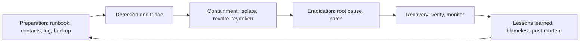

# Chương 13. Security logging và incident response

## 1. Vấn đề

Dù phòng thủ tốt đến đâu, sẽ có ngày một layer thủng. Khi đó câu hỏi là: bạn **có biết** không, biết **sau bao lâu**, và có đủ dữ kiện để trả lời "chuyện gì đã xảy ra, ai bị ảnh hưởng"? Thiếu log và alerting là A09 trong OWASP Top 10:2025 (Security Logging and Alerting Failures). Cũng ngược lại: log quá tay làm lộ password, token, dữ liệu cá nhân ngay trong file log.

## 2. Log gì

Mục tiêu: dựng lại được **ai, làm gì, trên cái gì, khi nào, từ đâu, kết quả**.

Sự kiện nên ghi:

| Nhóm | Ví dụ |
|---|---|
| Authentication | Login thành công/thất bại, logout, bật/tắt MFA, đổi/đặt lại password, account lockout |
| Session và token | Tạo/revoke session, refresh token bị dùng lại (reuse) |
| Authorization | Truy cập bị từ chối (403/404 do policy), đổi role/quyền |
| Hành động nhạy cảm | Hoàn tiền, xuất dữ liệu, đổi email, hành động admin |
| Input bất thường | Validation thất bại hàng loạt, payload giống tấn công, rate limit bị kích hoạt |
| Hệ thống | Lỗi 5xx, lỗi cấu hình, thay đổi cấu hình/secret, deploy |

Mỗi bản ghi nên có: thời điểm (UTC, ISO 8601), loại sự kiện, mã người dùng (ID, không phải password), IP và user agent, ID resource, kết quả, **request/correlation ID** để nối các service.

Dùng **log có cấu trúc** (JSON) để query được:

```ts
// lab/snippets/log.ts (pino 10.4.0, đã chạy thật)
import pino from "pino";

export const secLog = pino({
  name: "security",
  timestamp: pino.stdTimeFunctions.isoTime,           // ISO 8601
  redact: { paths: ["password", "token", "req.headers.authorization", "req.headers.cookie", "*.card_number"], censor: "[REDACTED]" },
});

secLog.warn({
  event: "authz.denied", user_id: 1, action: "view", resource: "order:2",
  ip: "172.18.0.5", request_id: "req-123",
  req: { headers: { authorization: "Bearer tok-alice", "user-agent": "curl/8" } },
  token: "tok-alice",
}, "authorization denied");
```

Output thật, một dòng JSON mỗi sự kiện; `authorization` và `token` đã bị che:

```
{"level":40,"time":"2026-11-08T08:18:01.308Z","pid":76,"hostname":"a5e37204728a","name":"security","event":"authz.denied","user_id":1,"action":"view","resource":"order:2","ip":"172.18.0.5","request_id":"req-123","req":{"headers":{"authorization":"[REDACTED]","user-agent":"curl/8"}},"token":"[REDACTED]","msg":"authorization denied"}
```

## 3. Không log gì

- Password (kể cả thất bại: người dùng hay gõ nhầm password vào ô username), token, session ID, API key, `Authorization` header, cookie.
- Số thẻ đầy đủ, CVV, dữ liệu y tế/định danh nhạy cảm; che (mask) hoặc hash khi buộc phải ghi.
- Toàn bộ request/response body mặc định (có thể chứa các thứ trên).
- Stack trace/chi tiết nội bộ **trong response trả client** (chỉ ghi vào log phía server).
- Dữ liệu cá nhân vượt mức cần thiết: tuân thủ quy định bảo vệ dữ liệu áp dụng (GDPR, Nghị định 13/2023/NĐ-CP của Việt Nam về bảo vệ dữ liệu cá nhân; hãy tham khảo chuyên gia pháp lý cho trường hợp cụ thể, sách này không phải tư vấn pháp lý).

Cấu hình thực tế: danh sách field bị che bằng `redact` của pino (`password`, `token`, `authorization`, `card_number`...), và có test đảm bảo log không chứa chuỗi bí mật mẫu.

**Log injection**: dữ liệu người dùng có xuống dòng (`\n`) có thể giả mạo bản ghi log. Dùng log JSON (xuống dòng bị escape) và không nối chuỗi thô vào log text.

## 4. Lưu trữ và bảo vệ log

- Gửi log ra nơi **tập trung, tách khỏi application server** (ELK/OpenSearch, Loki, cloud service) để attacker không xóa dấu vết.
- Hạn chế quyền ghi/sửa/xóa (append-only, WORM khi cần); log cũng là dữ liệu nhạy cảm cần access control.
- Đồng bộ thời gian (NTP) giữa các máy.
- Retention theo yêu cầu pháp lý/nghiệp vụ (và tối thiểu đủ để điều tra: nhiều vụ xâm nhập được phát hiện sau hàng tháng).
- Monitoring chính hệ thống log (log ngừng chảy là tín hiệu đáng báo động).

## 5. Phát hiện tấn công

Log chỉ có giá trị khi **có người/hệ thống xem**. Một số tín hiệu và quy tắc alert thực dụng:

| Tín hiệu | Gợi ý tấn công |
|---|---|
| Nhiều login thất bại trên **nhiều tài khoản** từ một IP/ASN | Credential stuffing (chương 6) |
| Một tài khoản thất bại nhiều lần rồi thành công | Brute force/đoán được password |
| Login thành công từ quốc gia/thiết bị lạ ngay sau thất bại | Account takeover |
| Nhiều 403/404 cho ID tuần tự bởi cùng user | Dò IDOR (chương 9) |
| Chuỗi `' OR`, `UNION SELECT`, `<script`, `../` trong parameter | Dò injection/XSS/traversal (alert mức thấp, chỉ là tín hiệu) |
| Refresh token reuse | Token bị đánh cắp (chương 7) |
| Lưu lượng xuất dữ liệu bất thường, query chậm bất thường | Trích xuất dữ liệu, SQLi time-based |
| Gọi tới IP nội bộ/metadata từ worker | SSRF (chương 10) |
| 5xx tăng đột biến sau deploy | Lỗi, hoặc tấn công khai thác |

Detection layer: **WAF** (chặn mẫu tấn công phổ biến, giảm nhiễu, không thay patch), **rate limit**, hệ thống alerting (Alertmanager, SIEM), canary token/honeytoken (tài khoản/bản ghi mồi: ai chạm vào là báo động). Tránh "alert fatigue": ít alert nhưng hành động được, mỗi alert có runbook.

## 6. Incident response

Có kế hoạch **trước** khi cần. Khung phổ biến (NIST SP 800-61): preparation, detection and analysis, containment/eradication/recovery, lessons learned.



Checklist rút gọn cho incident nghi lộ dữ liệu/account takeover:

1. **Triage severity** và lập kênh liên lạc (ai chỉ huy, ai ghi chép).
2. **Giữ bằng chứng** trước khi dọn (snapshot, sao chép log); đừng xóa/khởi động lại máy vội nếu cần điều tra.
3. **Containment**: revoke session/refresh token, rotate secret nghi lộ (chương 11), chặn IP/tài khoản, tạm tắt tính năng bị khai thác.
4. **Xác định scope**: query log theo tài khoản/IP/khoảng thời gian; dữ liệu nào bị truy cập.
5. **Patch nguyên nhân gốc** và kiểm tra tương tự ở nơi khác (một lỗi IDOR thường lặp ở nhiều endpoint).
6. **Thông báo**: người dùng bị ảnh hưởng và cơ quan quản lý nếu luật yêu cầu (nhiều khung pháp lý có thời hạn thông báo ngắn; xác minh theo luật áp dụng).
7. **Blameless post-mortem**: sửa quy trình, thêm phát hiện, thêm regression test.

Diễn tập (tabletop exercise) vài lần mỗi năm; có `security.txt` (RFC 9116) để nhà nghiên cứu biết gửi báo cáo vulnerability ở đâu.

## 7. Trade-off

- Log nhiều: điều tra tốt hơn nhưng tốn chi phí lưu trữ, rủi ro lộ dữ liệu, nhiễu. Log "đủ để điều tra" cho sự kiện bảo mật, giữ debug log ngắn hạn.
- Alert nhạy: bắt được sớm nhưng gây mệt mỏi; bắt đầu từ vài tín hiệu giá trị cao.
- WAF: tiện, nhưng có thể chặn nhầm và bị bypass; không thay sửa lỗi thật.
- Đội nhỏ: monitoring service có sẵn thường hợp lý hơn tự dựng SIEM.

## 8. Cạm bẫy

- Log password, token, header `Authorization`.
- Log chỉ nằm trên chính máy bị xâm nhập, không đẩy ra ngoài.
- Có log nhưng không ai đặt alert; không có runbook.
- Log không có correlation ID nên không nối được request qua các service.
- Khi có incident, vội khởi động lại/xóa mất bằng chứng; hoặc quên rotate secret.
- Hiển thị lỗi chi tiết cho client (A10:2025, mishandling of exceptional conditions).

## 9. Tóm tắt

- Log sự kiện bảo mật có cấu trúc: authentication, authorization, hành động nhạy cảm, lỗi; kèm correlation ID.
- Không log secret, dữ liệu cá nhân thừa; chống log injection; đẩy log ra nơi tập trung, bảo vệ quyền.
- Phát hiện cần alert hành động được và tín hiệu giá trị cao (stuffing, dò IDOR, token reuse).
- Có kế hoạch IR sẵn: giữ bằng chứng, containment, xác định scope, patch gốc, thông báo, post-mortem.

## 10. Câu hỏi tự kiểm tra

1. Kể ba loại sự kiện bắt buộc nên log và ba thứ tuyệt đối không log.
2. Vì sao phải đẩy log ra ngoài máy ứng dụng?
3. Tín hiệu nào trong log gợi ý credential stuffing khác với brute force?
4. Vì sao nên giữ bằng chứng trước khi dọn dẹp trong incident?

<details><summary>Đáp án</summary>

1. Nên log: login thất bại/thành công, truy cập bị từ chối, hành động nhạy cảm (đổi quyền, hoàn tiền). Không log: password, token/session ID/header Authorization, số thẻ đầy đủ.
2. Attacker có thể xóa/sửa log cục bộ; log ở nơi tách biệt giữ nguyên dấu vết.
3. Stuffing: nhiều tài khoản khác nhau, mỗi tài khoản ít lần thất bại, thường từ nhiều IP; brute force: một tài khoản bị thử rất nhiều password.
4. Để điều tra nguyên nhân và phạm vi chính xác; dọn dẹp/khởi động lại có thể làm mất dấu vết.
</details>
